# Architettura — Vinoozy

## Architecture Analysis

### System Overview

App Flutter monolitica per Android che parla direttamente con Firebase (Auth, Firestore con cache offline persistente, App Check, Crashlytics). Non esiste un backend proprio: le regole di sicurezza Firestore (`firestore.rules`) fanno rispettare forme dei dati e permessi. Una pagina statica su GitHub Pages (`docs/account-deletion/`) permette di cancellare l'account dal web. Le uniche altre chiamate di rete dell'app vanno a Open Food Facts (`world.openfoodfacts.org`), e solo nelle build con il contatto `OFF_CONTACT` configurato. La lettura delle etichette avviene sul telefono con ML Kit (modelli inclusi nell'app).

### Architectural Style

Client "fat" offline-first, a strati per modulo funzionale (`lib/<modulo>/{domain,data,ui}` + provider Riverpod). Evidenze: repository in `lib/*/data/` su `FirebaseFirestore`; domini in Dart puro; iniezione delle istanze reali in `lib/app/bootstrap.dart` tramite `ProviderContainer(overrides: ...)`. I moduli `lib/catalog/` e `lib/label/` usano una variante "porte e adattatori": nucleo puro in `core/` (verificato da script: nessun import Flutter/Firebase in `lib/catalog/core/`), adattatori di piattaforma in `platform/`, interfacce come cuciture di test (`LabelReader`, `ImageSource`, `LabelFileSystem`, `CacheFile`, `CatalogEventLogger`).

### Component Relationships

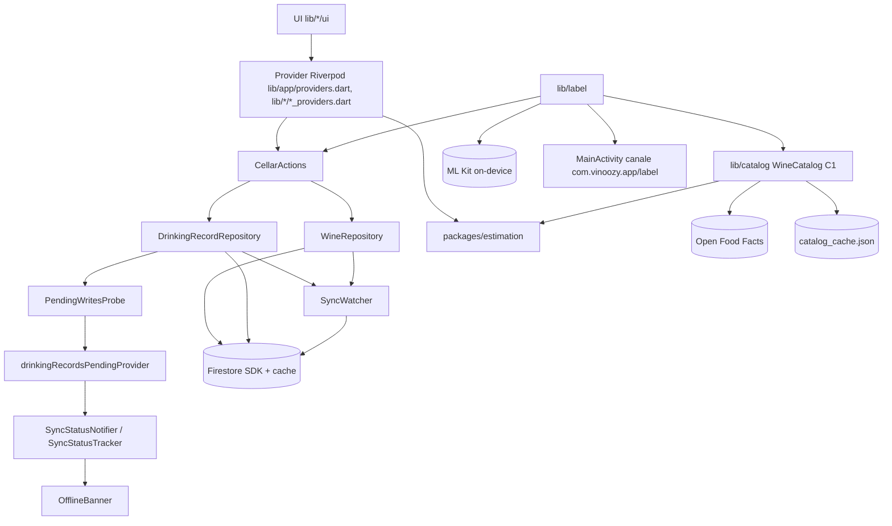

Testo: l'interfaccia legge i provider; le azioni della cantina scrivono tramite i repository su Firestore; le scritture delle bevute avvisano `PendingWritesProbe`, che imposta `drinkingRecordsPendingProvider`; `SyncStatusNotifier` combina questo valore con i metadati degli snapshot di cantina e vini e alimenta `OfflineBanner`. Ogni scrittura avvia anche `SyncWatcher`. Il modulo etichetta usa il canale nativo per preparare le immagini, ML Kit per leggerle, il catalogo per cercare il vino e `CellarActions` per salvare; non tocca mai Firestore direttamente (`tool/check_label_imports.sh`). Il catalogo usa le denominazioni di `estimation`, Open Food Facts e una cache su file.

### Superficie dell'interfaccia (intent 261107-ux-redesign)

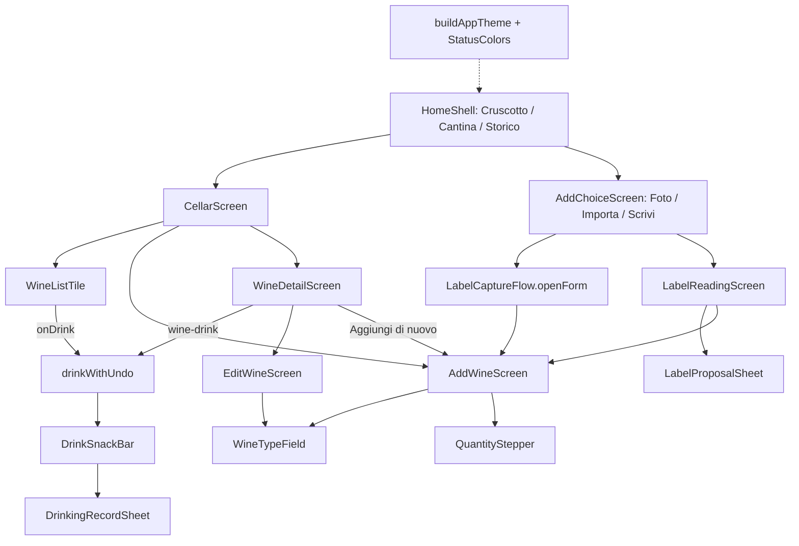

Testo: la shell ha tre schede; "Aggiungi" passa da `AddChoiceScreen` (foto, importa, scrivi). Il form `AddWineScreen` è aperto da quattro punti (cantina, scelta "Scrivi", etichetta incompleta o "Correggi", "Aggiungi di nuovo" dal dettaglio). `EditWineScreen` riusa `WineTypeField` e `QuantityStepper` ma non il form. La bevuta parte da due punti (riga e dettaglio) e passa sempre da `drinkWithUndo`. Tutti i widget leggono i colori dal tema costruito in `lib/app/theme.dart`. (Diagramma della scansione ux-redesign; le parti di bevuta e tema non sono state riverificate dopo le modifiche di quell'intent.)

### Superficie dell'etichetta e del catalogo (intent 261107-label-recognition)

Diagramma della scansione label-recognition, che descriveva u6 (una foto, `matchLabelText`). Il flusso attuale, con fronte e retro, base offline, "Cerca online" e Google Lens, è in [Etichetta: dal testo al form](#etichetta-dal-testo-al-form-comportamento-attuale).

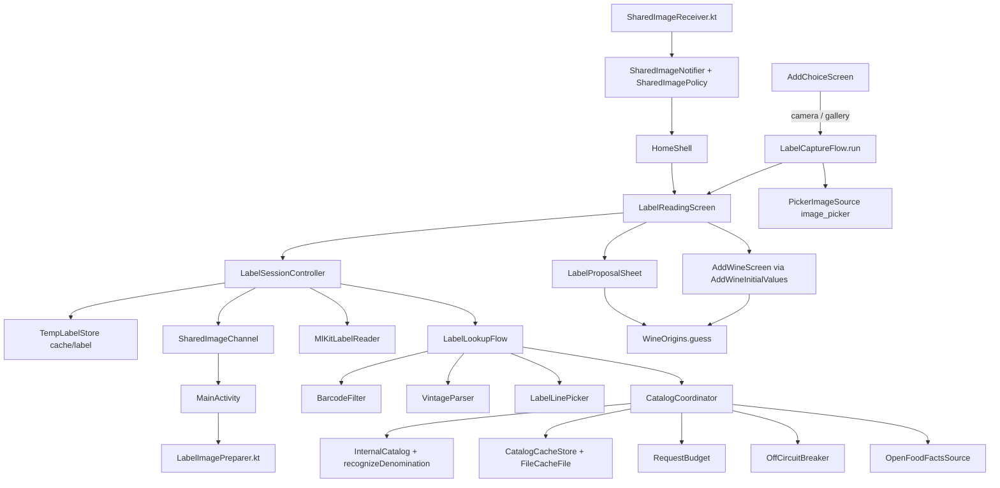

Testo: la foto arriva da fotocamera, galleria o condivisione; il controllore di sessione attende la pulizia, fa preparare l'immagine dal codice nativo, la fa leggere a ML Kit, la passa al flusso di ricerca, che usa filtro dei codici, analizzatore dell'annata, scelta della riga significativa e il catalogo; il catalogo prova cache e Open Food Facts (con budget e interruttore) e ricade sulle denominazioni interne. L'esito diventa una proposta, un form precompilato o una vista d'errore; paese e regione si deducono con `WineOrigins.guess`.

### Data Flow

Le scritture sono batch Firestore **non attesi**: il dato appare subito dalla cache locale e il SDK lo invia al server quando c'è rete. Prima di ogni batch il `LocalLedger` (`shared_preferences`, chiave `ledger.v1`) registra la scrittura per gestire il cambio di account. Lo stato della fascia deriva da `SnapshotMeta` (`hasPendingWrites`, `isFromCache`) dei due listener aperti (cantina, vini `quantity > 0`) e, per le bevute, dalla sonda.

Dati del vino nel form: `AddWineScreen` → `WineInput` (con `country` ISO 3166-1 dall'intent ux-redesign) → `WineValidator.validate` (regione ≤ 120 caratteri e canonicalizzata con `WineOrigins.canonicalRegion`, paese ISO valido, regione italiana senza paese ⇒ Italia) → `WineDraft.withDetails` → `CellarActions.saveNewWine` → `WineRepository.addWine`.

Dati della stima (verificato dall'intent 261108-label-autofill-windows): `WineDraft` → `WineFactsInput` (nome, produttore, annata, tipo, regione, denominazione, anno di riferimento; **senza paese**) → `WineFacts` → `estimateWindow` + `pairingsFor` → `WindowAdjuster.effective` con l'ultimo riscontro delle bevute → `WineEstimate{baseWindow, window, adjustment, pairings}` → campi `baseWindow`, `window`, `windowAdjustment`, `pairings` del documento. "Consigliato fino al" è `window.endYear`.

Dati dell'etichetta (scansione u6, sostituiti dal flusso a due foto descritto più sotto): file di image_picker o URI condiviso → copia nativa in `cacheDir/label/` (JPEG 2048 px) → `LabelReading{barcodes, text ≤ 2000}` in memoria → codice normalizzato e fino a 6 parole verso Open Food Facts (mai l'immagine né il testo intero) → `WineCandidate` → proposta o form. La copia dell'immagine si cancella alla fine della lettura; il codice a barre resta in memoria solo finché la schermata è aperta.

### Key Design Decisions

- Nessuna funzione cloud: tutta la logica è nell'app, la sicurezza nelle regole.
- Nessun listener sulle bevute (NFR5.1): lo stato "in attesa" delle bevute viene da `waitForPendingWrites()` invece che da uno snapshot.
- Pacchetto `estimation` puro e senza dipendenze, verificato da `tool/check_estimation_purity.sh`.
- Bevuta "ottimistica": salvataggio immediato e "Annulla" nel messaggio (BR1.10), invece di una conferma prima del salvataggio (stato alla scansione ux-redesign; quell'intent l'ha cambiata).
- Regione e denominazione sono testi liberi (≤ 120 caratteri); dall'intent ux-redesign il paese è un codice ISO 3166-1 opzionale e le regioni elencate si salvano col nome canonico.
- Colori solo dai token del tema (NFR3.1), contrasto verificato nei test.
- **Etichetta solo on-device**: ML Kit con modelli inclusi, mai Cloud Vision; nessun permesso di fotocamera o foto (intent di sistema e selettore di foto Android); immagini verificate e ridotte solo in Kotlin (`LabelImagePreparer`), mai decodificate in Dart.
- **Open Food Facts come aiuto, mai come blocco**: host fisso, 5 s, 1 MB, budget 8 ricerche e 60 prodotti al minuto, sospensione di 5 minuti dopo 3 guasti, cache di 30 giorni; spento senza `OFF_CONTACT` (build demo, CI, e2e).
- **Ordine di ricerca dell'etichetta** (attuale, working tree): codice nella base offline → testo nella base offline → denominazione interna (candidato a 0,70, mai sicuro da solo) → solo con rete e OFF acceso: codice su OFF, poi testo su OFF → candidati o niente. Una sola chiamata `matchLabel` per lettura (in u6 l'ordine partiva da OFF).
- **Stima interna a tabelle `const`**: 47 denominazioni italiane con scostamenti per qualificatore, 8 tipi, una riga generica; precedenza denominazione dell'utente → tipo con denominazione compatibile → denominazione nel nome → tipo → generica. La regione e il paese non entrano nella stima.
- **Finestra base e finestra effettiva separate**: `baseWindow` è la stima, `window` è la stima corretta dall'ultima bevuta con "Com'era?"; il cruscotto e la scheda leggono `window`.
- **Nulla si salva senza conferma**: "Conferma" o "Correggi" passano dal salvataggio di U4 con il controllo dei doppioni.

### Improvement Opportunities

- (Intent 261108-label-autofill-windows) Un analizzatore puro del testo (etichetta o testo incollato) che proponga produttore, denominazione, tipo, paese e regione si inserirebbe tra `LabelLookupFlow.run` e `LookupNotFound` (oggi solo nome e annata), riusando `recognizeDenomination`, `WineOrigins.guess` e `VintageParser`.
- (Stesso intent) Le denominazioni estere di `WineOrigins._denominations` (47, solo origine) e le tabelle di `estimation` (47 italiane, con finestra) sono due elenchi separati: estendere la stima al mondo intero tocca entrambi o li unifica nel pacchetto.
- (Stesso intent) Un livello o una fine manuale della finestra richiedono un punto unico che combini stima, livello, correzione manuale e riscontro delle bevute, perché oggi `saveEdit`, `EstimateRefresher` e `recomputeAdjustment` riscrivono la finestra ciascuno per conto suo.

- La sonda delle bevute presupponeva che `waitForPendingWrites()` arrivasse al SDK dopo il batch: presupposto falso sul plugin Android (vedi [code-quality-assessment.md](code-quality-assessment.md)); correzione nel working tree.
- Stesso presupposto d'ordine in `SyncWatcher._drain` (commento in `lib/sync/sync_watcher.dart:111-114`).
- Il form del vino è duplicato tra `AddWineScreen` e `EditWineScreen` (stato alla scansione ux-redesign).
- (Scansione label-recognition, ora superato: `CatalogCoordinator._external` controlla la rete) `LabelLookupFlow` chiama `matchLabelText` anche offline e `CatalogCoordinator._external` non conosce la rete: le letture offline consumano guasti dell'interruttore.
- (Scansione label-recognition, ora superato: il working tree unisce fronte e retro) La sessione di lettura è legata a un'immagine (`LabelReader.read(String)`, `LabelInput` singolo): unire fronte e retro richiede una sessione a più acquisizioni e un'unione dei `LabelReading` prima di `LabelLookupFlow.run`.
- (Scansione label-recognition, ora superato: esiste `lib/catalog/core/offline/`) Il catalogo non ha una fonte offline di prodotti: un database locale si inserirebbe come terza fonte in `CatalogCoordinator` (prima di OFF per `lookupBarcode` e `matchLabelText`), con l'adattatore di lettura in `lib/catalog/platform/` per rispettare la purezza del nucleo.
- (Scansione label-recognition, ora superato: esiste `OnlineSearchScreen`) La ricerca testuale esiste ma non è esposta: un'azione "Cerca online" può riusare `suggestExternal`/`search.pl` e il modello di lista `_SuggestionList` del form.

## Interaction Diagrams

### Bevuta offline e fascia "in attesa" (comportamento alla scansione pending-banner-fix)

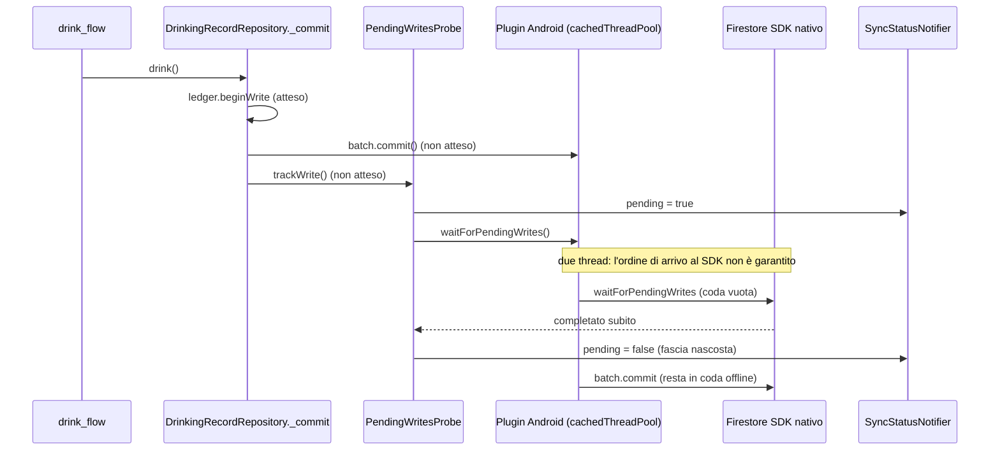

Testo: se `waitForPendingWrites` raggiunge il SDK prima del batch, si chiude subito e la sonda riporta lo stato a "sincronizzato" mentre la bevuta è ancora in coda.

### Ritorno in rete

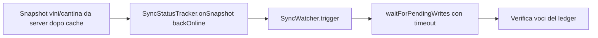

Testo: quando un listener passa da cache a server, `SyncStatusNotifier` avvia `SyncWatcher`, che attende la coda e verifica le scritture registrate nel ledger.

### Bevuta: dal tocco al messaggio (comportamento alla scansione ux-redesign)

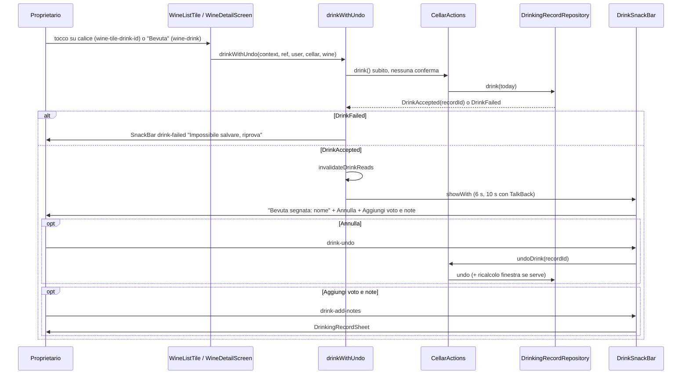

Testo: il tocco salvava la bevuta prima di qualunque domanda; l'unico modo di tornare indietro era "Annulla" finché il messaggio era visibile. L'intent ux-redesign ha introdotto un pannello "Ho bevuto" con conferma (vedi `docs/release-checklist.md` §1-octies); non riverificato in questa scansione.

### Aggiunta di un vino con paese e regione (comportamento attuale, riverificato)

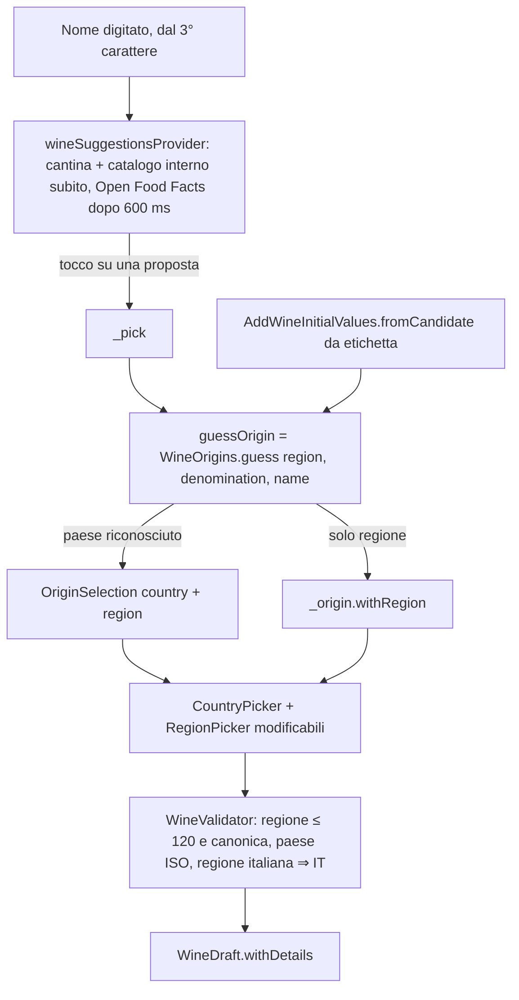

Testo: una proposta (o la proposta dell'etichetta tramite "Correggi") riempie nome, produttore, annata, tipologia, denominazione, paese e regione; paese e regione restano modificabili nei selettori del form. Le proposte "dalla cantina" non portano regione né denominazione.

### Foto: dall'etichetta alla proposta (comportamento u6, alla scansione label-recognition)

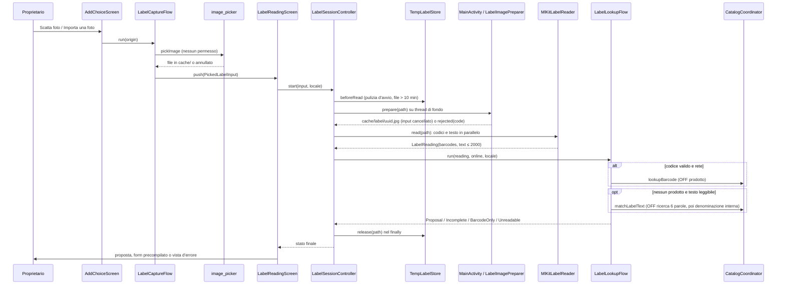

Testo: una sola immagine per lettura; la copia preparata si cancella in ogni caso alla fine della lettura, prima che l'esito sia mostrato. "Annulla" porta subito indietro e il risultato tardivo viene ignorato tramite l'id di lettura.

### Ricerca nel catalogo per una foto (comportamento u6, alla scansione label-recognition)

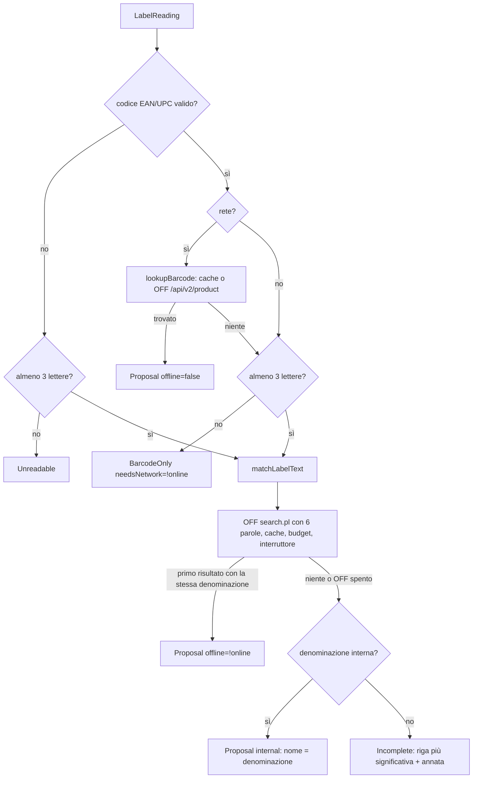

Testo: il catalogo interno entra solo come ripiego dopo Open Food Facts; senza rete `matchLabelText` prova comunque OFF (fallisce per rete) e poi usa la denominazione. L'annata letta da `VintageParser` sostituisce sempre quella del candidato.

### Superficie della stima e dei campi del vino (intent 261108-label-autofill-windows)

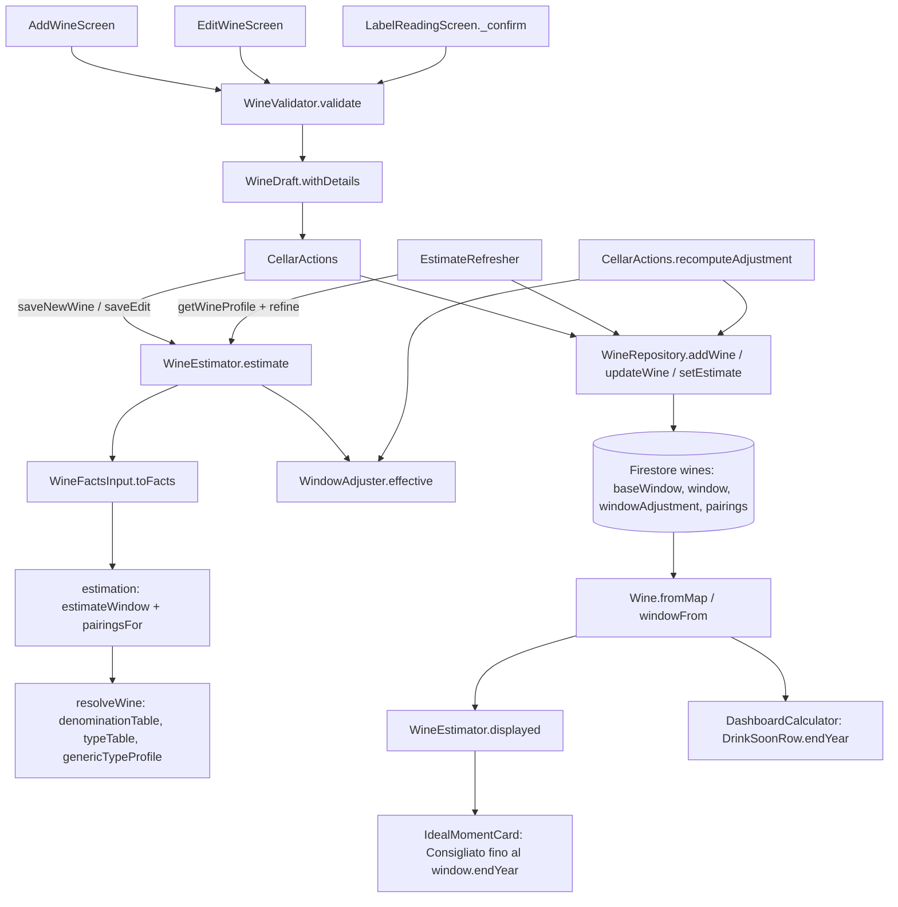

Testo: i tre form passano dal validatore e dalla bozza; `CellarActions` calcola la stima con `WineEstimator` (che chiama `estimation` e applica il riscontro delle bevute) e scrive con `WineRepository`. La finestra viene riscritta anche dall'aggiornamento col catalogo (`EstimateRefresher`, solo per finestre `internalRules`) e dal ricalcolo dopo una bevuta (`recomputeAdjustment`). La scheda del vino mostra `window.endYear` come "Consigliato fino al"; il cruscotto usa lo stesso anno per "da bere presto".

## Interaction Diagrams (aggiornamento dell'intent 261108-label-autofill-windows)

### Salvataggio di un vino e stima della finestra (comportamento attuale)

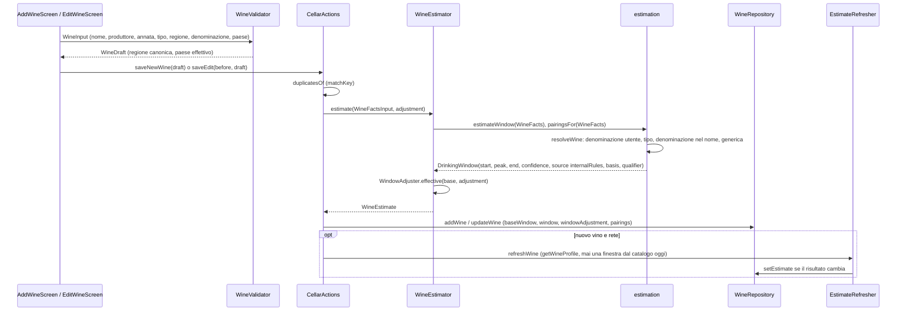

Testo: ogni salvataggio, anche una modifica del solo nome, ricalcola la finestra dai fatti; l'unica correzione conservata è il riscontro dell'ultima bevuta. `getWineProfile` oggi risponde sempre `found: false` (nessuna fonte ha finestre o abbinamenti) e `WineEstimator.refine` con `found: false` rifà la stima interna con gli stessi fatti: l'aggiornamento col catalogo scrive solo se la stima interna è cambiata (per esempio dopo un aggiornamento delle tabelle).

### Etichetta: dal testo al form (comportamento attuale)

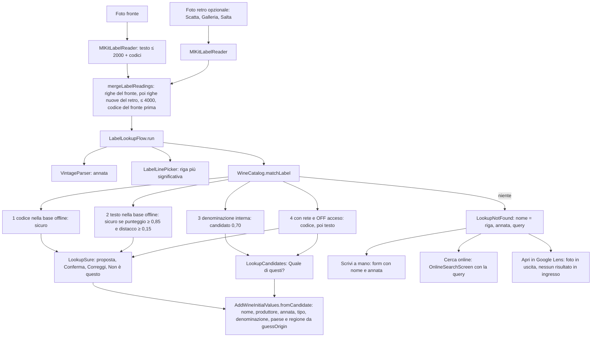

Testo: dal testo letto l'app ricava da sé solo l'annata e la riga più significativa; tutti gli altri campi del form vengono da un candidato di una base dati (base offline, denominazione interna, Open Food Facts). Senza candidati il form si apre con nome e annata e l'avviso "Non ho trovato il vino: controlla i dati". Google Lens riceve la foto del fronte ma nulla torna all'app, e l'app non legge gli appunti né accetta testo condiviso.

Nota storica: i due diagrammi qui sopra precedono il commit `baba947`. Oggi la stima applica il livello e la correzione manuale, e il testo dell'etichetta viene analizzato da `extractLabelFields` (vedi le sezioni seguenti).

## Aggiornamento dell'intent 261108-wine-style-profiles

### Dove si decidono, si salvano e si mostrano tipo, livello e finestra

| Dato | Dove si decide | Dove si salva | Dove si mostra |
|---|---|---|---|
| Tipo (`wineType`) | A mano in `WineTypeField` (form di aggiunta e modifica); preselezionato da `extractLabelFields`/`analyzeLabelText` (`_Reader._type` in `label_fields.dart`, `_Evidence.typeFor` in `label_candidates.dart`) e da un candidato del catalogo (`wineFamilyOf`, 5 famiglie → 8 tipi) | `wines/{id}.wineType`, stringa non controllata dalle regole | `WineTypeBadge`/`WineTypeFamily` (scheda e dettaglio), filtro `TypeFilter`, `DashboardCalculator.familyOf`, selettore del form |
| Tipo usato dalla stima | `resolveWine` in `recognizer.dart`: tipo scelto, poi tipo del catalogo, poi tipo principale della riga della denominazione o tipo del vitigno | Solo implicito: `window.basis` e `window.denominationKey`, il tipo dedotto non si salva | Riga "Origine della stima" (`estimateOriginText`) |
| Livello (`level`) | A mano in `WineLevelSelector`; suggerito "Da invecchiamento" da `LevelChoice.suggestionFor` (qualificativo del nome o della denominazione, `agingQualifierIn`) o dal testo dell'etichetta (`LabelFields.suggestedLevel`) | `wines/{id}.level` (`everyday`, `good`, `aging`), solo se scelto o accettato | `LevelSection`/`LevelPreview` nel form, `IdealMomentCard` nel dettaglio |
| Finestra base (`baseWindow`) | `estimateWindow` (denominazione → vitigno → tipo → generica; livello applicato agli scarti in anni) o finestra del catalogo | `wines/{id}.baseWindow` con `tablesVersion` e `denominationKey` | Sotto la correzione in `IdealMomentCard` |
| Finestra effettiva (`window`) | `WindowAdjuster.effectiveOf`: base + riscontro dell'ultima bevuta + "Consigliato fino al" manuale (`effectiveWindow`) | `wines/{id}.window`, `windowAdjustment`, `windowOverride` | `IdealMomentCard`, `WindowCard`, stato nella scheda (`statusOf`), cruscotto (da bere presto, picchi) |

### Flusso di classificazione e stima attuale

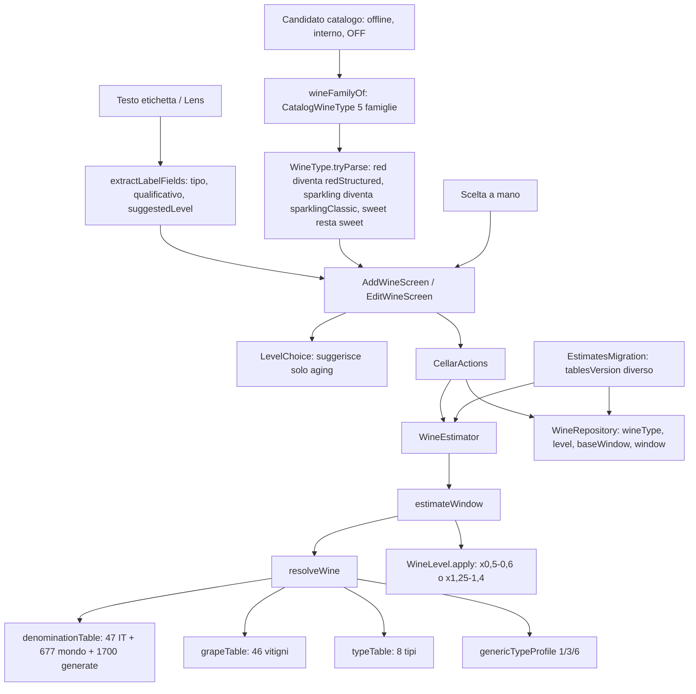

Testo: il tipo salvato e il tipo usato dalla stima sono due cose distinte. Il form salva solo il tipo scelto, preselezionato dall'etichetta o dal catalogo; la stima, se il tipo manca, lo deduce dalla denominazione o dal vitigno ma non lo scrive. Il livello moltiplica gli scarti in anni prima di aggiungere l'anno base; con un qualificativo che ha scarti propri, "Da invecchiamento" non moltiplica di nuovo. La migrazione rifà la stima con i fatti salvati e scrive solo i campi della stima.

### Granularità e unità

- Gli scarti delle tabelle sono anni interi (`YearOffsets(start, peak, end)`), l'anno base è l'annata, oppure l'anno di ingresso in cantina (stessi anni per spumanti e stima generica, un anno prima per i vini fermi).
- `statusOf` ragiona in mesi, ma solo a partire da anni interi: "da bere presto" è il 25% della finestra, tra 3 e 12 mesi.
- Le regole Firestore accettano solo anni interi tra 1900 e 2200 e i campi elencati in `wineFields()`. Una finestra in mesi, o una data di sboccatura o di imbottigliamento, richiede campi nuovi nel modello, nelle regole e nel codec.

## Interaction Diagrams (aggiornamento dell'intent 261108-wine-style-profiles)

### Migrazione una tantum delle stime (comportamento attuale)

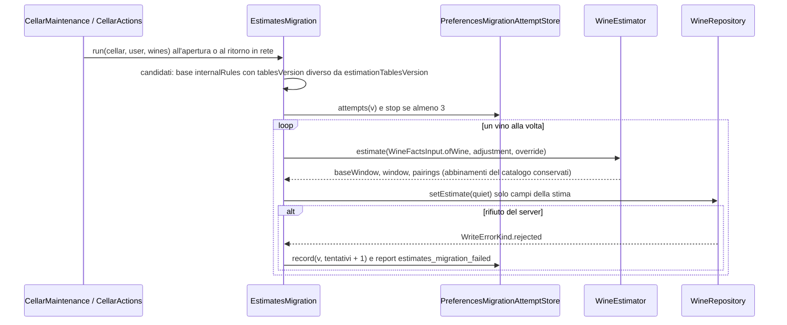

Testo: la migrazione parte solo se `estimationTablesVersion` cambia. Riscrive `baseWindow`, `window`, `windowAdjustment` e gli abbinamenti interni; `wineType`, `level` e `windowOverride` restano come sono. Le finestre del catalogo non sono candidate. Un rifiuto delle regole ferma la migrazione per quell'avvio; dopo 3 avvii con un rifiuto aspetta la versione successiva delle tabelle.

### Preselezione di tipo e livello dal testo dell'etichetta (comportamento attuale)

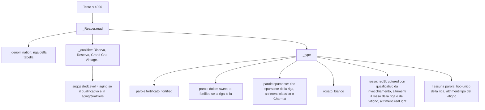

Testo: il tipo si ricava solo da parole del testo e dai tipi della riga della denominazione; una riga con più tipi e senza parole di colore resta senza tipo, a meno che non ci sia un vitigno. Il livello suggerito è soltanto "Da invecchiamento".

