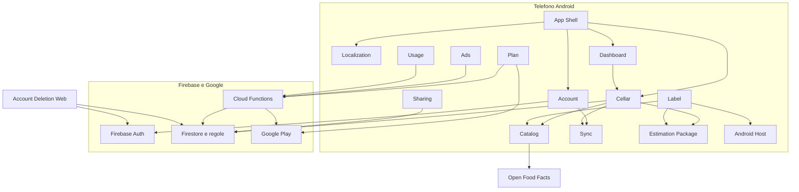
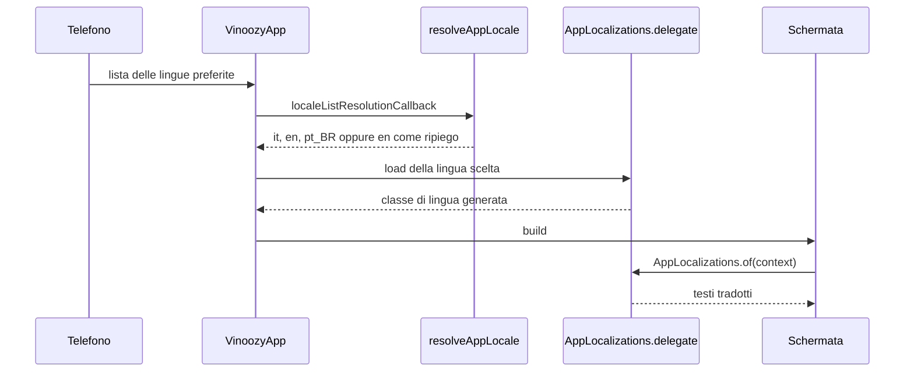
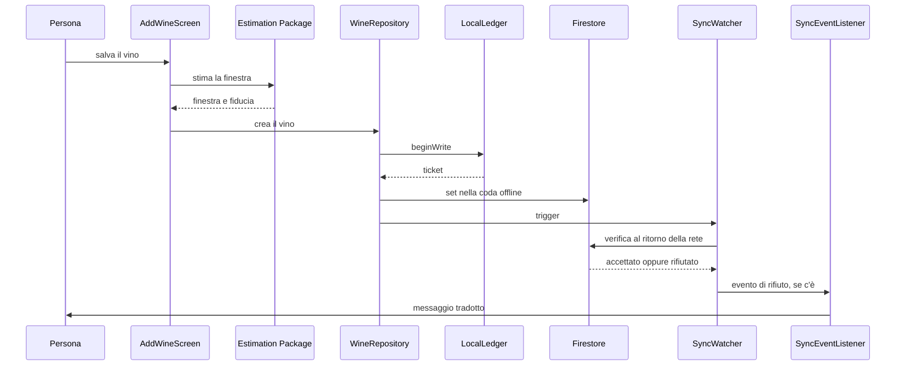

# Architecture

## Architecture Analysis

### System Overview

Vinoozy è un'app Flutter per Android con un backend Firebase. L'app tiene i dati in Firestore con la coda offline del telefono, calcola le stime con una libreria Dart pura inclusa nel repository e riconosce le etichette sul dispositivo. Un piccolo insieme di Cloud Functions gestisce acquisti, misura d'uso e annunci. Due pagine web statiche (privacy, cancellazione dell'account) sono pubblicate su GitHub Pages.

### Architectural Style

Client pesante con backend serverless, in un unico repository:

- **Monolite modulare sul client**: `lib/` è diviso per funzione (`account`, `cellar`, `catalog`, `label`, `dashboard`, `sharing`, `sync`, `plan`, `ads`, `usage`), e dentro ogni modulo per strato (`domain`, `data`, `ui`, oppure `core` e `platform`). Evidenza: struttura delle cartelle e controlli di CI che vietano importazioni tra strati (`tool/check_dashboard_readonly.sh`, `tool/check_label_imports.sh`, `tool/check_off_config.sh`).
- **Libreria di dominio isolata**: `packages/estimation` non ha dipendenze di produzione (`tool/check_estimation_purity.sh`).
- **Serverless**: regole di sicurezza Firestore come confine di autorizzazione (`firestore.rules`), Cloud Functions 2nd gen in `europe-west8` (`functions/src/index.ts`).
- **Offline-first**: le scritture passano da un registro locale (`lib/sync/ledger/`) e vengono verificate in background (`lib/sync/sync_watcher.dart`).

### Component Relationships



<!-- Text fallback: l'App Shell avvia Account, Cellar, Dashboard e usa Localization. Account usa Firebase Auth e Sync. Cellar usa Estimation Package, Catalog, Sync e Firestore. Label usa Catalog, Estimation Package e l'Android Host. Catalog chiama Open Food Facts. Dashboard legge Cellar. Sharing scrive in Firestore. Plan, Ads e Usage chiamano le Cloud Functions; Plan usa anche Google Play. Le Cloud Functions leggono e scrivono Firestore e interrogano Google Play. La pagina web di cancellazione account usa Firebase Auth e Firestore. -->

### Data Flow

1. **Avvio** (`lib/app/bootstrap.dart`): Firebase, poi App Check, poi in parallelo Crashlytics e lettura del registro locale; nessuna chiamata ad Auth o Firestore prima di App Check. Poi si collegano i servizi e parte `AccountGate`.
2. **Scrittura di un vino**: il modulo registra l'intenzione nel registro locale, scrive in Firestore (coda offline se manca la rete), e `SyncWatcher` verifica più tardi che il server abbia accettato. Un rifiuto arriva alla radice dell'app come evento (`SyncErrorBus`) e diventa un messaggio tradotto.
3. **Stima**: `lib/cellar/wine_estimator.dart` trasforma i dati del vino nei fatti del contratto C2 e chiama il pacchetto `estimation`; la finestra viene salvata con il vino.
4. **Etichetta**: l'immagine è preparata in Kotlin, letta da ML Kit sul telefono, e il testo passa a `estimation` (campi) e a `Catalog` (database offline, catalogo interno, Open Food Facts).
5. **Piano e uso**: i contatori d'uso restano sul telefono e vengono inviati con `reportUsage`; l'acquisto Plus è verificato da `verifyPurchase`.

### Localization Architecture

- Fonte dei testi: file ARB in `lib/l10n/`, con `app_en.arb` come modello. `flutter gen-l10n` genera `AppLocalizations` e una classe per lingua; i file generati sono versionati.
- Lingue offerte: decise da `lib/app/locale_resolution.dart` (`appLocales`, `resolveAppLocale`, `fallbackLocale`), non dalla lista generata. `VinoozyApp` le passa a `MaterialApp` insieme ai delegate generati.
- Nessuno stato di lingua nell'app: niente provider, niente preferenza salvata. L'unica forzatura è `appLocaleOverride` per le build E2E.
- I widget leggono i testi con `AppLocalizations.of(context)`; funzioni di etichetta come `lib/cellar/ui/wine_labels.dart` mappano i valori di dominio (enum del pacchetto `estimation`) sulle chiavi tradotte.
- I nomi di paesi e regioni non stanno negli ARB: sono dati Dart con un campo per lingua (`lib/cellar/domain/wine_origins.dart`).
- Date e numeri: `intl` con la lingua del contesto.

Inventario completo dei punti toccati dalle lingue: `code-structure.md`, sezione "Localization Touchpoints".

### Key Design Decisions

| Decisione | Implicazione |
|---|---|
| Lingua dal telefono, inglese come ripiego, senza selettore | Semplice; chi ha il telefono in una lingua non offerta non può scegliere |
| `pt-BR` distinto da `pt`, con `app_pt.arb` vuoto imposto dal generatore | Una classe generata in inglese che conta nella copertura |
| Valori salvati indipendenti dalla lingua (codice ISO, nome canonico, chiavi enum) | Cambiare lingua non richiede migrazioni dei dati |
| Regole Firestore come unica autorizzazione, cancellazione account senza Functions | Le Functions restano facoltative per il funzionamento di base |
| Copertura all'80% su tutto, generato compreso | Ogni file generato aggiunto pesa sulla soglia |
| Build E2E sempre in italiano | I test end-to-end non dipendono dalla lingua dell'emulatore |

### Improvement Opportunities

- Una sola fonte per l'elenco delle lingue, da cui derivare risoluzione, harness dei test, strumenti dello store e del web.
- Separare i dati di `wine_origins.dart` (paesi, regioni) dalla logica, e renderne i nomi estendibili per lingua senza un campo per ogni lingua.
- Un controllo di CI che confronti i file di localizzazione versionati con quelli rigenerati, e un file dei messaggi non tradotti.
- Un test che eserciti tutti i messaggi di ogni lingua, per coprire il codice generato.

## Interaction Diagrams

### Risoluzione della lingua all'avvio



<!-- Text fallback: il telefono passa la lista delle lingue preferite a VinoozyApp; VinoozyApp chiama resolveAppLocale, che restituisce it, en o pt_BR, oppure en come ripiego; il delegate generato carica la classe della lingua; ogni schermata chiede i testi con AppLocalizations.of(context). -->

### Aggiunta di un vino con rete assente



<!-- Text fallback: la persona salva il vino; il modulo chiede la stima al pacchetto estimation; WineRepository apre una scrittura nel registro locale, scrive in Firestore nella coda offline e avvisa SyncWatcher; al ritorno della rete SyncWatcher verifica l'esito; un rifiuto arriva a SyncEventListener alla radice dell'app, che mostra un messaggio tradotto. -->

### Lettura di un'etichetta

```mermaid
sequenceDiagram
  participant User as Persona
  participant Flow as Label
  participant Host as Android Host
  participant ML as ML Kit sul telefono
  participant Est as Estimation Package
  participant Cat as Catalog
  participant OFF as Open Food Facts

  User->>Flow: scatta o sceglie la foto
  Flow->>Host: prepara l'immagine
  Host-->>Flow: copia temporanea
  Flow->>ML: testo latino e codice a barre
  ML-->>Flow: righe di testo e codice
  Flow->>Est: estrai i campi dell'etichetta
  Flow->>Cat: matchLabel con la lingua dell'app
  Cat->>OFF: ricerca, solo con rete
  OFF-->>Cat: prodotti
  Cat-->>Flow: proposta sicura, candidati o nulla
  Flow->>User: proposta da confermare
```

<!-- Text fallback: la persona scatta o sceglie una foto; Label chiede all'Android Host di preparare l'immagine; ML Kit legge sul telefono testo latino e codice a barre; il pacchetto estimation estrae i campi; Catalog cerca nel database offline, nel catalogo interno e, solo con rete, in Open Food Facts passando la lingua dell'app; Label mostra una proposta sicura, dei candidati o nessun risultato. -->
