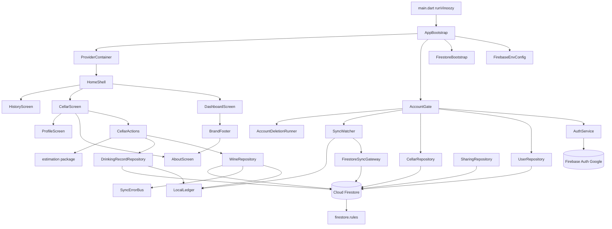
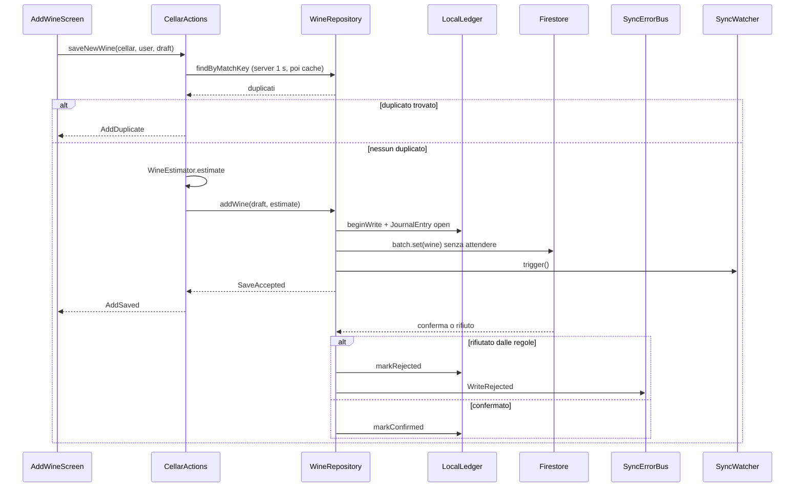
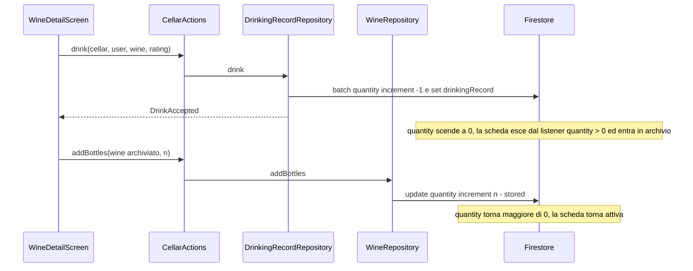
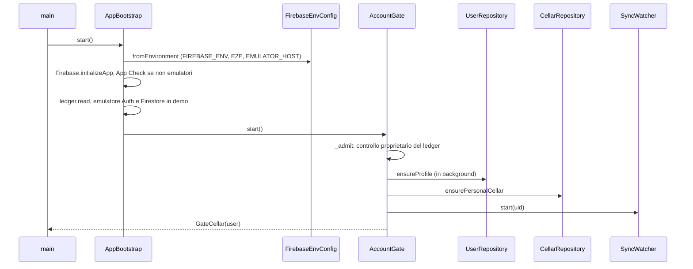
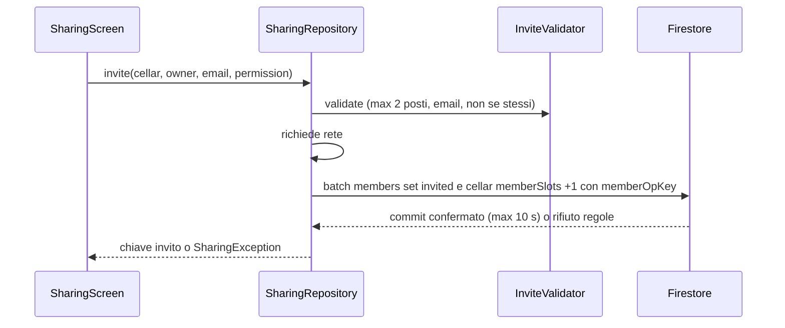

# Architettura

## Architecture Analysis

### System Overview

App mobile monolitica Flutter per Android che parla direttamente con Firebase
(Auth, Firestore, App Check, Crashlytics) senza alcun backend proprio. La
logica di autorizzazione e di integrità dei dati sta nelle regole di sicurezza
(`firestore.rules`); la logica di stima sta nel pacchetto Dart puro
`packages/estimation`. Le scritture sono offline-first: prima il ledger locale
(`LocalLedger`, SharedPreferences), poi il batch Firestore senza attendere la
rete; `SyncWatcher` verifica in background che le creazioni arrivino al server.

### Architectural Style

Client-heavy "serverless" con BaaS: monolite modulare per funzionalità
(`lib/account`, `lib/cellar`, `lib/sharing`, `lib/dashboard`, `lib/label`,
`lib/catalog`, `lib/sync`), stratificato in `domain/` (puro), `data/`
(repository Firestore), provider Riverpod e `ui/`. Dipendenze iniettate da
`AppBootstrap._wire` con `overrideWithValue`, sostituite da fake nei test.
Evidenze: nessuna directory `functions/`, nessun endpoint HTTP proprio,
`firestore.rules` con ~30 funzioni di validazione.

### Component Relationships

<!-- Text fallback: main avvia AppBootstrap, che legge FirebaseEnvConfig,
configura FirestoreBootstrap, crea AccountGate e il ProviderContainer.
AccountGate usa AuthService, UserRepository, CellarRepository, SyncWatcher e
AccountDeletionRunner. HomeShell ospita Dashboard, Cantina e Storico; la
Cantina usa CellarActions e apre AboutScreen e ProfileScreen; la Dashboard
apre AboutScreen tramite BrandFooter. CellarActions usa WineRepository,
DrinkingRecordRepository e il pacchetto estimation; i repository scrivono nel
LocalLedger e in Firestore, protetto da firestore.rules. -->

### Data Flow

1. **Lettura quotidiana**: un solo listener `winesStreamProvider(cellarId)`
   (`where quantity > 0`, con metadati) e uno `cellarStreamProvider(cellarId)`
   alimentano Cantina, Dashboard (`dashboardComputedProvider`), stato di
   sincronizzazione (`syncStatusProvider`) e manutenzione
   (`cellarMaintenanceTriggerProvider`). Dettaglio vino: listener separato
   `wineProvider`. Archivio: `fetchArchived` (`quantity <= 0`) una tantum.
   Storico: pagine da 30 (`pageHistory`).
2. **Letture "server, poi cache"**: `readServerOrCache` (timeout 1 s) per
   duplicati (`findByMatchKey`), bevute di un vino e cancellazioni.
3. **Scritture**: `LocalLedger.beginWrite` → `WriteBatch.commit()` non atteso →
   esito su ledger e `SyncErrorBus` (`WriteRejected`, `WriteFailed`,
   `SessionExpired`, `CellarAccessLost`, `CellarNotice`).
4. **Condivisione**: operazioni solo con rete, `commit()` atteso fino a 10 s,
   contatore `memberSlots` accoppiato nello stesso batch.
5. **Lavori di sistema**: backfill `matchKey`, migrazione stime/stili,
   `RecordReconciler` (operazioni da completare al ritorno della rete).

### Key Design Decisions

| Decisione | Alternative rifiutate (dal codice) | Conseguenze |
|---|---|---|
| Nessun backend; autorizzazione nelle regole Firestore | Cloud Functions (richiedono Blaze, budget 0 €) | Ogni invariante deve stare in `firestore.rules` o nel client; contatori atomici solo via batch accoppiati (vedi `memberSlots`). |
| Scritture offline-first con ledger locale | Attendere il server prima di chiudere il modulo | UI immediata; un rifiuto arriva in ritardo come notifica ("vino rifiutato"). |
| Quantità come incrementi, negativo ammesso (ADR-004) | Valore assoluto con transazione | Decrementi concorrenti sommabili; "attivo" = `quantity > 0`. |
| Flag di build come costanti di compilazione (`E2E`, `PERF`) | Flag a runtime | Il codice di test sparisce dalla release; verificato da `check_release_build.sh`. |
| `FIREBASE_ENV` predefinito `demo` | Predefinito produzione | Una build senza define non tocca mai produzione. |
| Un solo listener per cantina condiviso da più schermate | Listener per schermata | Meno letture Firestore; utile per il futuro `CloudUsageMeter` (contare una volta). |

Implicazioni di sicurezza: solo il provider `google.com`; App Check Play
Integrity in release; Crashlytics solo in release produzione con valori
sensibili oscurati (`ErrorReporter`); segreti solo in GitHub Actions.

### Improvement Opportunities

- Introdurre un'astrazione dei diritti/capacità unica (oggi assente) da cui
  dipendano `CellarActions`, schermate e regole, come chiede lo studio §9.1.
- Instrumentare gli snapshot prima del mapping in `WineRepository`,
  `DrinkingRecordRepository`, `SharingRepository`, `readServerOrCache` per un
  misuratore d'uso: oggi i metadati restano solo `hasPendingWrites` e
  `isFromCache` (`SnapshotMeta`).
- Estendere `tool/check_release_build.sh` a marker di cheat di sviluppo.
- Ridurre i file di UI oltre 1000 righe (`add_wine_screen.dart`,
  `guided_confirm_sheet.dart`).

## Interaction Diagrams

### Aggiunta di un vino (offline-first)

<!-- Text fallback: il modulo chiama CellarActions.saveNewWine; si cercano i
duplicati con matchKey (server entro 1 s, altrimenti cache). Senza duplicati si
calcola la stima, WineRepository scrive prima nel ledger e poi avvia il batch
Firestore senza attenderlo, e risponde SaveAccepted. L'esito del server marca
la voce confermata o rifiutata e, se rifiutata, pubblica WriteRejected. -->

### "Bevuto" e riattivazione dall'archivio

<!-- Text fallback: "Bevuto" scrive in un solo batch il decremento della
quantità e la bevuta; a quantità zero la scheda esce dal listener attivo e
passa all'archivio. Aggiungere bottiglie a una scheda archiviata (anche dal
dialogo duplicati o da Annulla) la riporta attiva: è il punto in cui il limite
di 15 schede attive dovrà intervenire. -->

### Avvio e accesso

<!-- Text fallback: main avvia AppBootstrap, che legge la configurazione di
build, inizializza Firebase e App Check (solo fuori dagli emulatori), legge il
ledger e collega gli emulatori in demo. AccountGate verifica il proprietario
del ledger, crea profilo e cantina personale, avvia SyncWatcher e mostra la
cantina. -->

### Invito in una cantina

<!-- Text fallback: l'invito è validato localmente (al massimo 2 posti),
richiede la rete e scrive in un solo batch l'invito e il contatore memberSlots
della cantina; le regole accettano solo se contatore e invito sono accoppiati.
È il modello già presente per un contatore atomico verificato dal server. -->
