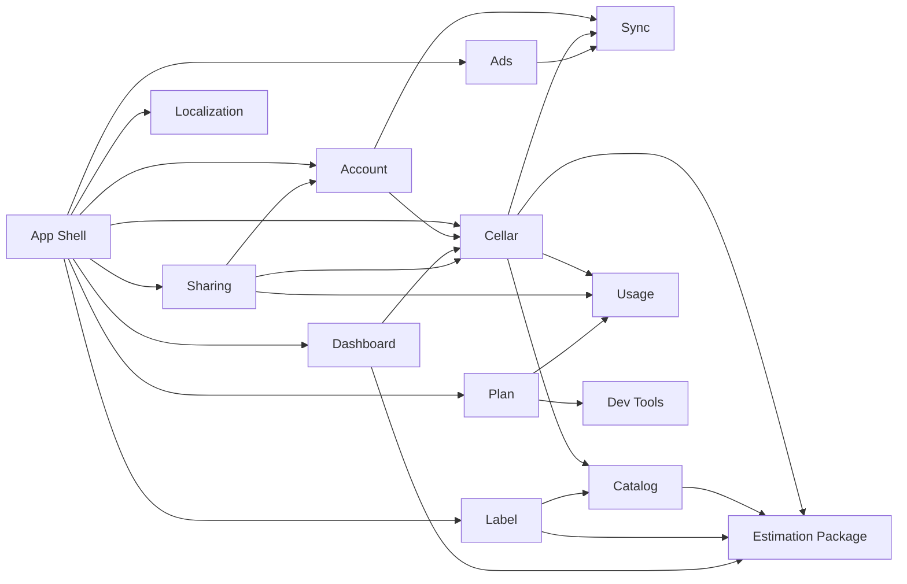

# Dependencies

Versioni e scopo di ogni libreria: `technology-stack.md`. Qui stanno le relazioni.

## External Dependencies

### Runtime services

| Servizio | Usato da | Note |
|---|---|---|
| Firebase Auth | Account, Account Deletion Web, Cloud Functions | Accesso con Google |
| Cloud Firestore | Cellar, Sharing, Account, Sync, Plan, Cloud Functions, Account Deletion Web | Coda offline sul telefono; regole nel repository |
| Firebase App Check | App Shell, Cloud Functions | Play Integrity in rilascio; obbligatorio per le callable |
| Firebase Crashlytics | App Shell | Solo build di rilascio del progetto reale |
| Cloud Functions | Plan, Ads, Usage | Mai distribuite dalla CI |
| Google Play Billing | Plan, Cloud Functions | Acquisto e verifica di Plus |
| Google Mobile Ads | Ads | Un tentativo al giorno |
| ML Kit sul telefono | Label | Modelli inclusi nell'app; testo solo in scrittura latina |
| Google Lens (app Google) | Label | Avviato su richiesta esplicita |
| Open Food Facts | Catalog | Solo con rete; licenza ODbL, attribuzione obbligatoria |
| Google Play Developer API | CI/CD Workflows | Rilascio e promozione |
| GitHub Pages | CI/CD Workflows | Pagine pubbliche |

### Build-time data sources

| Fonte | Usata da | Risultato |
|---|---|---|
| Esportazione di Open Food Facts, scaricata a mano | `tool/build_wine_db.dart` | `assets/wine_db/wines.jsonl.gz`, `manifest.json` |
| Registro eAmbrosia e file CSV in `tool/data/appellations/` | `tool/build_appellations.dart` | `packages/estimation/lib/src/generated/appellations.g.dart` |
| File ARB | `flutter gen-l10n` | `lib/l10n/app_localizations*.dart` |

### Package manifests

| Manifest | Gestore | Aggiornamenti |
|---|---|---|
| `pubspec.yaml`, `pubspec.lock` | pub | Dependabot settimanale |
| `packages/estimation/pubspec.yaml` | pub | Nessuna dipendenza di produzione, verificato in CI |
| `package.json`, `package-lock.json` | npm | Versioni esatte |
| `functions/package.json`, `tool/admin/package.json`, `test/rules/package.json` | npm | Pacchetti separati |
| `android/**/*.kts` | Gradle | Plugin di Flutter e di Firebase |
| `.github/workflows/*.yml` | GitHub Actions | Azioni fissate per SHA, Dependabot settimanale |

## Internal Dependencies

<!-- Text fallback: App Shell dipende da Account, Cellar, Dashboard, Sharing, Label, Plan, Ads e Localization. Account dipende da Sync e Cellar. Cellar dipende da Estimation Package, Catalog, Sync e Usage. Catalog dipende da Estimation Package. Label dipende da Catalog ed Estimation Package. Dashboard dipende da Cellar ed Estimation Package. Sharing dipende da Cellar, Account e Usage. Plan dipende da Usage e Dev Tools. Ads dipende da Sync per l'archivio chiave-valore. -->

Osservazioni:

- `Estimation Package` è una foglia: non importa nulla del resto.
- `Localization` è importata da tutte le cartelle `ui/` e da `lib/app/bootstrap.dart`; non importa nessun modulo.
- `lib/cellar/domain/wine_origins.dart` è importato da Cellar, Dashboard, Label e App Shell: è il punto condiviso dei nomi di paesi e regioni.
- `lib/sync/ledger/key_value_store.dart` è l'archivio chiave-valore riusato da Plan, Ads, Usage e Dev Tools.
- Dipendenze incrociate tra moduli pari esistono (per esempio Account importa il repository delle cantine, Sharing importa Account); nessun ciclo tra file è stato cercato in questa scansione.

## Dependency Rules Enforced by CI

| Regola | Controllo |
|---|---|
| `packages/estimation` senza dipendenze di produzione, senza Flutter | `tool/check_estimation_purity.sh` |
| `lib/dashboard/` sola lettura, `domain/` in Dart puro | `tool/check_dashboard_readonly.sh` |
| `lib/label/` senza Firestore né Storage | `tool/check_label_imports.sh` |
| `lib/catalog/` senza Firestore, `core/` in Dart puro, nessun contatto Open Food Facts nel repository | `tool/check_off_config.sh` |
| Bundle web ricostruibile identico, solo script locali | `tool/check_web_pins.sh` |

## Localization Dependencies

| Chi dipende | Da cosa |
|---|---|
| Ogni schermata | `AppLocalizations` generato |
| `VinoozyApp`, `AppBootstrap` | `appLocales`, `resolveAppLocale` |
| Cellar, Dashboard, Label, App Shell | `OriginCountry.nameIn`, `WineRegion.nameIn` con il codice di lingua |
| Catalog | `CatalogLocale` e il parametro `lc` di Open Food Facts |
| Test dei widget | `testLocales` e `pumpScreen` di `test/helpers/ui_harness.dart` |
| Test end-to-end | Build E2E in italiano |
| Store Listing | Cartelle `it-IT`, `en-US`, `pt-BR` e `tool/check_publication.mjs` |
| Account Deletion Web | Pagine `it`, `en`, `pt-BR` e `tool/check_web_pins.sh`, `tool/prepare_static_pages.mjs` |
| Copertura di CI | Numero di righe del codice di localizzazione generato |
| Lingue disponibili per date e widget di sistema | `intl` e `flutter_localizations` |
