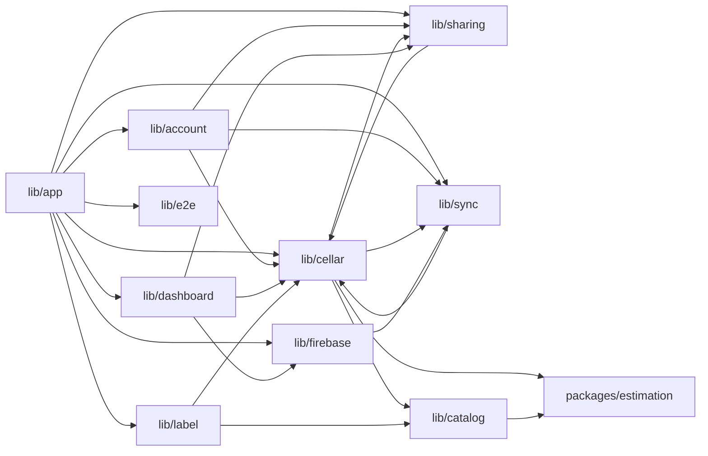

# Dipendenze

Le versioni delle librerie esterne sono elencate una sola volta in
`technology-stack.md`. Qui si descrivono le relazioni.

## Dipendenze esterne per modulo

| Modulo | Dipendenze esterne dirette |
|---|---|
| `lib/app/` | firebase_core, firebase_app_check, firebase_auth, firebase_crashlytics, cloud_firestore, google_sign_in, shared_preferences, package_info_plus, flutter_riverpod |
| `lib/firebase/` | firebase_core, cloud_firestore |
| `lib/account/` | firebase_auth, google_sign_in, cloud_firestore, shared_preferences, connectivity_plus |
| `lib/cellar/` | cloud_firestore, shared_preferences, estimation, flutter_riverpod, intl |
| `lib/sharing/` | cloud_firestore, share_plus, shared_preferences |
| `lib/sync/` | cloud_firestore, shared_preferences |
| `lib/dashboard/` | estimation, flutter_riverpod, shared_preferences (solo preferenza del grafico) |
| `lib/label/` | google_mlkit_*, image_picker, path_provider, estimation (nessun import cloud: gate `tool/check_label_imports.sh`) |
| `lib/catalog/` | http, crypto, path_provider, connectivity_plus, firebase_crashlytics (adattatore), estimation |
| `packages/estimation/` | nessuna (gate `tool/check_estimation_purity.sh`) |

## Dipendenze interne tra moduli



<!-- Text fallback: lib/app collega tutti i moduli. account dipende da cellar,
sync e sharing; cellar da sync, sharing, catalog ed estimation; sharing usa i
percorsi e il modello Cellar di cellar; dashboard legge cellar e sharing e il
flag PERF di firebase; label usa catalog e cellar; catalog usa estimation;
sync usa i percorsi Firestore di cellar; firebase usa il ledger di sync. -->

Il diagramma mostra gli archi principali. Il grafo reale degli import è più
denso: quasi tutti i moduli importano `lib/app` (provider di servizio,
`ErrorReporter`) e `lib/l10n`; la UI di `lib/cellar` importa anche
`lib/label`, `lib/dashboard` e `lib/account`; `lib/account` importa anche
`lib/firebase` e `lib/label` (pulizia delle foto in eliminazione).

Riferimenti incrociati notevoli (dipendenze circolari a livello di cartella,
non di file):

- `lib/cellar` ↔ `lib/sharing`: `CellarActions` riceve `AccessibleCellar`
  (`lib/sharing/domain/membership.dart`); `SharingRepository` usa `Cellar` e
  `cellarPath` di `lib/cellar`.
- `lib/cellar` ↔ `lib/sync`: `WineRepository` usa `LocalLedger` e
  `SyncErrorBus`; `FirestoreSyncGateway` usa `winePath` di
  `lib/cellar/data/firestore_codec.dart`.
- `lib/app/providers.dart` ↔ `lib/cellar/cellar_providers.dart` e
  `lib/sharing/sharing_providers.dart`: provider di invalidazione reciproca.
- `lib/firebase/firestore_bootstrap.dart` importa `LocalLedger` per il piano B
  del reset.

Un nuovo modulo di diritti/capacità dovrebbe essere letto da `lib/cellar`,
`lib/sharing`, `lib/dashboard`, `lib/account` e `lib/app` senza dipendere da
loro, per non allargare i cicli esistenti.

## Dipendenze di build e consegna

- `pubspec.yaml` → `packages/estimation` (path); `l10n.yaml` genera
  `lib/l10n/app_localizations*.dart` (`flutter gen-l10n`, eseguito in CI
  prima di `flutter analyze`).
- `tool/build_wine_db.dart` → `assets/wine_db/` (manifest verificato da
  `tool/check_wine_db_release.sh`); `tool/build_appellations.dart` e
  `tool/build_profile_map.dart` → `packages/estimation/lib/src/generated/`.
- `tool/gen_coverage_helper.dart` → `test/coverage_helper_test.dart`
  (ignorato da git) prima di `flutter test --coverage`.
- `release.yml` dipende da `ci` riuscito su `main`, da `tool/play_api.sh` e
  dai segreti `FIREBASE_PROD_*`, `ANDROID_UPLOAD_*`, `PLAY_INTERNAL_SA_JSON`.
- `firebase-deploy.yml` esegue `npm run test:rules` e il controllo degli
  indici prima del deploy in produzione con approvazione.
- `pages.yml` → `tool/build_web_bundle.sh`, `tool/check_web_pins.sh`,
  `tool/check_publication.mjs --web-only`.

## Dipendenze di dati (Firestore)

```text
users/{uid}
cellars/{cellarId}                 cellarId == uid del proprietario
  ├── wines/{wineId}               letto/scritto via canReadCellar/canEditCellar
  ├── drinkingRecords/{recordId}   wineId -> wines/{wineId}
  └── members/{emailLowercase}     memberSlots della cantina accoppiato
```

Le regole leggono `cellars/{id}` (proprietario) e `members/{email}` (invitato)
per ogni richiesta su vini e bevute; `users/{uid}` solo per la cancellazione
della cantina.
