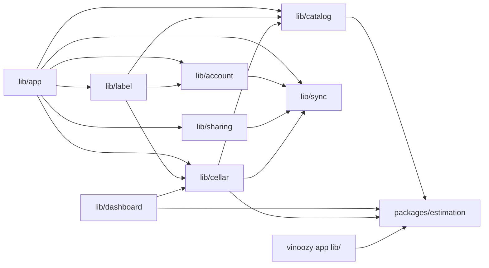

# Dipendenze — Vinoozy

Le versioni sono in [technology-stack.md](technology-stack.md); qui le relazioni.

## Dipendenze interne

Testo: `lib/app` cabla tutti i moduli; `lib/cellar` dipende da `lib/sync`, dal catalogo e da `estimation`; il cruscotto legge la cantina; l'etichetta usa catalogo, cantina (form, azioni, validazione, origini) e account (rete, gate, utente); il catalogo usa le denominazioni di `estimation`; `estimation` non dipende da nulla.

Vincoli verificati da script: `tool/check_estimation_purity.sh` (nessuna dipendenza di produzione in `estimation`), `tool/check_label_imports.sh` (nessun `cloud_firestore` né `firebase_storage` in `lib/label/`), `tool/check_off_config.sh` (vedi sotto), `tool/check_dashboard_readonly.sh`, `tool/check_release_build.sh` (nessun permesso `CAMERA`, `READ_MEDIA_IMAGES`, `READ_EXTERNAL_STORAGE` nel manifest unito).

## Percorso del bug NFR6.6 (scansione pending-banner-fix)

| Da | A | Tipo |
|---|---|---|
| `DrinkingRecordRepository._commit` | `WriteBatch.commit()` | Future non atteso |
| `DrinkingRecordRepository._commit` | `PendingWritesProbe.trackWrite()` | Future non atteso |
| `PendingWritesProbe._waitFor` | `FirebaseFirestore.waitForPendingWrites()` (via `bootstrap.dart`) | atteso |
| `PendingWritesProbe` | `DrinkingRecordsPending.set` | callback |
| `SyncStatusNotifier` | `drinkingRecordsPendingProvider` | `ref.listen` |
| `OfflineBanner` | `syncStatusProvider` | `ref.watch` |

## Dipendenze della superficie UX

| Da | A | Tipo |
|---|---|---|
| `AddWineScreen` | `WineValidator`, `WineDraft`, `WineRules`, `WineOrigins` | dominio puro |
| `AddWineScreen` | `wineSuggestionsProvider` → `WineCatalog` (`InternalCatalog` + Open Food Facts) | provider |
| `AddWineScreen` | `CellarActions.saveNewWine` / `addBottles` | azioni |
| `AddWineScreen` | `CountryPicker`, `RegionPicker` (`origin_pickers.dart`), `WineTypeField`, `QuantityStepper`, `wine_badges.dart`, `wine_labels.dart` | widget |
| `EditWineScreen` | `add_wine_screen.dart` (`show WineTypeField`) | import |
| `LabelCaptureFlow`, `LabelReadingScreen` | `AddWineScreen`, `AddWineInitialValues`, `wineFamilyOf`, `WineValidator`, `CellarActions`, `DuplicateDialog` | import |
| `LabelProposalSheet` | `guessOrigin`, `wineFamilyOf`, `WineOrigins`, `CountryFlag`, `WineTypeBadge`, `QuantityStepper` | import |
| `CellarScreen`, `WineDetailScreen` | `drinkWithUndo` | funzione |
| `InternalCatalog` | `estimation` `denominationCatalog` | import |
| `WineOrigins.guess` | `estimation` `recognizeDenomination` | import |
| `CellarActions.saveNewWine` / `saveEdit` | `WineEstimator` → `WineFactsInput.region`, `denomination` | stima |

## Dipendenze dell'etichetta e del catalogo

| Da | A | Tipo |
|---|---|---|
| `AddChoiceScreen` | `LabelCaptureFlow` | chiamata |
| `LabelCaptureFlow` | `imageSourceProvider` (`PickerImageSource` → image_picker) | provider |
| `LabelReadingScreen` | `labelSessionProvider(token)`, `labelFlowProvider`, `sharedImageChannelProvider.openSettings` | provider |
| `LabelSessionController` | `TempLabelStore`, `SharedImageChannel`, `labelReaderFactoryProvider` (`MlKitLabelReader`), `networkStatusProvider`, `catalogProvider`, `clockProvider`, `LabelErrorReporter` | letti all'avvio della lettura |
| `LabelLookupFlow` | `WineCatalog.lookupBarcode`, `WineCatalog.matchLabelText`, `BarcodeFilter`, `VintageParser`, `LabelLinePicker` | chiamate |
| `BarcodeFilter` | `normalizeBarcode` (`lib/catalog/core/off/open_food_facts_source.dart`) | import |
| `LabelLinePicker` | `estimation` `recognizeDenomination` | import |
| `SharedImageChannel` | `MainActivity` (canale `com.vinoozy.app/label`) | platform channel |
| `MainActivity` | `LabelImagePreparer`, `SharedImageReceiver` | Kotlin |
| `LabelImagePreparer` | `BitmapFactory`, `androidx.exifinterface` | Android |
| `SharedImageNotifier` | `SharedImagePolicy`, gate dell'account (`ValueListenable<GateState>`), `HomeShell.updateShell` | stato |
| `AppBootstrap` | `scheduleLabelCleanup`, `sharedImageProvider` | avvio |
| `catalogProvider` | `catalogSessionProvider` → `catalogCoordinatorProvider` | provider |
| `CatalogCoordinator` | `InternalCatalog`, `CatalogCacheStore`, `RequestBudget`, `OffCircuitBreaker`, `CatalogEventLogger`, `Future<OpenFoodFactsSource?>` | iniezione |
| `catalogCoordinatorProvider` | `catalogOffContactProvider` (`OFF_CONTACT`), `catalogHttpClientProvider`, `catalogAppVersionProvider`, `catalogCacheFileProvider`, `catalogEventLoggerProvider` | provider |
| `catalogSessionProvider` | `catalogUidProvider` (`authServiceProvider`) | `ref.listen` |
| `CatalogCacheStore` | `CacheFile` (`FileCacheFile` → `getApplicationSupportDirectory`) | porta |

### Regole di `tool/check_off_config.sh` (job `analyze`)

1. `OFF_CONTACT` con un valore in un file versionato o nuovo non ignorato (esclusi `aidlc/`, `docs/` e lo script) ⇒ errore; il nome non può comparire nei workflow.
2. Nessun indirizzo email nel Dart di `lib/` (l10n esclusa).
3. Nessun import di `cloud_firestore` o `cloud_functions` in `lib/catalog/`.
4. Nessun import di Flutter, Riverpod, path_provider, Firebase, `cloud_*` o `dart:ui` in `lib/catalog/core/`.

Conseguenza per un database locale di vini: il motore e l'apertura del file (path_provider, plugin nativi) devono stare in `lib/catalog/platform/` dietro una porta definita in `core/`, come già fa `CacheFile`.

## Dipendenze esterne rilevanti per il bug NFR6.6

`cloud_firestore` 7.1.0 (Android): `writeBatchCommit` e `waitForPendingWrites` sono inviati ciascuno a `cachedThreadPool.execute(...)` di `firebase_core` 5.1.0; nessuna garanzia d'ordine tra le due chiamate.

## Dipendenze esterne rilevanti per la grafica

Alla scansione ux-redesign la UI usava solo Flutter Material; quell'intent ha aggiunto bandiere emoji e serif di sistema senza nuove dipendenze di pubspec.

## Dipendenze esterne rilevanti per l'intent 261107-label-recognition

- **ML Kit**: due plugin Flutter 1.0.0 con modelli inclusi; un riconoscitore di testo latino e uno di codici per sessione; nessuna rete per leggere.
- **Open Food Facts**: solo HTTP con `package:http`; nessun SDK; nessun uso dell'esportazione pubblica (dump CSV/JSONL/Parquet) né di una procedura che la trasformi.
- **Nessun motore di database** tra le dipendenze; aggiungerne uno comporta `pubspec.yaml` e `pubspec.lock` versionato, la copertura dell'80% senza esclusioni sul nuovo codice, il controllo della dimensione dell'app (+15 MB, base `UNSET`) e il budget di 0 €/mese.
- **Altre app**: nessuna libreria per avviare intent; l'unico `startActivity` è in `MainActivity.openAppSettings`. Il manifest dichiara `<queries>` solo per `PROCESS_TEXT` (dal modello di Flutter), quindi da Android 11 l'app non "vede" altre app come Google Lens senza una nuova dichiarazione. Nessun `FileProvider` dell'app per passare un'immagine con `content://`. (Stato alla scansione label-recognition: il working tree ha ora `LensIntentLauncher`, il `FileProvider` e le `<queries>` per l'app Google; vedi sotto.)

## Dipendenze della stima e dei campi del vino (intent 261108-label-autofill-windows)

| Da | A | Tipo |
|---|---|---|
| `AddWineScreen`, `EditWineScreen`, `LabelReadingScreen._confirm` | `WineValidator.validate` → `WineDraft.withDetails` | dominio puro |
| `CellarActions.saveNewWine` / `saveEdit` / `ensureEstimates` | `WineEstimator.estimate` | chiamata |
| `CellarActions.recomputeAdjustment` | `WineEstimator.withAdjustment` → `WindowAdjuster.effective` | chiamata |
| `EstimateRefresher` | `WineCatalog.getWineProfile`, `WineEstimator.refine`, `WineRepository.setEstimate`, `NetworkStatus` | chiamata |
| `WineEstimator` | `estimation` `estimateWindow`, `pairingsFor`, `WineType.tryParse` | import |
| `estimateWindow`, `pairingsFor` | `resolveWine` → `denominationTable`, `typeTable`, `genericTypeProfile` | interno al pacchetto |
| `WineRepository.addWine` / `updateWine` / `setEstimate` | `WineEstimate.toFields`, `Wine.windowToMap`, `Wine.pairingsToMap` | serializzazione |
| `Wine.fromMap` | `Wine.windowFrom`, `WindowAdjustment.fromMap`, `WineOrigins.isCountryCode` | lettura |
| `WineDetailScreen` | `WineEstimator.displayed` → `IdealMomentCard` | UI |
| `DashboardCalculator` | `wine.window` (`DrinkSoonRow.endYear`) | lettura (analisi superficiale) |
| `WineOrigins.guess`, `LabelLinePicker`, `CatalogCoordinator`, `InternalCatalog` | `recognizeDenomination` | import |
| `CatalogCoordinator` | `OfflineWineDb` (`wine_db_loader.dart`, isolate), `NetworkStatus` del catalogo | iniezione |
| `LabelReadingScreen` | `LensLauncher` → canale `vinoozy/lens` → `LensIntentLauncher` | platform channel |

Conseguenze per l'intent:

- Un nuovo dato che modifica la finestra (livello, fine manuale) attraversa `WineInput` → `WineDraft` → `WineFactsInput`/`WineEstimator` → `WineEstimate` → `WineRepository` → regole, e va considerato in `saveEdit`, `EstimateRefresher`, `recomputeAdjustment`, `ensureEstimates` e `displayed`.
- Estendere le tabelle al mondo intero tocca solo `packages/estimation` (puro, senza dipendenze), ma `WineOrigins._denominations` in `lib/cellar/domain/` ha già un secondo elenco di denominazioni estere (solo origine) che potrebbe divergere.
- Un analizzatore del testo dell'etichetta o incollato può restare in `lib/label/core/` (Dart puro; `tool/check_label_imports.sh` vieta Firestore nel modulo) riusando `recognizeDenomination`, `VintageParser`, `LabelLinePicker` e `WineOrigins`; la lettura degli appunti richiede `flutter/services.dart` in `ui/` o `platform/`.

## Dipendenze Node

Solo sviluppo (`package.json`): emulatori, test delle regole (`test/rules/`), test e bundle della pagina web. `package-lock.json` versionato.
