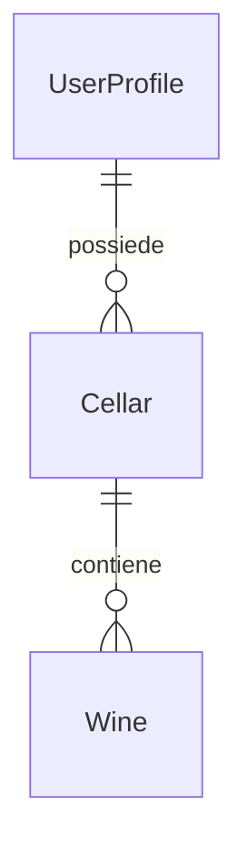

# Functional Spec — u1-skeleton

Fonti: `unit-of-work.md` (U1), `unit-of-work-story-map.md`, `stories.md` (US1.1, US2.1, US9.1, US9.2, US10.1), `requirements.md`, `components.md` (Account, Cellar, Sync), `contract-summary.md` (C3), `rules.md`, risposte in `functional-design-questions.md` (Q1: memoria offline di Firestore).

U1 è il walking skeleton: la versione minima che funziona da capo a fondo. Copre accesso, aggiunta di un vino scritto, elenco semplice, uso offline e sincronizzazione. Non contiene stima, cruscotto, foto, condivisione, presentazione iniziale né cancellazione dell'account (unità successive).

## Storie implementate

| Storia | Parte coperta da U1 |
|--------|---------------------|
| US1.1 | Completa, ma dopo l'accesso si apre la Cantina; il Cruscotto arriva con u5-dashboard |
| US2.1 | Aggiunta scritta con validazioni e quantità; suggerimenti e misura dei 30 secondi in u4-cellar |
| US9.1 | Completa |
| US9.2 | Solo il vincolo del livello dati (incrementi, BR3.4); comandi in u4-cellar, prova con due persone in u7-sharing |
| US10.1 | Completa per le schermate di U1 |

## Workflow

### W1 — Primo accesso (BR1.1, BR1.3)

1. L'utente apre l'app senza sessione → schermata Accesso.
2. Senza rete → messaggio "Serve la connessione per il primo accesso"; fine.
3. Tocca "Continua con Google" → selettore account di Google.
4. Annullato o fallito → "Accesso non riuscito" con "Riprova"; nessun dato creato.
5. Riuscito → controllo dell'utente precedente (BR1.4): se sul telefono restano modifiche in coda di un altro account, l'accesso è bloccato con il messaggio di BR1.4 e si esce; se l'account è diverso e non ci sono modifiche in coda, si cancella la memoria offline.
6. Si crea o si aggiorna il profilo `users/{uid}`; si legge `cellars/{uid}` e, se non esiste, la si crea ("La mia cantina") (BR1.3). Durante questo passo la Cantina mostra un indicatore di caricamento.
7. Creazione o lettura fallita → la Cantina mostra "Impossibile preparare la cantina" con "Riprova"; il pulsante "Aggiungi" è disattivato.
8. Riuscito → si apre la Cantina. Il Cruscotto arriva con u5-dashboard; fino ad allora la Cantina è la prima schermata.

### W2 — Avvio con sessione (BR1.2)

1. L'utente apre l'app con una sessione salvata → apre direttamente la Cantina, con o senza rete.
2. Se al ritorno della rete il cloud segnala la sessione non più valida → torna ad Accesso. Le modifiche non inviate restano sul telefono e ripartono quando accede di nuovo lo stesso account; un account diverso viene bloccato finché sono in coda (BR1.4).

### W3 — Aggiungere un vino scritto (BR2.1–BR2.5, BR3.1)

1. Cantina → tocca "Aggiungi" → si apre Scrivi con nome vuoto, annata vuota, quantità 1; il telefono genera l'ID del vino (BR2.4).
2. L'utente compila; uscendo da un campo, nome e annata si controllano (BR2.1, BR2.2).
3. Tocca "Salva": controllo di tutti i campi; se fallisce, errore sotto il campo e i dati restano.
4. Valido → il pulsante "Salva" si disattiva (niente doppio tocco), il vino viene salvato sul telefono (BR3.1), il modulo si chiude e il vino appare subito nell'elenco con la nota "Stima in arrivo" (la stima arriva con u2/u4).
5. Se c'è rete, l'invio al cloud avviene subito e compare per poco "Sincronizzazione in corso"; senza rete compare "Offline - sincronizzazione in attesa" (BR3.2).

### W4 — Lavorare offline e sincronizzare (BR3.1–BR3.3)

1. Senza rete ogni modifica resta sul telefono; l'indicatore "Offline - sincronizzazione in attesa" è visibile.
2. Chiudendo e riaprendo l'app le modifiche sono ancora presenti (BR3.3).
3. Al ritorno della rete le modifiche partono da sole; quando non ne restano l'indicatore scompare.
4. Se il cloud rifiuta una modifica (errore `permission-denied` della scrittura) → Firestore annulla la modifica sul telefono e l'utente vede "Modifica non consentita".

### W5 — Lingua e tema (BR5.1–BR5.3)

All'avvio e a ogni cambio di impostazioni del telefono l'interfaccia usa la lingua (it, en, pt-BR, altrimenti inglese) e il tema del sistema.

## Stato della sincronizzazione

| Stato | Condizione | Indicatore | Transizione |
|-------|------------|------------|-------------|
| Sincronizzato | nessun documento con `hasPendingWrites` | nascosto | una scrittura → In attesa |
| In attesa, con rete | ≥ 1 documento con `hasPendingWrites`, rete presente | "Sincronizzazione in corso" | invio completato → Sincronizzato; rete persa → In attesa, offline |
| In attesa, offline | ≥ 1 documento con `hasPendingWrites`, nessuna rete | "Offline - sincronizzazione in attesa" | rete tornata → In attesa, con rete |
| Rifiutata | la scrittura termina con `permission-denied` | messaggio "Modifica non consentita" | la modifica viene annullata → Sincronizzato o In attesa |

Segnali: lo stato "in attesa" si ricava dagli snapshot della cantina e dell'elenco dei vini ascoltati con `includeMetadataChanges` (basta un documento con `hasPendingWrites`); la rete dallo stato di connessione del telefono; il rifiuto dall'errore della scrittura.

## Diagramma delle entità (derivato da `components.md` e C3)

<!-- Text fallback: un utente possiede zero o più cantine; ogni cantina contiene zero o più vini. In U1 ogni utente ha una sola cantina personale, con ID uguale al suo uid. -->

## Campi scritti in U1 (da C3)

| Documento | Campi scritti in U1 | Valori iniziali | Lasciati vuoti in U1 |
|-----------|---------------------|-----------------|----------------------|
| `users/{uid}` | displayName, email, onboardingSeen, createdAt, schemaVersion | onboardingSeen = false, schemaVersion = 1 | — |
| `cellars/{uid}` | ownerId, name, createdAt, schemaVersion | ownerId = uid, name = "La mia cantina" tradotto, schemaVersion = 1 | — |
| `cellars/{uid}/wines/{wineId}` | name, vintage, quantity, createdAt, updatedAt, updatedBy | vintage = null se "senza annata", updatedBy = uid | producer, wineType, region, denomination, window, pairings (assenti) |

Sul telefono, fuori da Firestore, si conserva solo `lastUid` (BR1.4).

## Riepilogo delle regole (derivato da `rules.md`)

Accesso Google al primo avvio (BR1.1), sessione offline (BR1.2), cantina personale con ID fisso (BR1.3), modifiche in coda legate all'utente (BR1.4), validazioni di nome, annata e quantità (BR2.1–BR2.3), salvataggio immediato (BR2.4), solo 0,75 L (BR2.5), prima sul telefono poi nel cloud (BR3.1), indicatore offline (BR3.2), durabilità (BR3.3), quantità come incrementi (BR3.4), accesso solo del proprietario (BR4.1), lingua, tema e accessibilità (BR5.1–BR5.3).

## Prova da capo a fondo dello skeleton

Con l'emulatore Firebase: accesso con un utente di prova, modalità senza rete, aggiunta di "Barolo 2016 x2", indicatore visibile, ritorno della rete, il vino è presente nel cloud dell'emulatore e un secondo utente non lo vede.

Caso con la coda già piena: utente A offline aggiunge un vino ed esce; accede l'utente B → accesso bloccato (BR1.4); accede di nuovo A con la rete → il vino arriva nel cloud. Un secondo accesso di A da un altro telefono apre la stessa `cellars/{uid}` senza crearne un'altra (BR1.3).
