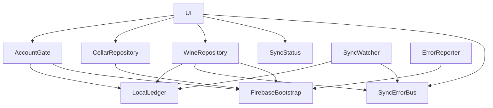

# Logical Components — u1-skeleton

Fonti: `security-design.md`, `performance-design.md`, `tech-stack-decisions.md`, `components.md` (Account, Cellar, Sync), `contract-summary.md` (C3).

## Componenti

| Componente | Cartella | Responsabilità | Dipende da | Area di guasto |
|------------|----------|----------------|------------|----------------|
| `FirebaseBootstrap` | `lib/firebase/` | Inizializza Firebase, App Check, Crashlytics e le impostazioni di Firestore; `configure()` si riusa dopo il reset | SDK Firebase | Avvio: se fallisce, schermata d'errore con "Riprova" |
| `AccountGate` | `lib/account/` | Stato della sessione, controllo del registro a ogni avvio, blocco del cambio di account, signOut | FirebaseAuth, GoogleSignIn, `LocalLedger` | Accesso: non apre dati finché il controllo non passa |
| `LocalLedger` | `lib/sync/ledger/` | Valore unico `ledger.v1` (proprietario, `seq`, `generation`, giornale con `ownerUid` e `state`) modificato solo dalla coda seriale `_mutate` | `shared_preferences` | Dati locali: un errore blocca la scrittura (NFR6.4) |
| `SyncWatcher` | `lib/sync/` | Verifica in background (security-design.md §4): una sola esecuzione alla volta, al massimo 3 ripetizioni immediate | Firestore, `LocalLedger` | Sincronizzazione: un errore di rete viene ritentato al prossimo innesco (avvio, scrittura, rete tornata) |
| `SyncErrorBus` | `lib/sync/` | Flusso unico degli errori di scrittura e delle voci rifiutate | — | Nessuna |
| `SyncStatus` | `lib/sync/` | Calcola sincronizzato, in corso e offline dai metadati | provider degli snapshot | Nessuna |
| `CellarRepository` | `lib/cellar/data/` | `ensurePersonalCellar`, ascolto della cantina | Firestore | Cantina: errore con "Riprova", che riapre anche gli ascolti di cantina e vini |
| `WineRepository` | `lib/cellar/data/` | `create`, `incrementQuantity` (solo dati in U1), ascolto dei vini | Firestore, `LocalLedger`, `SyncErrorBus` | Vini |
| `UserRepository` | `lib/account/data/` | `ensureProfile` | Firestore | Profilo: un errore non blocca la Cantina, si ritenta |
| `ErrorReporter` | `lib/app/` | Sanitizza i messaggi e li invia a Crashlytics | Crashlytics | Nessuna |
| UI (`SignInScreen`, `BlockedAccountScreen`, `CellarScreen`, `AddWineScreen`, `OfflineBanner`, `RejectedWineNotice`) | `lib/account/ui/`, `lib/cellar/ui/`, `lib/sync/ui/` | Schermate di `frontend-components.md` più la schermata di blocco e l'avviso dei vini rifiutati | provider Riverpod | Interfaccia |
| `firestore.rules` | radice del repository | Regole di sicurezza di U1 (§2 di `security-design.md`) | — | Cloud |

## Dipendenze

<!-- Text fallback: l'interfaccia usa AccountGate, i repository della cantina e dei vini, lo stato della sincronizzazione e il flusso degli errori. AccountGate, WineRepository e SyncWatcher usano LocalLedger. WineRepository e SyncWatcher pubblicano sul flusso degli errori. I repository e l'ErrorReporter usano FirebaseBootstrap. -->

## Isolamento

- Solo i repository, `SyncWatcher` e `FirebaseBootstrap` importano gli SDK Firebase. L'interfaccia e `AccountGate` lavorano su interfacce (`AuthService`, `CellarRepository`, ...), sostituibili con `mocktail` nei test dei widget.
- `LocalLedger` sta dietro un'interfaccia `KeyValueStore`, quindi gli unit test non toccano il disco.
- Nessuno stato condiviso fuori da Riverpod e da `LocalLedger`. Il reset passa da un punto solo (`ResetCoordinator`, dentro `AccountGate`): ferma `SyncWatcher`, invalida i provider, incrementa `generation` e solo dopo pulisce Firestore. Il piano B (riavvio manuale con `SystemNavigator.pop`) non richiede pacchetti in più.

## Mappa dei requisiti

| Requisito | Componente |
|-----------|------------|
| NFR4.1, NFR4.9, NFR4.10 | `AccountGate`, `LocalLedger` |
| NFR4.2–NFR4.5 | `firestore.rules` |
| NFR4.6, NFR4.7, NFR8.2 | `FirebaseBootstrap`, `ErrorReporter` |
| NFR4.11 | `CellarRepository`, `UserRepository` |
| NFR6.1 | `FirebaseBootstrap` |
| NFR6.2, NFR6.3 | `SyncErrorBus`, `SyncWatcher`, `LocalLedger` |
| NFR6.4 | `WineRepository`, `AddWineScreen` |
| NFR2.4, NFR5.1 | `SyncStatus`, provider degli snapshot |
