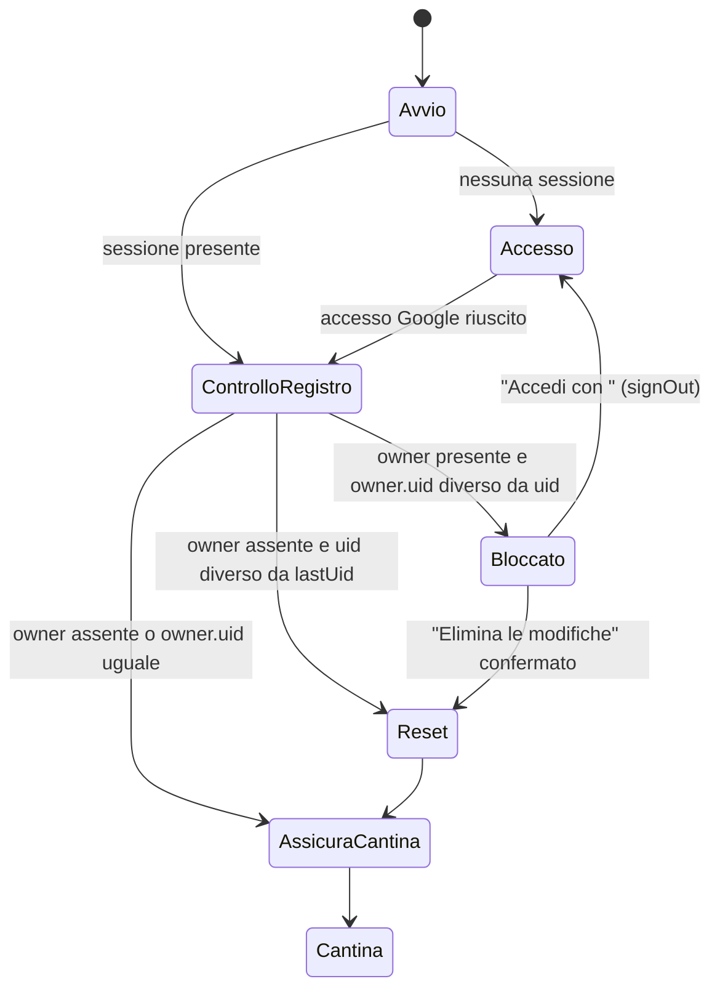

# Security Design — u1-skeleton

Fonti: `security-requirements.md` (NFR4.1–NFR4.11, NFR6.1–NFR6.4, NFR8.1–NFR8.5, NFR5.3, NFR5.4), `tech-stack-decisions.md`, `functional-spec.md` (W1–W5, BR1.3, BR1.4), `contract-summary.md` (C3), revisione 2 delle NFR Requirements (`reviews/review-02.md`), revisione 1 di questo stage (`reviews/review-01.md`), risposte in `nfr-design-questions.md`.

## 1. Accesso e sessione



<!-- Text fallback: all'avvio, senza sessione si va ad Accesso. Con sessione, o dopo l'accesso, si controlla il proprietario del registro. Se è un altro uid l'app è bloccata; da lì si esce con signOut verso Accesso oppure si elimina con conferma (Reset). Se il registro non ha proprietario e l'uid è diverso dall'ultimo, si esegue Reset. Poi si assicura la cantina e si apre la Cantina. -->

- **Controllo a ogni avvio (R-12 della revisione 2).** `AccountGate` controlla il registro sia dopo l'accesso sia a ogni avvio con sessione salvata, *prima* di creare qualsiasi ascoltatore Firestore.
- **Il blocco copre anche i vini rifiutati (R-01 della revisione 1).** `owner` resta nel registro finché esiste una voce del giornale di quell'utente, anche se è `rejected`. Così B non può innescare un Reset automatico che cancella in silenzio i vini rifiutati di A.
- **"Accedi con <email>":** `FirebaseAuth.signOut()` e `GoogleSignIn.signOut()`, poi la schermata Accesso.
- **"Elimina le modifiche":** il dialogo di conferma mostra l'email di A e il *numero* di vini non salvati, mai i nomi. Poi parte il Reset (§4).
- **Solo Google:** l'app ha un solo pulsante e le regole controllano `sign_in_provider == 'google.com'` (NFR4.1).
- **Sessione revocata (W2):** `idTokenChanges()` emette `null`, oppure una scrittura fallisce con `unauthenticated`. In entrambi i casi l'app va ad Accesso senza toccare il registro. Le scritture restano nella coda di Firestore e ripartono quando lo stesso utente rientra.

## 2. Regole di sicurezza (`firestore.rules`)

Il file è unico e condiviso con u7-sharing, che aggiungerà le condizioni per le persone invitate a `canReadCellar` e `canWriteWines`. Questo è lo schema completo di U1; la sintassi definitiva si scrive in Code Generation.

```
function signedIn() { return request.auth != null && request.auth.token.firebase.sign_in_provider == 'google.com'; }
function uid() { return request.auth.uid; }
function onlyChanged(fields) { return request.resource.data.diff(resource.data).affectedKeys().hasOnly(fields); }
function cellarOwner(cellarId) { return get(/databases/$(database)/documents/cellars/$(cellarId)).data.ownerId; }

match /users/{userId} {
  allow get: if signedIn() && userId == uid();
  allow create: if signedIn() && userId == uid() && validUserCreate();
  allow update: if signedIn() && userId == uid() && onlyChanged(['displayName','email','onboardingSeen']);
  allow list, delete: if false;
}
match /cellars/{cellarId} {
  allow get: if signedIn() && (cellarId == uid() || resource.data.ownerId == uid());
  allow list: if signedIn() && resource.data.ownerId == uid();
  allow create: if signedIn() && cellarId == uid() && validCellarCreate();
  allow update: if signedIn() && resource.data.ownerId == uid() && onlyChanged(['name']) && validName();
  allow delete: if false;
  match /wines/{wineId} {
    allow read: if signedIn() && cellarOwner(cellarId) == uid();
    allow create: if signedIn() && cellarOwner(cellarId) == uid() && validWineCreate();
    allow update: if signedIn() && cellarOwner(cellarId) == uid() && validWineUpdate();
    allow delete: if false; // U1 has no delete; u4-cellar opens it
  }
}
```

| Funzione | Contenuto | Requisito |
|----------|-----------|-----------|
| `validUserCreate()` | `keys().hasOnly(['displayName','email','onboardingSeen','createdAt','schemaVersion'])`; `createdAt == request.time`; `schemaVersion == 1`; `onboardingSeen == false` | NFR4.2 |
| `validCellarCreate()` | `keys().hasOnly(['ownerId','name','createdAt','schemaVersion'])`; `ownerId == uid()`; `createdAt == request.time`; `schemaVersion == 1`; `validName()` | NFR4.3 |
| `validName()` | `name is string && name.size() >= 1 && name.size() <= 60` | NFR4.3 |
| `validWineCreate()` | Solo i campi di C3; `name` di 1–120 caratteri; `vintage == null` oppure intero tra 1900 e `request.time.year() + 1`; `quantity` intero tra 1 e 99; `updatedBy == uid()`; `createdAt == request.time && updatedAt == request.time` | NFR4.5 |
| `validWineUpdate()` | Solo i campi di C3; `createdAt` invariato; `updatedBy == uid()`; `updatedAt == request.time`; `quantity is int` senza minimo (ADR-004); `name` e `vintage`, se cambiano, con i limiti della creazione | NFR4.5 |

- `allow get` su `cellars` usa il corto circuito: per il proprietario `cellarId == uid()` è vero anche se il documento non esiste.
- L'aggiornamento della cantina legge `resource.data.ownerId` senza `get()`.
- Il costo di `cellarOwner()` è una lettura per ogni lettura o scrittura di vini, già compreso in NFR5.2.

## 3. Registro locale (`LocalLedger`)

**Formato.** Un solo valore JSON `ledger.v1` in `shared_preferences`:

```
{ "lastUid": "...", "generation": 3,
  "owner": { "uid": "...", "email": "...", "seq": 17 } | null,
  "journal": [ { "wineId": "...", "cellarId": "...", "name": "...",
                 "ownerUid": "...", "state": "open" | "rejected", "notices": 0 } ] }
```

Il giornale contiene solo ID, nome, proprietario e stato, come NFR8.1. "Aggiungi di nuovo" riapre il modulo con il solo nome già compilato.

**Serializzazione (R-02 della revisione 1).** Ogni lettura-modifica-scrittura passa da un'unica coda seriale, `LocalLedger._mutate(fn)`, una catena di Future in un solo isolate. I chiamanti sono `beginWrite`, i callback delle scritture, `SyncWatcher` e l'interfaccia (avvisi e scelte); nessuno scrive il valore direttamente. Un test unitario lancia mutazioni concorrenti e verifica che nessuna vada persa.

**Operazioni:**

| Operazione | Effetto |
|------------|---------|
| `beginWrite(uid, email, entry?)` | Imposta `owner` (se manca) e incrementa `owner.seq`; aggiunge la voce `open` per le creazioni. La scrittura su Firestore parte solo dopo il completamento. |
| `markConfirmed(wineId)` | Rimuove la voce |
| `markRejected(wineId)` | Imposta `state = rejected` |
| `noticeShown(wineId)` | `notices += 1`; a 3 rimuove la voce |
| `dismiss(wineId)` | Rimuove la voce ("Ignora" o "Aggiungi di nuovo") |
| `tryReleaseOwner(seqAtStart, uid)` | Cancella `owner` solo se `owner.seq == seqAtStart`, `owner.uid == uid` e non ci sono voci con `ownerUid == uid` |
| `reset(newUid)` | Svuota `owner` e `journal`, imposta `lastUid = newUid`, incrementa `generation` |

**Esito delle scritture.** Il Future di `set()` è agganciato con la `generation` corrente; un callback di una generazione precedente viene ignorato.

| Esito del Future | Azione |
|------------------|--------|
| Successo | `markConfirmed` |
| `permission-denied`, `invalid-argument`, `failed-precondition` | `markRejected` ed evento su `SyncErrorBus` (rifiuto del server) |
| `unauthenticated` | Nessun cambio alla voce: la scrittura resta in coda. Si va ad Accesso (R-06 della revisione 1). |
| Altri codici (`unknown`, `internal`, `resource-exhausted`) | Voce lasciata `open`, messaggio "Impossibile salvare, riprova", `ErrorReporter`. Sarà `SyncWatcher` a verificarla. |

## 4. Verifica in background (`SyncWatcher`, R-03 della revisione 1)

- **Inneschi:** avvio dopo `AccountGate`; ogni scrittura; passaggio di `isFromCache` da `true` a `false` sugli snapshot (rete tornata).
- **Una sola esecuzione alla volta:** se ne è già in corso una, si segna "da ripetere" e non se ne avvia una seconda.

**Passi:**

1. `seq0 = owner.seq`, poi `await waitForPendingWrites()`.
2. Per ogni voce `open` dell'utente corrente: `get(GetOptions(source: Source.server))` del vino.

   | Esito della lettura | Azione |
   |---------------------|--------|
   | Il documento esiste | `markConfirmed` |
   | Il documento non esiste | `markRejected`, perché la coda è vuota e la scrittura non è arrivata |
   | `permission-denied` | `markRejected` |
   | `unavailable` o timeout di 10 s | Interrompe questa esecuzione senza cambiare la voce; riprova al prossimo innesco |
   | Altro errore | `ErrorReporter`; la voce resta `open`; riprova al prossimo innesco |

3. `tryReleaseOwner(seq0, uid)`.
4. Se il rilascio non è avvenuto perché `seq` è cambiato, si ripete subito, al massimo 3 volte di seguito. Poi si aspetta il prossimo innesco. Non ci sono cicli stretti.

**Avvisi.** Le voci `rejected` dell'utente corrente producono l'avviso "Il vino <nome> non è stato salvato nel cloud", con "Aggiungi di nuovo" e "Ignora". Ogni volta che l'avviso viene mostrato si chiama `noticeShown`.

## 5. Reset dei dati locali (NFR4.10)

1. Dialogo di conferma, con il conteggio dei vini non salvati.
2. `ResetCoordinator` ferma `SyncWatcher` e invalida i provider Riverpod (`cellarStreamProvider`, `winesStreamProvider`, `syncStatusProvider`).
3. `LocalLedger.reset(newUid)`. La `generation` incrementata fa ignorare i callback delle scritture ancora pendenti.
4. `FirebaseFirestore.instance.terminate()`, poi `clearPersistence()`, poi `FirestoreBootstrap.configure()`.

**Prova obbligatoria all'inizio della generazione del codice.** Un test d'integrazione esegue il passo 4 e poi una lettura. Se FlutterFire non permette di riusare l'istanza, si applica il piano B senza pacchetti in più:

- si salva `ledger.resetPending = true` *prima* del passo 3;
- l'app mostra "Riavvia l'app per completare" con un pulsante che chiama `SystemNavigator.pop()`;
- al riavvio, `FirestoreBootstrap` esegue `clearPersistence()` prima di qualsiasi uso di Firestore, poi completa il reset.

Se `clearPersistence()` fallisce, l'app resta Bloccata con "Riprova".

## 6. Cantina personale (NFR4.11)

- **`ensurePersonalCellar(uid)`:**
  - **Operazione:** `runTransaction` che legge `cellars/{uid}` e, se il documento non esiste, lo crea con `serverTimestamp`. Ha al massimo 3 tentativi con attesa crescente.
  - **In caso di errore** (anche un errore degli ascolti di cantina o vini): `CellarScreen` mostra "Impossibile preparare la cantina" con "Riprova" e il pulsante Aggiungi disattivato. "Riprova" rifà prima `ensurePersonalCellar` e solo dopo invalida i provider degli ascolti di cantina e vini, che si riaprono; non serve riavviare l'app.
  - **Senza rete all'avvio:** si usa la cantina della cache. Se la cache non la contiene, compare lo stesso errore.
- **`ensureProfile()`:** con una transazione, crea il profilo se manca, altrimenti lo aggiorna con `update({displayName, email})`.

## 7. App Check, avvio, segreti e privacy

| Tema | Design | Requisito |
|------|--------|-----------|
| Ordine di avvio | `Firebase.initializeApp()`, poi `FirebaseAppCheck.activate(...)`. Solo dopo, in parallelo, configurazione di Crashlytics e lettura del registro. Nessuna chiamata ad Auth o Firestore prima di App Check (R-08 della revisione 1). | NFR4.6 |
| App Check | `playIntegrity` nelle build release, `debug` nelle build debug su un telefono reale; non si attiva con l'emulatore. Diventa obbligatorio con il 99% di richieste verificate per 7 giorni. | NFR4.6 |
| Configurazione | `lib/firebase/options_demo.dart` (`demo-vinoozy`) nel repository; `config/firebase_prod.json` (valori passati con `--dart-define-from-file`, mai committato) e `google-services.json` scritti dal job di build a partire dai segreti; scelta con `--dart-define=FIREBASE_ENV=prod\|demo`. L'import condizionale con una variabile propria è stato scartato: Flutter non lo supporta (prova sul telefono, 2026-11-05). Con `FIREBASE_ENV=prod` e valori mancanti l'avvio fallisce subito (`MissingProductionOptionsError`, schermata d'errore), senza mai ripiegare sulla configurazione demo. | NFR4.7 |
| Manifest | `usesCleartextTraffic=false`; `10.0.2.2` consentito solo nella variante debug; `allowBackup=false`. | NFR4.8, NFR8.4 |
| Crashlytics | Attivo solo in release; nessun `setUserIdentifier`; `ErrorReporter.sanitize()` toglie uid, email, percorsi `cellars/...` e nomi di vini prima di `recordError`. | NFR8.2 |
| Data Safety | Checklist di rilascio con la tabella copiata da NFR8.1–NFR8.3. | NFR8.3 |
| Budget | Avviso di fatturazione a 1 € sul progetto Blaze, attivo prima della prima pubblicazione (fino ad allora il progetto è su Spark, senza spesa possibile); rischio di spesa accettato. | NFR5.3, NFR5.4 |

## 8. Errori ai confini

| Confine | Errore | Comportamento |
|---------|--------|---------------|
| Accesso Google | Annullato o di rete | "Accesso non riuscito" con "Riprova" (recuperabile) |
| Transazione della cantina | `unavailable` o `aborted` | 3 tentativi con attesa crescente, poi errore con "Riprova" |
| Scrittura di un vino | Codici di rifiuto del server | `markRejected` e avviso (§3) |
| Scrittura di un vino | `unauthenticated` | Accesso; la scrittura resta in coda |
| Verifica sul server | `unavailable` o timeout | Riprova al prossimo innesco (§4) |
| `shared_preferences` | Eccezione in `beginWrite` | La scrittura su Firestore non parte; "Impossibile salvare, riprova" (NFR6.4) |
| `clearPersistence()` | Errore | Stato Bloccato con "Riprova" |
| Ascolto della cantina o dei vini | `permission-denied` o altro errore dello stream | Stato "Impossibile preparare la cantina" con "Riprova" (recuperabile; riapre gli ascolti) |

Nessun errore viene ignorato: ogni ramo mostra un messaggio o lo registra con `ErrorReporter`.
