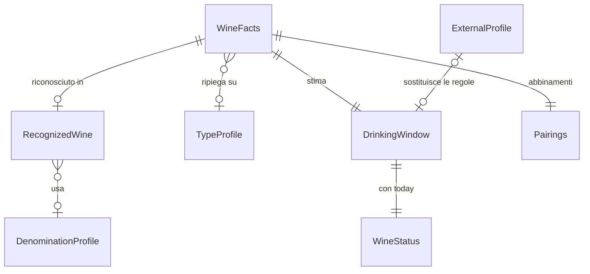

# Functional Specification — u2-estimation

U2 è la libreria pura della stima (pacchetto Dart senza Flutter né Firebase, `unit-of-work.md`). Implementa il contratto C2 v1 di `contract-summary.md`, con le aggiunte compatibili descritte in `entities.md`. Copre, per la parte di calcolo, le storie US4.1, US4.2 e US7.1 di `stories.md`; la visualizzazione nel dettaglio e nel cruscotto è di U4 e U5.

Sorgenti di verità: `entities.md` (forma dei dati), `rules.md` (regole e tabelle). Questo file è la sorgente di verità per i flussi.

## Funzioni (C2 v1)

| Funzione | Ingresso | Uscita | Regole |
|---|---|---|---|
| `estimateWindow` | `WineFacts`, `ExternalProfile?` | `DrinkingWindow` | BR1.1–BR1.4, BR1.6, BR1.7, BR2.1, BR2.2, BR3.1, BR4.5 |
| `statusOf` | `DrinkingWindow`, `today` | `WineStatus` | BR3.2, BR3.3 |
| `pairingsFor` | `WineFacts`, `ExternalProfile?` | `Pairings` | BR1.1, BR1.2, BR1.7, BR4.1, BR4.2, BR4.5 |
| `needsRefinement` | `DrinkingWindow` | bool | BR1.5 |

Nessuna funzione legge l'orologio (BR4.4). `statusOf` riceve `today` come data di calendario locale senza ora. `estimateWindow` non ha bisogno di `today`: senza annata usa `WineFacts.referenceYear`, l'anno in cui il vino è entrato in cantina (`createdAt` di C3), obbligatorio in quel caso (BR1.3, BR4.5). Così ricalcolare una stima con gli stessi dati dà sempre lo stesso risultato.

## W1 — Stima della finestra (`estimateWindow`)

0. Si controllano gli ingressi (BR4.5): nome vuoto, annata fuori da 1900–2200, oppure annata e anno di riferimento entrambi assenti danno un errore di argomento.
1. Se c'è un `ExternalProfile` con una finestra valida (BR1.6), la finestra è quella della base dati: `source = catalog`, `basis = catalog`. La fiducia è quella data da C1, alta se C1 non la indica, e al massimo bassa se il profilo è stato chiesto senza annata (BR1.4, BR3.1). Fine.
2. Si risolve il vino (BR1.2, BR1.7, BR1.1), in quest'ordine:
   - la denominazione indicata dall'utente;
   - altrimenti, se l'utente ha indicato la tipologia, la denominazione ricavata dal nome solo se ha la stessa tipologia: se è diversa il riconoscimento si scarta e vale la tipologia indicata;
   - altrimenti la denominazione e la tipologia di C1, quando ci sono;
   - altrimenti quelle ricavate dal nome, per parole intere (vince l'alias con più parole), con la qualifica (Riserva, Superiore, Gran Selezione) trovata nel nome.
3. Si sceglie l'anno base: l'annata se presente, altrimenti l'anno di riferimento (BR1.3).
4. Se la denominazione è nota, gli scostamenti vengono dalla sua riga, o dalla qualifica se ne ha di propri (BR2.1, `basis = denomination`).
5. Altrimenti si usa la riga della tipologia nota (`basis = wineType`), o la riga generica se la tipologia è sconosciuta (`basis = generic`) (BR2.2).
6. Inizio, picco e fine sono anno base più gli scostamenti; `source = internalRules`.
7. La fiducia segue BR3.1.

Esempi (con `today` nel 2026):

| Ingresso | Finestra | Fiducia | Base |
|---|---|---|---|
| "Barolo 2016" | 2024 / 2031 / 2046 | medium | denomination |
| "Barolo Riserva 2016" | 2026 / 2034 / 2051 | medium | denomination |
| "Barbera d'Asti Superiore DOCG", senza annata, entrato nel 2026 | 2028 / 2031 / 2037 (base 2025) | low | denomination |
| "Rosso della casa 2023", tipologia indicata redLight | 2024 / 2025 / 2027 | low | wineType |
| "Vino di Mario 2022", tipologia sconosciuta | 2023 / 2025 / 2028 | low | generic (avviso) |

## W2 — Stato (`statusOf`)

1. Se `today` è prima del 1° gennaio di `startYear`, lo stato è `waiting`.
2. Se `today` è dopo il 31 dicembre di `endYear`, lo stato è `pastWindow`.
3. Altrimenti si calcolano la durata in mesi, il preavviso (25%, limitato tra 3 e 12) e i mesi mancanti di calendario dal primo giorno del mese di `today` al 1° gennaio dopo `endYear` (BR3.3). Per esempio il 1° gennaio dell'ultimo anno mancano 12 mesi, il 1° settembre 4. Lo stato è `drinkSoon` se i mesi mancanti sono pari o inferiori al preavviso, altrimenti `ready`.

Esempi di controllo:

- AC4.2.1: finestra di 15 anni, 11 mesi mancanti. Il preavviso è 12 mesi, quindi lo stato è `drinkSoon`.
- AC4.2.2: finestra di 1 anno, 4 mesi mancanti. Il preavviso è 3 mesi, quindi lo stato è `ready`.

## W3 — Abbinamenti (`pairingsFor`)

1. Se il profilo esterno ha abbinamenti, si restituiscono i primi 5 come testi in `items`, con `categoryKeys` vuota e `source = catalog` (BR4.2).
2. Altrimenti si risolve il vino come in W1, passi 0–5, e si restituiscono in `categoryKeys` le categorie della denominazione o della tipologia, da 3 a 5, con `items` vuota e `source = internalRules` (BR4.1).
3. Le chiavi delle categorie sono stabili. La traduzione in it, en e pt-BR è nei file di localizzazione dell'app (U4), non in U2. `items` mantiene il significato di C2 v1 (testo leggibile), quindi un'app che non conosce `categoryKeys` non mostra mai una chiave grezza.

## W4 — Ricalcolo e avviso

- **Ricalcolo:** `needsRefinement` è vero per ogni stima interna (BR1.5). Alla prima connessione U4 chiede il profilo a U3 e richiama `estimateWindow`.
- **Avviso:** con `basis = generic` (codice `GENERIC_ESTIMATE`), U4 mostra l'avviso "stima non precisa: manca la tipologia" e permette di indicare la tipologia a mano. La nuova tipologia arriva come `WineFacts.wineType` e ha precedenza su tutto ciò che è ricavato dal nome (BR1.2, BR4.3). U2 non contiene testi dell'interfaccia.
- **Dati salvati senza `basis`:** chi legge una finestra salvata senza `basis` la tratta come `catalog` se `source = catalog`, altrimenti come `wineType`, cioè senza avviso.

## Casi limite

- **Annata nel futuro** (anno corrente + 1, consentito da C3): la finestra è calcolata normalmente e lo stato è `waiting`.
- **Annata molto vecchia** (per esempio 1950): la finestra può essere già finita, quindi lo stato è `pastWindow`. Non è un errore.
- **Nome con più denominazioni** (per esempio "Barbera d'Asti o Barolo"): vince l'alias con più parole. A parità vince il primo nel nome.
- **Parola che contiene un alias** (per esempio "Castiglione", che contiene "asti"): non è un riconoscimento, perché il confronto è per parole intere.
- **Tipologia inserita a mano diversa da quella riconosciuta** (per esempio "Barolo bianco della casa", con tipologia indicata `white`): la denominazione Barolo viene scartata e si usa la tabella dei bianchi.
- **Ingressi non validi** (nome vuoto, annata fuori dai limiti, né annata né anno di riferimento): errore di argomento a U4, che non salva la stima (BR4.5).
- **Profilo esterno con anni invertiti** (`startYear` maggiore di `endYear`): il profilo viene ignorato e si usano le regole interne (BR1.6).
- **Ultimo mese della finestra** (dicembre di `endYear`): i mesi mancanti sono 1 e lo stato è `drinkSoon`, perché il preavviso è sempre almeno 3.
- **Qualifica senza scostamenti propri** (per esempio "Barolo Superiore"): la qualifica viene ignorata per gli anni e si usa la riga base della denominazione; `qualifier` non viene impostato.

## Diagramma delle entità (derivato da `entities.md`)

Testo equivalente: `WineFacts` viene riconosciuto (`RecognizedWine`) usando le `DenominationProfile`, oppure ricade su `TypeProfile`. Da questo nascono `DrinkingWindow` e `Pairings`. Un `ExternalProfile` valido sostituisce le regole interne. `DrinkingWindow`, insieme a `today`, dà `WineStatus`.

## Riepilogo delle regole (derivato da `rules.md`)

| Gruppo | Regole |
|---|---|
| Riconoscimento e precedenze | BR1.1, BR1.2, BR1.3, BR1.4, BR1.5, BR1.6, BR1.7 |
| Calcolo della finestra | BR2.1, BR2.2 |
| Fiducia e stato | BR3.1, BR3.2, BR3.3 |
| Abbinamenti, avviso, purezza e ingressi | BR4.1, BR4.2, BR4.3, BR4.4, BR4.5 |

## Fuori da U2

- **U4:** visualizzazione della finestra, della fiducia, della fonte, dell'avviso e del campo tipologia; ricalcolo alla prima connessione.
- **U3:** base dati esterna.
- **U5:** grafici del cruscotto.
