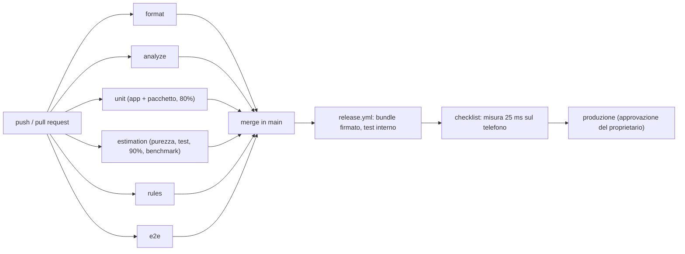

# CI/CD Pipeline — u2-estimation

Fonti: `security-design.md` §1, §3, §5 e `logical-components.md` (NFR Design di U2), `tech-stack-decisions.md` (NFR7.1–NFR7.5), `components.md`, `functional-spec.md` di u2 (le quattro funzioni e i casi limite che i test coprono), `contract-summary.md` (C2), workflow `ci.yml` e `release.yml` di U1, riepilogo confermato in `infrastructure-design-questions.md`. Per una libreria non esiste un `performance-design.md` separato: le soglie di velocità usate qui sono quelle della sezione Prestazioni di `logical-components.md`.

U2 è il pacchetto Dart `packages/estimation`, usato dall'app con una dipendenza `path`. Non ha server, risorse cloud, ambienti o rilasci propri: viaggia dentro il bundle dell'app. La pipeline di U2 è quindi solo un insieme di controlli aggiunti alla CI condivisa di U1; il rilascio resta quello di `release.yml`.

## 1. Controlli in CI (`ci.yml`)

Nuovo job `estimation`, in parallelo ai job esistenti (`format`, `analyze`, `unit`, `rules`, `e2e`), su `ubuntu-latest`, con `timeout-minutes: 10`. Usa la stessa azione Flutter dei job esistenti (`flutter-version-file: .flutter-version`), così la versione di Dart è la stessa dell'app. Non servono emulatori, Node né segreti.

Passi, in ordine, tutti con `working-directory: packages/estimation`:

| # | Passo | Comando | Requisito | Blocca il merge se |
|---|---|---|---|---|
| 1 | Dipendenze | `dart pub get` | — | la risoluzione fallisce |
| 2 | Formattazione | `dart format --output=none --set-exit-if-changed .` | NFR7.4 | un file non è formattato |
| 3 | Analisi | `dart analyze --fatal-infos` | NFR7.4 | qualsiasi segnalazione |
| 4 | Purezza | `../../tool/check_estimation_purity.sh` | NFR4.1, NFR4.4, NFR2.2 | dipendenze, import, parole vietate, stato globale o costruzioni dell'indice fuori posto (`security-design.md` §1, §3) |
| 5 | Test | `dart test --coverage=coverage` | NFR7.2, NFR7.3, NFR4.2, NFR4.3, NFR4.4, NFR8.1 | un test fallisce |
| 6 | Copertura | `dart run coverage:format_coverage --lcov --in=coverage --out=coverage/lcov.info --report-on=lib` poi `../../tool/check_coverage.sh 90 coverage/lcov.info` | NFR7.1 | copertura delle righe di `lib/` sotto il 90%, `tables.dart` compreso |
| 7 | Benchmark | `dart run benchmark/estimation_benchmark.dart` | NFR2.1 (a), NFR2.2, NFR2.3, NFR7.5 | una soglia di `logical-components.md` superata (`exit(1)`) |
| 8 | Artefatto | `actions/upload-artifact` di `coverage/lcov.info` come `estimation-coverage`, conservato 14 giorni come quello dell'app | — | — |

Il job usa le stesse azioni già fissate per hash di commit in `ci.yml`; non si aggiungono azioni nuove.

**Spostamento dichiarato rispetto agli NFR:** `tech-stack-decisions.md` (NFR7.1, NFR7.5) metteva copertura, benchmark e purezza in passi del job `unit`. Qui stanno in un job `estimation` separato, che gira in parallelo e non richiede Flutter per i test. Il controllo è lo stesso e resta obbligatorio per il merge; cambia solo il job che lo esegue.

**File di `lib/` non caricati dai test:** come `tool/gen_coverage_helper.dart` fa per l'app, il pacchetto ha un test `test/coverage_helper_test.dart` che importa ogni file di `lib/`, così un file senza test conta come 0% invece di sparire dal calcolo. Un test controlla che l'elenco degli import coincida con i file presenti in `lib/`.

**Benchmark su runner condiviso:** le soglie sono strette e il runner può avere rallentamenti occasionali. Regola: se una misura supera la soglia, lo script la ripete una volta da capo (3 giri di riscaldamento e 10 misurati). Fallisce solo se supera la soglia anche la seconda volta. La soglia non si alza mai per far passare il job; se fallisce due volte di seguito in giorni diversi, si analizza il codice.

**File ignorati:** `packages/estimation/coverage/` e `packages/estimation/.dart_tool/` si aggiungono a `.gitignore`.

**Regola di protezione di `main`:** il job `estimation` si aggiunge ai controlli obbligatori del ramo `main` su GitHub, come gli altri job. Un controllo rosso non si aggira e la soglia non si abbassa (team.md, Testing Posture).

## 2. Effetti sui job esistenti

- **`format`:** gira dalla radice con `dart format .` e include già `packages/estimation`. Non servono le dipendenze del pacchetto per formattare, quindi il job non cambia.
- **`analyze`:** gira dalla radice con `flutter analyze` dopo il solo `flutter pub get` dell'app, che non risolve le dipendenze di sviluppo del pacchetto (`test`, `benchmark_harness`, `coverage`). Per non rompere il job, `analysis_options.yaml` della radice aggiunge `packages/**` agli `exclude`; il pacchetto viene analizzato solo dal job `estimation` con il suo `analysis_options.yaml` (`lints/recommended`).
- **`e2e`:** esegue `flutter test integration_test`, che raccoglie ogni test della cartella. Per questo la misura sul telefono del §5 non sta in `integration_test/` ma in una cartella separata, `integration_test_perf/`, che il job `e2e` non legge.
- **Commento in testa a `ci.yml`:** "All five check jobs" diventa "All six check jobs", e il nuovo job si aggiunge ai controlli obbligatori di `main`.

## 3. Copertura di progetto (80%, senza esclusioni)

Il job `unit` dell'app oggi controlla l'80% su `coverage/lcov.info`. Con U2 diventa:

1. `flutter test --coverage` dell'app, come oggi.
2. Nel pacchetto: `dart pub get`, `dart test --coverage=coverage`, `format_coverage` come al passo 6.
3. Unione con `cat coverage/lcov.info packages/estimation/coverage/lcov.info > coverage/merged.lcov.info`. `check_coverage.sh` somma solo le righe `LF`/`LH` di tutti i file, quindi la concatenazione basta e i percorsi non vanno riscritti.
4. `tool/check_coverage.sh 80 coverage/merged.lcov.info`.

I test del pacchetto girano quindi due volte, nel job `estimation` e nel job `unit`. Durano pochi secondi, ed è più semplice che far dipendere `unit` da `estimation` e passare l'artefatto, cosa che renderebbe la CI sequenziale.

## 4. Rilascio (`release.yml`)

- Nessun cambiamento. `flutter build appbundle` risolve la dipendenza `path` e compila il pacchetto dentro l'app; il bundle firmato va sul canale di test interno di Google Play come oggi.
- Una correzione delle tabelle enologiche è una normale modifica di codice: passa dalla CI, entra in `main` con uno squash merge ed esce con la versione successiva dell'app (Q1 delle NFR Requirements).
- **Rollback:** come per l'app (team.md, Deployment). Si ferma il rilascio graduale e si pubblica una versione con la correzione. U2 non ha dati salvati da riportare indietro: le stime salvate da U4 si ricalcolano alla prima connessione (`needsRefinement`).

## 5. Prima della produzione

Alla checklist dello smoke test (`docs/release-checklist.md`) si aggiunge una riga, eseguita dal proprietario sul suo telefono prima di approvare la produzione:

- `flutter drive --profile --driver=test_driver/perf_driver.dart --target=integration_test_perf/estimation_perf_test.dart`: la mediana stampata deve essere ≤ 25 ms (NFR2.1 b). Il valore si annota nella checklist con la versione.
- **Perché `--profile` e non `--release`:** NFR2.1 (b) chiede la build release perché la debug è molto più lenta. `flutter drive` ha bisogno di un canale di collegamento con il test, che la modalità release toglie. La modalità profile compila il codice nello stesso modo della release (compilazione anticipata, senza strumenti di debug), quindi la misura è equivalente.
- **File da produrre in Code Generation:** `integration_test_perf/estimation_perf_test.dart` (500 vini sintetici, 3 giri di riscaldamento, mediana di 10, stampa del risultato), `test_driver/perf_driver.dart` (driver standard di `integration_test`) e la riga nuova in `docs/release-checklist.md`.

Se la misura supera la soglia, la versione non si promuove in produzione.

## 6. Segreti e costi

- Nessun segreto: il job `estimation` non legge alcun segreto di GitHub Actions.
- Nessuna risorsa Firebase o cloud.
- Costo: pochi minuti in più di GitHub Actions per ogni push, dentro il piano gratuito del repository pubblico. Il budget di 0 €/mese non cambia.

## 7. Diagramma

Testo equivalente: a ogni push girano in parallelo i sei job, compreso il nuovo `estimation`. Solo con tutti verdi si fa il merge in `main`. Il merge avvia `release.yml`, che pubblica sul test interno. Prima della produzione il proprietario misura la velocità sul telefono e poi approva.
