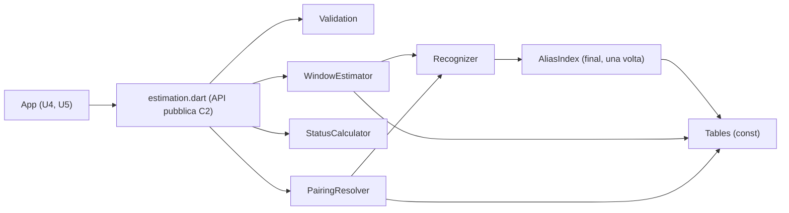

# Logical Components — u2-estimation

Fonti: `performance-requirements.md` (NFR2.1–NFR2.3), `security-requirements.md` (NFR4.1–NFR4.4, NFR8.1), `tech-stack-decisions.md` (NFR7.1–NFR7.5), `functional-spec.md` (W1–W4), `contract-summary.md` (C2), riepilogo confermato in `nfr-design-questions.md`.

U2 è un unico pacchetto Dart (`packages/estimation`), usato dall'app tramite una dipendenza `path`. Non ha servizi, processi o risorse cloud: i componenti sotto sono moduli interni del pacchetto. Il dominio di guasto è uno solo, il processo dell'app: un errore in U2 arriva a U4 come `EstimationArgumentError` e non può lasciare stato sporco, perché U2 non ne ha.

## Componenti

Testo equivalente: l'app chiama solo `estimation.dart`. L'API passa prima da Validation, poi da WindowEstimator, StatusCalculator o PairingResolver. WindowEstimator e PairingResolver usano Recognizer, che legge l'AliasIndex, costruito una volta dalle Tables costanti.

| Componente | File | Responsabilità | NFR |
|---|---|---|---|
| API pubblica | `lib/estimation.dart` | Esporta le 4 funzioni di C2, i tipi e `EstimationArgumentError`; nient'altro (`src/` non è esportato) | C2, NFR4.1 |
| Models | `lib/src/models.dart` | Tipi immutabili con uguaglianza per valore | NFR4.4, NFR8.1 |
| Validation | `lib/src/validation.dart` | Controlli di ingresso e codici d'errore per `estimateWindow`, `pairingsFor` e `statusOf`; `needsRefinement` non lancia mai | NFR4.2 |
| Recognizer | `lib/src/recognizer.dart` | Normalizzazione del nome e ricerca per parole intere (BR1.1) | NFR2.3 |
| AliasIndex | `lib/src/recognizer.dart` (`final aliasIndex = buildAliasIndex();`) | Mappa parola iniziale → alias candidati, unica struttura costruita a runtime, una sola volta | NFR2.2, NFR2.3 |
| WindowEstimator | `lib/src/window.dart` | W1 (BR1.2–BR1.7, BR2.x, BR3.1) | NFR2.1 |
| StatusCalculator | `lib/src/status.dart` | W2 (BR3.2, BR3.3), aritmetica intera sui mesi | NFR2.1 |
| PairingResolver | `lib/src/pairings.dart` | W3 (BR4.1, BR4.2) | NFR2.1, NFR4.3 |
| Tables | `lib/src/tables.dart` | 48 denominazioni, tipologie e riga generica come `const` | NFR2.2, NFR7.2 |
| Strumenti | `tool/check_estimation_purity.sh`, `tool/check_coverage.sh`, `benchmark/estimation_benchmark.dart` | Gate in CI | NFR4.1, NFR4.4, NFR7.1, NFR7.5 |

## Prestazioni (NFR2.1–NFR2.3)

- **Riconoscimento:** il nome normalizzato si divide in parole una volta; per ogni posizione si cercano nell'AliasIndex solo gli alias che iniziano con quella parola, poi si confrontano le parole successive. Costo proporzionale al numero di parole del nome, non al numero di alias.
- **Nessuna allocazione evitabile:** le categorie di abbinamento delle tabelle sono restituite come le liste `const` stesse, non copiate; solo i primi 5 abbinamenti di C1 diventano una nuova lista non modificabile. StatusCalculator lavora con interi (anni e mesi), senza `DateTime` intermedi oltre a `today`.
- **Budget in CI (runner `ubuntu-latest`, mediana di 10 giri dopo 3 di riscaldamento, 500 vini sintetici):**

| Misura | Soglia | Origine |
|---|---|---|
| Riconoscimento di 500 nomi da 60 caratteri, misurato da solo chiamando la funzione interna `recognize()` (importata da `src/` nel benchmark) | ≤ 4 ms | NFR2.3 (stretta qui, punto minore della revisione) |
| Stima + stato + abbinamenti di 500 vini, riconoscimento compreso | ≤ 10 ms | NFR2.1 (a) |
| Secondo blocco di 500 stime rispetto al primo | ≤ +10% | NFR2.2 |
| Una stima singola rispetto a una costruzione di `buildAliasIndex()` | ≤ 1/10 | NFR2.2 (scopre un indice ricostruito a ogni chiamata) |

Il benchmark (`benchmark/estimation_benchmark.dart`, con `package:benchmark_harness`) esegue le misure in quest'ordine, stampa una riga per misura e termina con `exit(1)` alla prima soglia superata, così il passo della CI fallisce.

- **Sul telefono:** la misura la fa il proprietario, una volta per versione, prima di approvare la produzione. Si avvia con `flutter drive --profile --driver=test_driver/perf_driver.dart --target=integration_test/estimation_perf_test.dart` sul telefono collegato: il test chiama le 4 funzioni su 500 vini sintetici e stampa la mediana di 10 giri. Soglia ≤ 25 ms (NFR2.1 b). Il risultato si annota nella checklist dello smoke test (`docs/release-checklist.md`).
- **Costruzione una sola volta:** le tabelle sono `const` e non si costruiscono mai a runtime. Per l'indice degli alias valgono due controlli: lo script di purezza ammette `buildAliasIndex(` solo nella definizione e nell'inizializzazione del `final` di primo livello, e il benchmark confronta il costo di una stima con quello della costruzione dell'indice (`security-design.md` §3).

## Isolamento e impatto di un guasto

| Guasto | Impatto | Contenimento |
|---|---|---|
| Ingresso non valido | La singola stima non viene salvata da U4 | Errore di argomento con codice; nessuno stato modificato |
| Bug in una riga di tabella | Finestre sbagliate per una denominazione | Test generati per ogni riga; correzione con un aggiornamento dell'app (Q1 delle NFR Requirements) |
| Regressione di velocità | Cruscotto più lento | Benchmark in CI blocca il merge |

## Risorse condivise

- **CI:** job `unit` del workflow `ci.yml` di U1. U2 aggiunge i passi elencati in `security-design.md` §5.
- **SDK:** stessa versione di Dart dell'app (`.flutter-version`).
- **Copertura di progetto:** l'lcov del pacchetto si unisce a quello dell'app per la soglia dell'80% (NFR7.1).

Nessuna risorsa cloud, nessun segreto, nessun costo.
