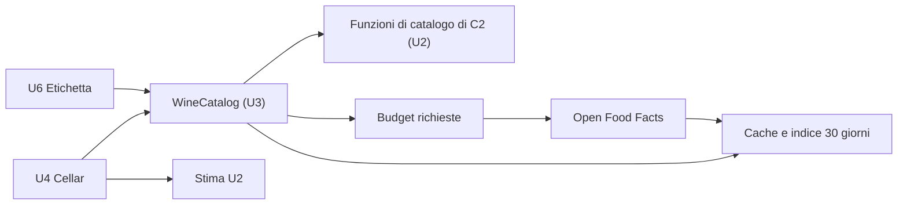

# Functional Specification — u3-wine-catalog

U3 è il modulo del catalogo dei vini, dentro l'app (`lib/catalog/`), come deciso in Q2. Implementa il contratto C1 come interfaccia Dart `WineCatalog`, con due fonti dietro (Q1): il catalogo interno e Open Food Facts (OFF). Copre la parte di dati esterni delle storie US4.1 e US7.1 e fornisce a U4 (suggerimenti) e U6 (etichetta e codice a barre) le operazioni di FR2.1 e FR2.2.

Sorgenti di verità: `entities.md` (forma dei dati) e `rules.md` (regole). Questo file è la sorgente di verità per i flussi.

## Cambio rispetto al progetto iniziale

`components.md`, `unit-of-work.md`, `unit-of-work-dependency.md` e `contract-summary.md` descrivevano U3 come una funzione cloud che custodisce la chiave di un fornitore. Il proprietario ha scelto un catalogo interno più OFF, che non richiede chiavi (Q1, Q2). Questi documenti sono stati aggiornati il 2026-11-05, ciascuno con una nota che indica la data e il motivo:
- **C1** passa da callable Firebase a interfaccia Dart, con le stesse operazioni e gli stessi tipi. Non serve una `v2`, perché nessuna versione pubblicata dell'app usa ancora C1. Le aggiunte sono compatibili: `suggestExternal`, `lookupBarcode`, il parametro `cellarWines`, e i campi `source` e `barcode`. Gli errori Dart sono solo `CatalogArgumentError`.
- **C5:** il fornitore è Open Food Facts, con limiti, cache e identificativo indicati. Le due domande aperte su C5 e C1 sono chiuse.
- **C2:** ha tre aggiunte compatibili di U2, cioè `normalizeWineText`, `recognizeDenomination` e `denominationCatalog`. U3 le usa per normalizzare e riconoscere i nomi.
- **Dipendenze:** U3 ora dipende da U2. Estimation non dipende più da WineCatalog: resta una libreria pura e i dati esterni le arrivano tramite U4 (Cellar). Così non ci sono cicli.
- **Nessuna funzione cloud** e nessun piano Blaze per U3. Autenticazione e limite per utente di C1 sono sostituiti dal budget sul telefono di BR2.3, perché le richieste partono dal telefono e non toccano il nostro cloud.

## Operazioni

| Operazione | Ingresso | Uscita | Regole |
|---|---|---|---|
| `suggestWines` | query (2–120 caratteri), locale, `cellarWines` facoltativo | `SuggestResult` (al massimo 10, solo interno, immediato) | BR1.1, BR1.4 |
| `suggestExternal` | query, locale | `SuggestResult` (solo OFF) | BR1.2, BR2.1–BR2.3, BR4.1, BR5.1 |
| `matchLabelText` | testo (al massimo 2000 caratteri) | `LabelMatch` | BR1.3, BR2.1–BR2.3, BR4.1, BR5.1 |
| `getWineProfile` | nome, produttore, annata | `WineProfileResult` | BR3.1 |
| `lookupBarcode` | codice a barre (8, 12 o 13 cifre) | `WineCandidate?` | BR1.5, BR2.1–BR2.3, BR4.1 |

Errori: solo `CatalogArgumentError`, con i codici `queryTooShort`, `queryTooLong`, `textTooLong` e `invalidBarcode`. Tutto il resto dà risultati vuoti o solo interni (BR2.2).

## F1 — Suggerimenti mentre si scrive

1. A ogni lettera U4 chiama `suggestWines(query, locale, cellarWines)`. La risposta, solo interna, arriva subito (BR1.1): prima i vini della cantina, poi le denominazioni con le loro varianti. L'annata scritta nella query si copia nelle proposte.
2. Quando c'è rete, la query ha almeno 3 caratteri e l'utente non scrive da 600 ms, U4 chiama `suggestExternal(query, locale)` (BR1.2). La risposta viene dalla cache (BR2.1) oppure da OFF, nei limiti di budget (BR2.3) e di tempo (BR2.2).
3. U4 aggiunge le proposte di OFF dopo quelle interne, senza doppioni (BR1.4), fino a 10. Mostra "Dati da Open Food Facts (ODbL)" accanto a quelle di OFF (BR5.2). Se nel frattempo la query è cambiata, ignora la risposta.

## F2 — Riconoscimento dell'etichetta (`matchLabelText`)

1. Nel testo letto sul telefono (U6) si cercano la denominazione, con `recognizeDenomination` di C2, e l'annata (BR1.3).
2. Con rete e budget si cerca su OFF con le 6 parole più lunghe e si sceglie il risultato con la stessa denominazione.
3. La proposta unisce nome e produttore di OFF con denominazione, tipologia e annata.
4. Senza nulla di riconosciuto, `matched = false` e U6 propone di scrivere a mano (FR2.3). Nessun vino si salva senza conferma.

## F3 — Codice a barre (`lookupBarcode`)

1. Il codice si normalizza: 12 cifre diventano 13 con uno zero davanti, 8 e 13 cifre restano come sono; altrimenti `invalidBarcode` (BR1.5).
2. La risposta viene dalla cache oppure dalla lettura del prodotto su OFF, nei limiti.
3. Si restituisce `null` se il prodotto non è un vino, non si trova oppure OFF non è disponibile.

## F4 — Profilo del vino (`getWineProfile`)

1. Le fonti attuali non hanno finestre né abbinamenti, quindi `found = false`, `window` è assente e `pairings` è vuota (BR3.1). Questa operazione non chiama OFF.
2. Tipologia, regione e denominazione vengono dall'indice `ProfileHint`, cioè dai vini già visti su OFF, oppure da `recognizeDenomination` sul nome. Con `found = false` U4 non passa `ExternalProfile` a `estimateWindow`, perché in C2 è riservato a `found = true`. Copia invece tipologia, regione e denominazione nei campi vuoti di `WineFacts`, così U2 le usa per riconoscere il vino.
3. **Conseguenza per `needsRefinement`.** Con le fonti attuali ogni stima resta `internalRules`, quindi `needsRefinement` di C2 resta vero per tutti i vini. Per non chiedere il profilo a ogni connessione, U4 lo chiede una sola volta per vino e versione del catalogo: è un criterio da riportare nella progettazione di U4. Il ricalcolo può comunque migliorare la stima, per esempio da generica a stima per tipologia, quando OFF conosce la tipologia.
4. **Effetto sulle storie:**
   - **AC4.1.2** e **AC7.1.2** sono sempre soddisfatti: fonte "stima per tipologia" e abbinamenti per tipologia, indicati come tali.
   - **AC4.1.1** e **AC7.1.1** non si verificano con le fonti attuali. Il motivo è l'assunzione A1, letta nel senso di FR4.2 e FR7.2: non esiste una fonte gratuita di finestre e abbinamenti. OFF è gratuito ma non li ha. Il proprietario ha confermato questa conseguenza nel riepilogo ("la finestra resta quella delle regole interne"). Torneranno validi quando si aggiungerà un fornitore con finestre e abbinamenti, cambiando solo l'adattatore (C5).
   - **AC4.1.3** è soddisfatto: senza rete la stima per tipologia è immediata (U2), e alla prima connessione il ricalcolo descritto al punto 3 può migliorarla.

## Casi limite

- **Nessuna rete:** solo catalogo interno, nei suggerimenti e nell'etichetta; il codice a barre restituisce `null` se non è in cache. Nessun errore.
- **OFF lento o fuori servizio:** dopo 5 secondi si rinuncia. Dopo 3 errori di fila OFF si sospende per 5 minuti (BR2.2).
- **Budget esaurito:** solo risultati interni. La finestra mobile di 60 secondi libera il budget da sola (BR2.3).
- **Contatto non configurato:** OFF non si usa (BR5.1).
- **Prodotto di OFF senza nome o non vino:** viene scartato (BR4.1, BR1.5).
- **Query con annata:** "Barolo 2016" propone "Barolo DOCG" con annata 2016.
- **Uscita o cancellazione dell'account:** cache e indice si cancellano (BR2.1, U8).

## Diagramma dei flussi

Testo equivalente: U4 e U6 chiamano `WineCatalog`, che usa le funzioni di catalogo di U2 per normalizzare e riconoscere i nomi. Quando c'è rete e il budget lo consente, interroga OFF e salva le risposte in cache. U4 passa i dati esterni alla stima di U2, che non chiama mai U3.

## Fuori da U3

- **U2:** aggiunge al pacchetto le funzioni di catalogo di C2 (`displayName`, `region` e alias per ogni denominazione). Le costruisce la generazione del codice di U3, come modifica compatibile del pacchetto di U2.
- **U4:**
  - campo di scrittura con la pausa di 600 ms;
  - unione dei risultati;
  - attribuzione ODbL vicino alle proposte;
  - ricalcolo una volta per vino;
  - passaggio di `cellarWines`.
- **U6:** fotocamera, lettura del testo e del codice a barre sul telefono.
- **U8:** cancellazione di cache e indice all'uscita e alla cancellazione dell'account.
- **Proprietario, prima della pubblicazione (BR5.3):**
  - contatto per OFF nella configurazione;
  - informativa privacy;
  - scheda "Sicurezza dei dati" di Google Play;
  - schermata delle informazioni con l'attribuzione.
