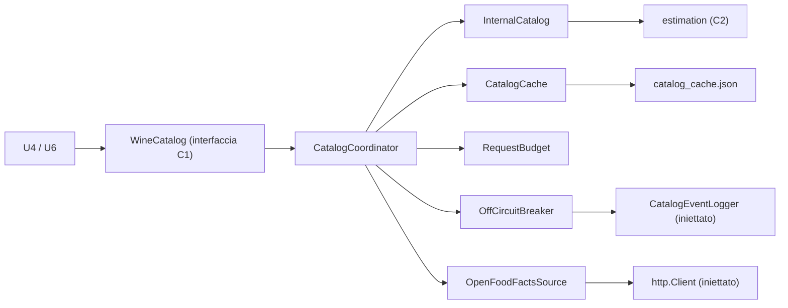

# Logical Components — u3-wine-catalog

Fonti: requisiti non funzionali di U3 (`performance-`, `security-`, `scalability-`, `reliability-`, `observability-requirements.md`, `tech-stack-decisions.md`), `functional-spec.md` e `rules.md` di U3, `contract-summary.md` (C1, C2, C5), riepilogo confermato in `nfr-design-questions.md`.

U3 è un modulo Dart dentro l'app, in `lib/catalog/`. Non ha processi o risorse cloud propri. L'unico confine esterno è Open Food Facts (OFF), raggiunto via HTTPS dal telefono. Un guasto di OFF resta dentro l'adattatore e il coordinatore: verso U4 e U6 arrivano solo risultati, mai eccezioni, tranne `CatalogArgumentError` per gli ingressi non validi.

## Componenti

Testo equivalente:
- U4 e U6 chiamano l'interfaccia `WineCatalog`, implementata da `CatalogCoordinator`.
- Il coordinatore usa `InternalCatalog`, che si appoggia alle funzioni di catalogo di C2, per i risultati interni.
- Per OFF passa da `CatalogCache`, `RequestBudget` e `OffCircuitBreaker`, poi da `OpenFoodFactsSource`, che usa il client HTTP iniettato.
- Il circuit breaker registra gli eventi con il registratore iniettato.
- La cache scrive su `catalog_cache.json`.

Il modulo ha due parti:
- **Nucleo puro `lib/catalog/core/`.** Contiene la logica e dipende solo da Dart, da `package:http` e dal pacchetto `estimation`. Gira con `dart run` per il benchmark. Non importa Flutter, `path_provider` né Firebase, e lo verifica `tool/check_off_config.sh`.
- **Parte di piattaforma `lib/catalog/platform/`.** Collega il nucleo a file, Crashlytics, versione dell'app e Riverpod.

| Componente | File | Responsabilità | Requisiti |
|---|---|---|---|
| `WineCatalog` | `core/wine_catalog.dart` | Interfaccia di C1 (5 operazioni), tipi, `CatalogArgumentError` (solo codice) | C1, NFR4.5, NFR8.3 |
| `CatalogCoordinator` | `core/catalog_coordinator.dart` | Validazione, ordine delle fonti, unione senza doppioni (BR1.4), profilo (BR3.1), epoca delle risposte in volo | NFR4.5, NFR6.1, NFR8.1 |
| `InternalCatalog` | `core/internal_catalog.dart` | Indice delle denominazioni costruito una volta; ricerca per inizio di parola (BR1.1); vini della cantina passati da U4 | NFR1.1, NFR1.5, NFR2.1 |
| `OpenFoodFactsSource` | `core/off/open_food_facts_source.dart` | Richieste HTTPS, scadenza unica di 5 s, lettura a flusso con limite, mappatura (BR4.1), esito tipizzato | NFR1.3, NFR4.1–NFR4.4, NFR6.2 |
| `CatalogCacheStore` | `core/catalog_cache_store.dart` | Cache e indice in memoria, scadenza, limiti, epoca, salvataggi serializzati verso un'interfaccia `CacheFile` | NFR1.4, NFR2.3, NFR6.4, NFR8.1 |
| `RequestBudget` | `core/request_budget.dart` | Finestra mobile di 60 s: 8 ricerche e 60 letture | NFR2.2 |
| `OffCircuitBreaker` | `core/off_circuit_breaker.dart` | 3 errori, poi sospensione di 5 minuti; `CatalogHealth`; evento `off_suspended` | NFR6.2, NFR6.6, NFR6.7 |
| `CatalogEventLogger` | `core/catalog_event_logger.dart` | Interfaccia (solo enum e numeri) e flag `debugLogging` | NFR8.3 |
| `CatalogConfig` | `core/catalog_config.dart` | `OFF_CONTACT`, host fisso, versione ricevuta dalla piattaforma; OFF spento senza contatto | NFR4.3 |
| `FileCacheFile` | `platform/file_cache_file.dart` | `CacheFile` su `catalog_cache.json` nella cartella di supporto (`path_provider`), con scrittura atomica e cancellazione di file e `.tmp` | NFR6.4, NFR8.1 |
| `CrashlyticsCatalogEventLogger` | `platform/crashlytics_catalog_event_logger.dart` | Implementazione di produzione del registratore | NFR5.1, NFR6.6 |
| Provider | `platform/catalog_providers.dart` | Composizione reale con Riverpod; `catalogSessionProvider` chiama `clear()` a ogni cambio di uid di U1; versione da `package_info_plus` | NFR4.3, NFR8.1 |

## Isolamento e impatto di un guasto

| Guasto | Impatto | Contenimento |
|---|---|---|
| OFF lento o fuori servizio | Nessun risultato esterno | Timeout di 5 secondi, circuit breaker, risultati interni sempre presenti |
| Risposta di OFF enorme o malformata | Nessun risultato esterno | Lettura a flusso fino a 1 MB, parsing difensivo |
| File di cache rovinato | Cache vuota | Si svuota e si riparte (NFR6.4) |
| Ingresso non valido da U4/U6 | La singola chiamata fallisce | `CatalogArgumentError` con codice |

## Risorse condivise

- **`AndroidManifest.xml` e `data_extraction_rules.xml` (di U1):** nessuna modifica. Escludono già dal backup e dal trasferimento tutti i domini, `file` compreso; un test di U3 lo verifica (`security-design.md` §5).
- **`pubspec.yaml`:** nuove dipendenze `http`, `path_provider` e `package_info_plus` (ultime versioni stabili compatibili, decise in Code Generation).
- **`release.yml`:** nessuna modifica. `OFF_CONTACT` si aggiunge al JSON di configurazione di produzione, che `release.yml` già ricostruisce dal segreto esistente.
- **File di traduzione:** chiave `offAttribution` in it, en e pt-BR.
- **CI (`ci.yml`, di U1 e U2):** passo benchmark del catalogo nel job `unit` e controllo `OFF_CONTACT` (vedi `performance-design.md` e `security-design.md`).
- **Pacchetto `estimation` (U2):** funzioni di catalogo di C2 aggiunte in modo compatibile.
