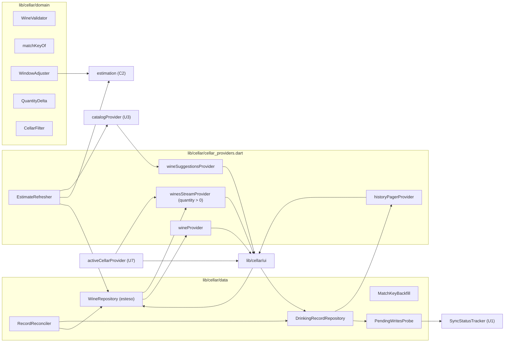

# Logical Components — u4-cellar

Fonti:
- requisiti non funzionali di U4: `performance-requirements.md`, `security-requirements.md`, `tech-stack-decisions.md`;
- design funzionale di U4: `functional-spec.md`, `rules.md`, `frontend-components.md`;
- codice esistente: `lib/cellar/`, `lib/catalog/platform/catalog_providers.dart`, `lib/dashboard/`, `lib/sharing/sharing_providers.dart`, `lib/app/home_shell.dart`, `firestore.rules`;
- riepilogo confermato in `nfr-design-questions.md`.

## Componenti

Testo equivalente:
- il nucleo puro valida, calcola la chiave dei doppioni, applica il riscontro alla stima di base, corregge le quantità e filtra;
- i repository leggono e scrivono vini e bevute; `RecordReconciler` completa al ritorno della rete le operazioni lasciate a metà, e `PendingWritesProbe` dice al banner di sincronizzazione quando ci sono bevute in coda;
- i provider espongono l'elenco con le sole bottiglie presenti, il vino singolo, lo Storico a pagine e i suggerimenti;
- il raffinatore delle stime usa il catalogo e la stima e scrive tramite il repository;
- tutto lavora sulla cantina attiva di U7.

| Componente | File | Responsabilità | Requisiti |
|---|---|---|---|
| `WineValidator` | `lib/cellar/domain/wine_validator.dart` | Nome, produttore, annata, quantità (BR1.3); errori per campo | NFR3.4; BR1.3 |
| `matchKeyOf` | `lib/cellar/domain/match_key.dart` | `normalizeWineText(nome)` + "|" + `normalizeWineText(produttore)` + "|" + annata, al più 400 caratteri | BR1.4; NFR4.1 |
| `WindowAdjuster` | `lib/cellar/domain/window_adjuster.dart` | Puro: `effective(base, adjustment)` con le regole di BR1.12; fiducia −1 livello; etichetta della fonte | BR1.12; NFR2.4 |
| `QuantityDelta` | `lib/cellar/domain/quantity_delta.dart` | Puro: `forIncrease(stored, n) = n − min(0, stored)`; `canDecrease(stored) = displayQuantity(stored) > 0` | BR1.15; NFR6.2 |
| `CellarFilter` | `lib/cellar/domain/cellar_filter.dart` | Ricerca senza maiuscole e accenti (`normalizeWineText`) su nome e produttore; filtri per stato e famiglia; ordinamento | BR1.8; NFR2.1 |
| `WineRepository` (esteso) | `lib/cellar/data/wine_repository.dart` | `watchCellarWines` (`where quantity > 0`, sostituisce `watchWines`), `watchWine(id)`, `findByMatchKey`, `addWine`, `addBottles`, `updateWine`, `setEstimate`, `deleteWineWithRecords`, `mergeInto`; tutte le quantità passano da `QuantityDelta` | BR1.4–BR1.7, BR1.13–BR1.15, BR1.20 |
| `DrinkingRecordRepository` | `lib/cellar/data/drinking_record_repository.dart` | `drink` (batch con −1 e la bevuta), `undo`, `updateRecord`, `pageHistory(after, 30)` ordinato per `drankOn` e `createdAt`, `recordsOfWine(wineId)` ordinate in memoria | BR1.10, BR1.11, BR1.16 |
| `MatchKeyBackfill` | `lib/cellar/data/match_key_backfill.dart` | Una volta per cantina: batch da 400 sui vini senza chiave, poi `matchKeyBackfill: true`; ripetibile | BR1.4; NFR5.3, NFR4.2, NFR4.9 |
| `RecordReconciler` | `lib/cellar/data/record_reconciler.dart` | Operazioni da completare al ritorno della rete (NFR6.6), salvate in `shared_preferences` con la chiave `cellar.pending.<uid>` come lista JSON di `{op, cellarId, wineId, createdAt}`, dove `op` è `reapplyAdjustment` (chiunque abbia `canEdit`) o `purgeRecords` (solo il proprietario, creata dopo un'eliminazione offline). Sono idempotenti: `reapplyAdjustment` ricalcola dal server; `purgeRecords` rilegge `where wineId` e cancella ciò che resta. Una voce si toglie quando riesce, quando le regole la rifiutano (motivo `cellar_reconcile_failed`, senza falso "accesso perso") o dopo 7 giorni. Al più 50 voci. Se `shared_preferences` non è disponibile, le voci restano solo in memoria fino alla chiusura dell'app; il caso è registrato una volta. | BR1.12, BR1.14; NFR6.6 |
| `PendingWritesProbe` | `lib/cellar/data/pending_writes_probe.dart` | Segna `SyncSource.drinkingRecords` "in attesa" dopo ogni scrittura di una bevuta e la libera quando `waitForPendingWrites()` si chiude; un controllo all'avvio; nessuna lettura in più (`security-design.md` §4) | NFR6.6; BR1.10, BR1.11 |
| `EstimateRefresher` | `lib/cellar/estimate_refresher.dart` | Coda dei vini da migliorare, uno per volta, al più 20 per ritorno della rete; solo con `canEdit` | BR1.5, BR1.6, BR1.19; NFR5.4 |
| Provider | `lib/cellar/cellar_providers.dart` | `winesStreamProvider` (ora con `quantity > 0`), `wineProvider`, `historyPagerProvider`, `wineSuggestionsProvider` (attesa di 250 ms), `cellarFilterProvider` | NFR1.2, NFR2.x, NFR5.x |
| Schermate | `lib/cellar/ui/` | `CellarScreen`, `AddWineScreen`, `WineDetailScreen`, `EditWineScreen`, `HistoryScreen`, `DrinkingRecordSheet`, `DuplicateDialog`, `DuplicateBanner`, `DeleteWineDialog`, `DrinkSnackBar` | BR1.1–BR1.20; NFR3.x |
| `SyncStatusTracker` (modifica) | `lib/sync/sync_status.dart` | `SyncSource` aggiunge `drinkingRecords`; nuovo `setPending(source, bool)` che cambia solo lo stato "in attesa" e non il passaggio cache → server | NFR6.6 |
| Shell (modifica) | `lib/app/home_shell.dart` | Terza scheda Storico; azioni del Cruscotto collegate al dettaglio, alla Cantina filtrata e all'inserimento | BR1.17 |
| Regole e indici | `firestore.rules`, `firestore.indexes.json` | `security-design.md` §1 | NFR4.x |

## Isolamento e impatto di un guasto

| Guasto | Impatto | Contenimento |
|---|---|---|
| Catalogo spento o lento | Nessun suggerimento esterno, stime interne | Suggerimenti interni subito; coda delle stime ripresa al ritorno della rete |
| Errore di stima di un vino | Il vino è "da stimare" | try/catch per vino; nessun blocco del salvataggio |
| Backfill interrotto | Alcuni vini senza chiave | Ripresa alla riapertura; il flag si scrive solo alla fine |
| Rifiuto delle regole | Scrittura persa | `reportWriteRejected` di U1/U7 |
| Ultima bottiglia bevuta offline | Nessun ascolto copre la bevuta | `PendingWritesProbe` tiene il banner "in attesa" fino alla conferma |
| Annulla dopo una cancellazione | Nessuna scrittura | Controllo in cache; messaggio "Non c'è più nulla da annullare" |
