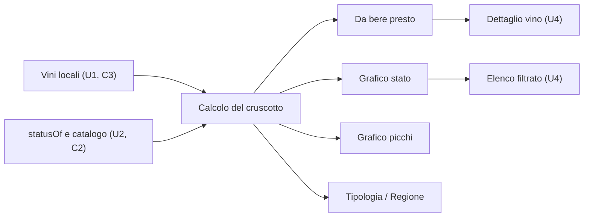

# Functional Specification — u5-dashboard

Fonti: `unit-of-work.md` (U5), `requirements.md` (FR5.1–FR5.6, NFR2, NFR3), `stories.md` (US5.1, US5.2), `components.md` (Dashboard), `contract-summary.md` (C2 stima, C3 vini), risposte in `functional-design-questions.md` (Q1: quattro barre; Q2: selettore tipologia/regione; riepilogo confermato).

U5 è la schermata che si apre all'avvio dell'app. Legge i vini della cantina attiva dal salvataggio locale di U1 (C3, `cellars/{cellarId}/wines`), calcola lo stato di ogni vino con U2 (`statusOf` di C2) e mostra una lista e tre grafici. Non scrive dati: è in sola lettura.

## Interfacce usate

- **U1, cantina attiva:** `cellarStreamProvider(uid)` di `lib/app/providers.dart` fornisce la cantina personale dell'utente collegato, che è l'unica finché U7 non aggiunge le cantine condivise. Quando U7 introdurrà la scelta della cantina, U5 userà la cantina scelta senza altri cambi.
- **U1, vini:** `winesStreamProvider(cellarId)` è un flusso dei vini dal salvataggio locale di Firestore, aggiornato anche dalla sincronizzazione. Gli errori del flusso portano allo stato di errore (vedi `frontend-components.md`).
- **U1, prima sincronizzazione:** il flusso dei vini di U1 espone già `WinesSnapshot.meta.isFromCache`. U5 lo usa come `fromCacheOnly` (BR1.8, BR1.9) senza modifiche a U1.
- **U1, modello del vino:** il `Wine` di U1 (`lib/cellar/domain/wine.dart`) oggi legge solo i campi dello scheletro. I campi di C3 che servono al cruscotto (`producer`, `wineType`, `region`, `denomination`, `window`) sono già definiti dal contratto C3, che appartiene a U1. **U5 li aggiunge al modello in sola lettura** (lettura da Firestore, valori facoltativi) e converte `window` in `DrinkingWindow` di C2 con `startYear`, `peakYear` ed `endYear`. È una modifica compatibile al codice di U1, dichiarata nel piano di U5. Le scritture di quei campi restano a U4.
- **U2:** `statusOf` (BR1.2), `WineType.tryParse` (BR1.6) e `recognizeDenomination` del catalogo di C2 (BR1.6).
- **Navigazione:** U5 non dipende da U4. Espone `DashboardScreen` con tre azioni iniettate: `onOpenWine(wineId)`, `onOpenStatus(WineStatus)` e `onAddFirstWine()`.
  - **Oggi:** l'app collega le azioni alle schermate di U1, cioè l'elenco `CellarScreen` per le prime due e `AddWineScreen` per l'aggiunta. In più U5 modifica la shell dell'app di U1 (`vinoozy_app.dart`): la prima schermata diventa il Cruscotto, e una barra di navigazione porta al Cruscotto e alla Cantina.
  - **Con U4:** U4 ricollegherà le azioni al dettaglio, all'elenco filtrato e all'inserimento completo, cambiando solo il collegamento.

## Dati letti

Da ogni vino di C3 servono: `name`, `producer`, `vintage`, `quantity`, `wineType`, `region`, `denomination` e `window` (startYear, peakYear, endYear). I vini che U4 non ha ancora stimato non hanno una finestra: si contano solo nel terzo grafico, mentre per lo stato e i picchi finiscono in "da stimare" (vedi regole del cruscotto).

## Regole del cruscotto

| ID | Regola |
|---|---|
| BR1.1 | **Bottiglie, non righe.** Ogni vino conta per la sua `quantity`. I vini con quantità 0 sono esclusi da lista e grafici. Una quantità negativa letta da C3 vale 0 (ADR-004). |
| BR1.2 | **Stato del giorno.** Lo stato si calcola a ogni apertura, e a ogni cambio della cantina, con `statusOf(window, oggi)` di C2, dove oggi è la data locale senza ora. Non si salva (FR4.5). Una finestra non valida (anni mancanti o non in ordine, oppure `statusOf` che dà errore) non blocca il cruscotto: il vino si tratta come senza finestra ("da stimare") e l'errore si registra una sola volta in Crashlytics, senza dati del vino. |
| BR1.3 | **Da bere presto (FR5.2).** Si elencano i vini con stato `drinkSoon`, ordinati per `window.endYear` crescente. A parità vale il nome, senza maiuscole né accenti, e poi l'annata. Ogni riga mostra nome, annata, produttore se c'è, quantità e anno di fine. Senza vini compare "Nessuna bottiglia in scadenza". Tocco su una riga: azione `onOpenWine`. Si mostrano al massimo 10 righe; se ce ne sono di più compare "Vedi tutti (N)", che chiama `onOpenStatus(drinkSoon)`. |
| BR1.4 | **Grafico dello stato (FR5.3, Q1).** Quattro barre nell'ordine: da aspettare (`waiting`), pronte (`ready`), da bere presto (`drinkSoon`), oltre la finestra (`pastWindow`). Ogni barra mostra il numero di bottiglie. I vini senza finestra non sono nelle barre: sotto il grafico compare "N bottiglie da stimare", se N > 0. |
| BR1.5 | **Grafico dei picchi (FR5.4).** Colonne per `window.peakYear`: "picco passato" (prima dell'anno in corso), una colonna per ogni anno dall'anno in corso ai 10 successivi, poi "oltre". Le colonne vuote si mostrano con 0, per avere un asse fisso. I vini senza finestra sono esclusi e, come in BR1.4, compare la nota "N bottiglie da stimare" se N > 0. |
| BR1.6 | **Terzo grafico (FR5.5, Q2).** Un selettore a due voci, Tipologia e Regione. Parte da Tipologia e ricorda l'ultima scelta sul telefono. **Tipologia:** rosso, bianco, rosato, spumante, dolce, più "non indicata"; il campo `wineType` di C3 è una stringa e si converte con `WineType.tryParse` di C2, la funzione pubblica del pacchetto `estimation`. Accetta sia i nomi della tipologia di U2 (`redLight`, `redStructured`, `white`, `rose`, `sparklingClassic`, `sparklingTank`, `sweet`, `fortified`) sia i valori di C1 (`red`, `white`, `rose`, `sparkling`, `sweet`), come stabilito nelle aggiunte compatibili di C2. Le famiglie sono: rosso = `redLight` e `redStructured`; bianco = `white`; rosato = `rose`; spumante = `sparklingClassic` e `sparklingTank`; dolce = `sweet` e `fortified`. Un valore assente o non riconosciuto va in "non indicata". **Regione:** `region` del vino, altrimenti la regione restituita da `recognizeDenomination(denomination)` di C2, altrimenti "non indicata". Le regioni si confrontano senza maiuscole né accenti. Per ogni regione si mostra la forma scritta più frequente; a parità, la prima in ordine alfabetico. "Non indicata" non entra nella classifica. Si mostrano le 8 regioni con più bottiglie (a parità, in ordine alfabetico), poi "altre" con la somma delle restanti e infine "non indicata". |
| BR1.7 | **Numeri e lettore schermo (FR5.6).** Ogni barra riporta il suo numero. Ogni grafico ha una descrizione testuale per TalkBack con il titolo e tutte le coppie etichetta–valore nell'ordine mostrato, per esempio "Stato delle bottiglie: da aspettare 12, pronte 30, da bere presto 4, oltre la finestra 2". I numeri non dipendono solo dal colore. |
| BR1.8 | **Cantina vuota (FR5.6).** Se la somma delle bottiglie è 0 e l'elenco non viene solo dalla cache locale (`fromCacheOnly` falso), al posto della lista e dei grafici compare un invito ("La tua cantina è vuota") con il pulsante "Aggiungi il primo vino", che apre l'inserimento (U4). |
| BR1.9 | **Aggiornamento.** Il cruscotto si aggiorna da solo quando cambiano i vini, anche per modifiche arrivate dalla sincronizzazione. Si aggiorna anche al cambio di giorno, con un timer fino alla mezzanotte locale successiva e con un ricalcolo quando l'app torna in primo piano. Con 0 bottiglie da sola cache locale mostra "Sincronizzazione della cantina…" invece dello stato vuoto. |

## Flussi

1. **Apertura (FR5.1).** Dopo l'accesso la prima schermata è il Cruscotto (U5 modifica la shell di U1). L'elenco della cantina resta raggiungibile dalla barra di navigazione.
2. **Calcolo.** Dai vini locali (BR1.1) si calcolano gli stati (BR1.2), poi la lista (BR1.3) e i tre grafici (BR1.4–BR1.6), in un unico passaggio sui vini.
3. **Interazione.**
   - Tocco su un vino della lista: azione `onOpenWine`.
   - Tocco su una barra dello stato: azione `onOpenStatus`.
   - Selettore del terzo grafico: cambia vista senza ricalcolare gli stati.
4. **Senza rete.** Tutto funziona sui dati locali: AC5.2.3 chiede che il cruscotto compaia entro 2 secondi con 500 bottiglie (vedi NFR di U5).

## Casi limite

- **Vino senza annata:** la finestra di U2 c'è comunque, perché usa l'anno di riferimento; si comporta come gli altri.
- **Vino senza finestra** (non ancora stimato): solo nel terzo grafico, con il conteggio "da stimare" in BR1.4 e BR1.5.
- **Picco nell'anno in corso:** colonna dell'anno in corso.
- **Regione scritta in modi diversi** (per esempio "piemonte" e "Piemonte"): si confronta senza maiuscole né accenti e si mostra la forma più frequente.
- **Molte regioni:** le prime 8 per numero di bottiglie; a parità, in ordine alfabetico.
- **Cantina condivisa con sola lettura:** il cruscotto è identico, perché è in sola lettura.

## Diagramma

Testo equivalente: i vini locali e le funzioni di U2 alimentano un unico calcolo, che produce la lista e i tre grafici. Dalla lista si va al dettaglio del vino e dal grafico dello stato all'elenco filtrato, entrambi in U4.

## Fuori da U5

- **U4:** dettaglio del vino, elenco con filtro per stato, inserimento del primo vino, stima e sua scrittura in `window`.
- **U1:** salvataggio locale e sincronizzazione, navigazione principale.
- **U2:** `statusOf`, mappatura delle tipologie, regione delle denominazioni.
