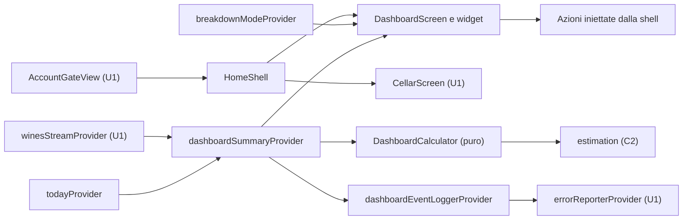

# Logical Components — u5-dashboard

Fonti:
- requisiti non funzionali di U5: `performance-requirements.md`, `security-requirements.md`, `tech-stack-decisions.md`;
- design funzionale di U5: `functional-spec.md`, `rules.md`, `frontend-components.md`;
- codice di U1: `lib/app/providers.dart`, `lib/app/vinoozy_app.dart`, `lib/account/ui/account_gate_view.dart`, `lib/cellar/ui/cellar_screen.dart`, `lib/cellar/domain/wine.dart`, `lib/app/error_reporter.dart`, `lib/app/theme.dart`;
- riepilogo confermato in `nfr-design-questions.md`.

U5 è una schermata dentro l'app, in sola lettura, senza risorse cloud. Un guasto resta nella schermata: un vino rovinato si salta, mentre un errore di lettura mostra "Riprova" senza toccare il resto dell'app.

## Componenti

Testo equivalente:
- il gate dell'account mostra la shell, che contiene il Cruscotto e la Cantina;
- il provider del cruscotto ascolta i vini di U1 e il servizio "oggi", poi chiama il calcolo puro, che usa le funzioni di C2;
- se il risultato contiene vini con finestra non valida, il provider avvisa il registratore, che passa dall'uscita unica degli errori di U1;
- i widget leggono il risultato e il selettore. Le azioni di navigazione arrivano dalla shell.

| Componente | File | Responsabilità | Requisiti |
|---|---|---|---|
| `DashboardCalculator` | `lib/dashboard/domain/dashboard_calculator.dart` | Funzione pura `compute(wines, today)` → `DashboardSummary`; un solo passaggio. I vini rovinati non lanciano: contano come "da stimare" e incrementano `invalidWindowCount`. Non registra niente. | BR1.1–BR1.7; NFR2.2, NFR6.1 |
| `DashboardSummary` e modelli di vista | `lib/dashboard/domain/dashboard_summary.dart` | Valori immutabili con uguaglianza per valore, compreso `invalidWindowCount` | BR1.3–BR1.6 |
| `todayProvider` | `lib/dashboard/today_provider.dart` | Data locale di oggi, letta da `clockProvider` di U1. Un timer scatta alla prossima mezzanotte locale, calcolata con `DateTime(y, m, d + 1)`, che è corretta anche con l'ora legale. Aggiorna anche al ritorno in primo piano (`AppLifecycleListener`). | BR1.9; NFR6.4 |
| `dashboardSummaryProvider` | `lib/dashboard/dashboard_providers.dart` | Provider con parametro `uid`. Combina `winesStreamProvider(Cellar.personalCellarId(uid))`, cioè lo stesso flusso di `CellarScreen` (oggi l'id è l'uid stesso), `cellarStreamProvider(uid)` (per gli errori) e `todayProvider`, e ricalcola solo se cambiano. Espone caricamento, sincronizzazione (`isFromCache`), errore, vuoto e dati. Se `invalidWindowCount > 0` chiama il registratore. | NFR2.3, NFR6.2, NFR6.3, NFR8.1 |
| `breakdownModeProvider` | `lib/dashboard/dashboard_providers.dart` | Selettore Tipologia/Regione salvato in `shared_preferences`; non ricalcola gli stati | BR1.6; NFR2.3 |
| `DashboardEventLogger` e `dashboardEventLoggerProvider` | `lib/dashboard/dashboard_event_logger.dart` | Interfaccia con il solo evento `invalidWindow()`. L'implementazione chiama `ErrorReporter.report` di U1 con `DashboardInvalidWindow`, che ha un messaggio fisso, senza chiavi personalizzate. Al massimo un evento per processo, perché il provider non usa `autoDispose`. | NFR8.1 |
| Widget | `lib/dashboard/ui/` | `DashboardScreen` (riceve `user`, `setup`, `onRetrySetup` e le azioni), `DrinkSoonSection`, `StatusChartCard`, `PeakYearChartCard`, `BreakdownChartCard`, `BarChart` generico | BR1.3–BR1.8; NFR3.x, NFR6.x |
| Gate dell'account (modifica a U1) | `lib/account/ui/account_gate_view.dart` | Negli stati `GateEnsureCellar` (`setup: preparing`) e `GateCellar` (`ready` o `failed`) restituisce `HomeShell(user, setup, onRetrySetup: gate.retryCellar)` al posto di `CellarScreen`. Gli altri stati non cambiano. | FR5.1; NFR7.5 |
| Shell (nuova, in U1) | `lib/app/home_shell.dart` | `NavigationBar` con Cruscotto (prima scheda) e Cantina, e un `IndexedStack` con `DashboardScreen` e `CellarScreen`. A entrambe passa gli stessi `user`, `setup` e `onRetrySetup`. Collega le azioni del Cruscotto: `onAddFirstWine` apre `AddWineScreen` di U1; `onOpenWine` e `onOpenStatus` portano alla scheda Cantina finché U4 non fornisce il dettaglio e il filtro. | FR5.1; NFR7.5 |
| Modello `Wine` (modifica a U1) | `lib/cellar/domain/wine.dart` | `Wine.fromMap` resta "mai lancia". Legge in modo facoltativo `producer`, `wineType`, `region` e `denomination` come stringhe (altrimenti `null`), più `window`, convertito in `DrinkingWindow?` da `_windowFrom`: • se `window` non è una mappa, o se `startYear`, `peakYear` o `endYear` mancano o non sono interi, il risultato è `null`, cioè "da stimare"; • `confidence` e `source` si leggono per nome (C3); se mancano o sono sconosciuti valgono `low` e `internalRules`; • `basis` si legge per nome e, se manca, si ricava con `EstimationBasis.resolveStoredBasis` di C2; • gli anni non si controllano qui: una finestra incoerente fa lanciare `statusOf`, e il calcolatore la conta come non valida. Nessuna scrittura nuova. Test del mapper con mappe incomplete, tipi sbagliati e valori sconosciuti. | Interfacce usate; NFR4.1, NFR6.1 |
| Tema (modifica a U1) | `lib/app/theme.dart` | `ThemeExtension` `StatusColors`: quattro colori di stato e un colore neutro per le barre, in tema chiaro e scuro, registrata in `ThemeData.extensions` | NFR3.2 |
| Controlli | `tool/check_dashboard_readonly.sh` e il suo test, `benchmark/dashboard_benchmark.dart`, `tool/perf_cold_start.sh`, `integration_test/dashboard_500_test.dart`, `integration_test_perf/dashboard_perf_test.dart` | Sola lettura in CI; benchmark del calcolo; misure sul telefono; caso da 500 vini in CI | NFR4.1, NFR2.1, NFR2.2, NFR2.4 |

## Isolamento e impatto di un guasto

| Guasto | Impatto | Contenimento |
|---|---|---|
| Vino con finestra non valida | Il vino conta come "da stimare" | try/catch attorno a `statusOf` per singolo vino; `invalidWindowCount`; un solo evento per processo, con messaggio fisso |
| `window` malformata nel documento | Il vino conta come "da stimare" | Il mapper restituisce `null` senza lanciare |
| Tipologia o quantità strane | Valori normalizzati (BR1.1, BR1.6) | Nessuna eccezione |
| Cantina in preparazione | Scheletro di caricamento, nessun ascoltatore | `CellarSetup.preparing`, come in `CellarScreen` |
| Preparazione fallita o errore di un flusso | Messaggio di U1 con "Riprova" | `onRetrySetup` (`AccountGate.retryCellar`) riapre gli ascoltatori |
| Prima sincronizzazione | "Sincronizzazione della cantina…" con "Aggiungi il primo vino" | `isFromCache`; mai lo stato vuoto in questo caso |

## Risorse condivise

- **Codice di U1:** gate dell'account, shell, tema e modello `Wine`, con modifiche compatibili e in sola lettura. I test di U1 che aprivano l'elenco come prima schermata passano dalla scheda "Cantina" (`security-design.md` §5).
- **CI:**
  - nel job `analyze`: lo script di sola lettura e il suo test, più il nuovo marcatore in `tool/check_release_build.sh`;
  - nel job `unit`: il benchmark e la copertura di `lib/dashboard/`;
  - nel job `e2e`: il Cruscotto dopo l'accesso e il caso da 500 vini.
- **Traduzioni:** nuove chiavi del cruscotto in it, en e pt-BR, con i plurali.
