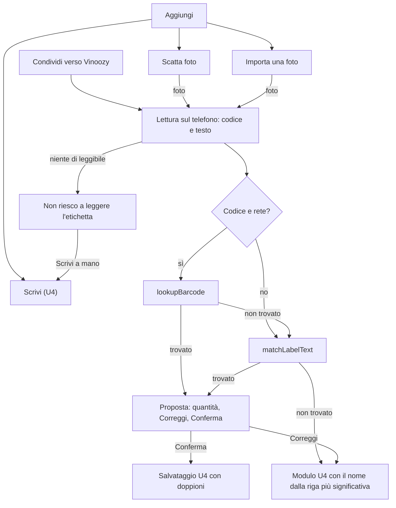

# Functional Specification — u6-label-recognition

Fonti:
- `unit-of-work.md` (U6: aggiunta di un vino dalla foto dell'etichetta);
- `requirements.md` (FR2.2 con l'importazione aggiunta il 2026-11-06, FR2.3, FR2.4; FR1.4 e NFR8 aggiornati il 2026-11-06);
- `stories.md` (US2.2, AC2.2.1–AC2.2.5);
- `components.md` (LabelRecognition);
- `contract-summary.md` (C1 catalogo di U3: `matchLabelText`, `lookupBarcode`; C3 dati, tramite il salvataggio di U4);
- mockup M4 e M4a (`refined-mockups/mockups.md`), stati della foto (`interaction-spec.md`);
- risposte in `functional-design-questions.md`: Q1 = A (la foto non si conserva), Q2 = A (fotocamera di sistema), Q3 = A (codice a barre prima del testo), importazione di una foto fatta prima, riepilogo confermato.

U6 aggiunge un secondo modo di inserire un vino: da una foto dell'etichetta, scattata sul momento o importata dalla galleria.
- La lettura avviene **sul telefono** con ML Kit: testo e codice a barre.
- La ricerca del vino usa il catalogo di U3.
- Il salvataggio è quello di U4.
- U6 non scrive nulla in Firestore da sé e non conserva la foto.

## Interfacce usate

| Interfaccia | Da | Uso |
|---|---|---|
| `WineCatalog.lookupBarcode(code)` | U3 (C1) | Prodotto per codice a barre su Open Food Facts, con la rete |
| `WineCatalog.matchLabelText(text, locale)` | U3 (C1) | Vino dal testo letto: Open Food Facts con la rete, denominazione interna sempre |
| Modulo di inserimento `AddWineScreen` con valori iniziali | U4 | "Correggi", "Scrivi a mano" e proposta incompleta |
| Salvataggio con controllo dei doppioni (`CellarActions`) | U4 | "Conferma" |
| `activeCellarProvider`, `canEdit` | U7 | Chi può aggiungere |
| `NetworkStatus` | U1 | Rete presente o assente |

Nessun cambio al modello dati (C3) né ai contratti: `lookupBarcode` e `matchLabelText` esistono già in U3.

## Regole

| ID | Regola |
|---|---|
| BR1.1 | **Ingressi (FR2.2, AC2.2.5).** "Aggiungi" mostra tre pulsanti grandi: "Scatta foto", "Importa una foto" e "Scrivi". "Scrivi" apre il modulo di U4. Solo chi ha `canEdit` sulla cantina attiva vede "Aggiungi" (U7). |
| BR1.2 | **Scatto (Q2 = A).** "Scatta foto" apre la fotocamera di sistema. Se l'utente torna indietro senza scattare, si torna ad "Aggiungi" senza messaggi. |
| BR1.3 | **Importazione (AC2.2.5).** "Importa una foto" apre la galleria di sistema e accetta una sola immagine. Annullare la scelta torna ad "Aggiungi" senza messaggi. |
| BR1.4 | **Condivisione verso l'app (AC2.2.5).** Un'immagine condivisa da un'altra app ("Condividi" → Vinoozy) apre direttamente la lettura. • Se l'utente non ha fatto l'accesso, l'immagine viene ignorata e si apre l'accesso. • Se sulla cantina attiva non ha `canEdit`, compare "Non puoi aggiungere vini a questa cantina" e non si legge nulla. • Si accetta solo un'immagine (`image/*`); con più immagini si usa la prima e compare "Ho usato solo la prima foto". • Se arriva mentre è aperta un'altra lettura, la nuova sostituisce la vecchia. |
| BR1.5 | **Permessi (AC2.2.4).** Se il sistema nega l'accesso alla fotocamera o alla galleria, compare una spiegazione: "Per leggere l'etichetta serve l'accesso alla fotocamera" (o "alle foto"). Sotto ci sono "Apri impostazioni" e "Scrivi a mano". |
| BR1.6 | **Copia di lavoro e foto (Q1 = A).** L'app lavora su una copia temporanea dell'immagine nella propria cartella temporanea e la cancella appena la lettura finisce, anche con un errore, un annullamento o la chiusura della schermata. Le copie rimaste da una chiusura improvvisa si cancellano al successivo avvio. La foto originale nella galleria non si modifica né si cancella mai. Nessuna immagine va nel cloud. |
| BR1.7 | **Lettura (FR2.2).** Sulla stessa immagine l'app esegue la lettura del codice a barre e del testo, sul telefono e senza rete. • Codici accettati: EAN-13, EAN-8 e UPC-A, normalizzati con `normalizeBarcode` di U3. • Testo: blocchi in ordine di lettura, uniti con a capo, al più 2.000 caratteri, il limite di `matchLabelText`. |
| BR1.8 | **Ricerca (Q3 = A), in quest'ordine:** 1. un codice valido e la rete: `lookupBarcode`; un risultato diventa la proposta; 2. altrimenti, o se il codice non dà risultati: `matchLabelText` con il testo letto e la lingua dell'app; 3. l'annata viene dal testo letto (anno tra 1900 e quest'anno), anche se la proposta viene dal codice; 4. un errore del catalogo (rete, limite di richieste, servizio esterno) non blocca: si passa al passo successivo, e alla fine vale la regola dei casi difficili (BR1.11). |
| BR1.9 | **Proposta (AC2.2.1).** "Ho riconosciuto:" con nome, produttore (se c'è) e annata (o "senza annata"). Sotto: quantità da 1 a 99, già a 1 (FR2.4), poi "Correggi" e "Conferma". Senza rete compare anche "Senza rete riconosco solo la denominazione: controlla i dati". |
| BR1.10 | **Conferma e correzione (FR2.3, AC2.2.2).** • "Conferma" salva con il percorso di U4: controllo dei doppioni (U4 BR1.4, con "Aggiungi N bottiglie" se il vino esiste), stima e abbinamenti sul telefono, ritorno alla Cantina con il messaggio di conferma. • "Correggi" apre il modulo di U4 compilato con nome, produttore, annata, quantità e, se presenti, tipologia, regione e denominazione della proposta. • Nessun vino si salva senza "Conferma" o "Salva". |
| BR1.11 | **Casi difficili (AC2.2.3, `interaction-spec.md`).** • **Niente di leggibile** (nessun codice valido e meno di 3 lettere nel testo): "Non riesco a leggere l'etichetta", con "Riprova" (torna al pulsante da cui si era partiti) e "Scrivi a mano" (modulo vuoto, nome attivo). • **Testo letto, nessun vino trovato:** proposta incompleta. Si apre il modulo di U4 con il nome compilato dalla riga più significativa e l'annata, se letta, e il messaggio "Non ho trovato il vino: controlla i dati". • **Errore della lettura sul telefono** (immagine non valida o danneggiata): come "Niente di leggibile", con il motivo fisso `label_read_failed` nei report. |
| BR1.12 | **Riga più significativa.** Tra le righe del testo si sceglie la prima che contiene una denominazione riconosciuta; altrimenti la riga più lunga con almeno 3 lettere, senza numeri soli né parole come "ml", "% vol" o "contiene solfiti". La riga si accorcia a 120 caratteri. È una scelta di prodotto, non di enologia: serve solo a non far partire l'utente da un campo vuoto. |
| BR1.13 | **Attesa.** Durante lettura e ricerca compare "Leggo l'etichetta…" con "Annulla". "Annulla" interrompe, cancella la copia e torna ad "Aggiungi". La ricerca nel catalogo usa i tempi massimi di U3. |
| BR1.14 | **Privacy (NFR8).** Il testo letto, il codice e l'immagine non finiscono nei report degli errori né nei log. Si registrano solo motivi fissi: `label_read_failed`, `label_pick_failed`, `label_lookup_failed`, `label_cleanup_failed` (copia temporanea non cancellata, BR1.6). |
| BR1.15 | **Integrazione con U4 (correzione dopo la revisione).** U6 riusa il salvataggio e il modulo di U4 senza duplicarli. Servono queste estensioni compatibili di U4: • **`AddWineScreen`** accetta un oggetto `AddWineInitialValues`: nome, produttore, annata (o "senza annata"), quantità 1–99, tipologia, regione, denominazione, un avviso facoltativo in alto (testo localizzato). Valori assenti restano vuoti come oggi. La tipologia del catalogo (`CatalogWineType`) si converte nella famiglia di U4 con la stessa funzione che U4 usa quando si sceglie un suggerimento. • **Salvataggio con doppioni:** la finestra "Hai già … Aggiungere N bottiglie?" diventa un componente pubblico di U4 (`DuplicateDialog`, con il limite di 99 di U4) usato sia da `AddWineScreen` sia dalla proposta di U6. "Conferma" chiama `CellarActions.saveNewWine`: se torna `AddDuplicate`, mostra quella finestra; se torna un errore, mostra il messaggio di salvataggio di U4 e resta sulla proposta, con la quantità scelta. • Nessun altro cambio a U4. |

## Chiarimenti dopo la revisione (2026-11-06)

- **Codice letto senza risultato e testo illeggibile (BR1.8, BR1.11).** Se c'è un codice valido ma non dà risultato, o non c'è rete, e il testo ha meno di 3 lettere:
  - con la rete: "Ho letto il codice a barre ma non trovo il vino", con "Riprova" (fotografa il fronte dell'etichetta) e "Scrivi a mano";
  - senza rete: "Ho letto il codice a barre: serve la rete per cercarlo", con "Riprova", "Scrivi a mano" e "Riprova quando torna la rete" che rifà la ricerca per codice senza una nuova foto (il codice resta in memoria finché la schermata è aperta, mai salvato).
- **Annata (BR1.8 passo 3).** L'annata letta dal testo **sostituisce** quella del candidato trovato per codice o per testo: il codice a barre identifica il prodotto, non l'annata, e l'annata stampata in etichetta è la più affidabile. Se il testo non contiene un anno valido, resta quella del candidato.
- **Modelli di ML Kit (BR1.7).** I modelli di testo latino e dei codici a barre sono **inclusi nell'app**, così la lettura funziona anche al primo uso senza rete. Il peso in più dell'app si misura nei requisiti non funzionali.
- **Permessi (BR1.5).** Su Android la fotocamera di sistema e il selettore di foto non chiedono permessi all'app, e il manifest non dichiara `CAMERA`. `PermissionDeniedView` compare quando il sistema restituisce un errore di accesso: su iPhone (permesso di fotocamera o foto negato) e su Android se la fotocamera di sistema non è disponibile o restituisce un errore di accesso. Se non c'è nessuna app fotocamera, il messaggio è "Fotocamera non disponibile" con "Importa una foto" e "Scrivi a mano".
- **Condivisione verso l'app (BR1.4), casi in più:**
  - avvio a freddo: l'immagine si tiene finché accesso e cantina attiva sono pronti, poi si applicano le regole di BR1.4;
  - `canEdit` ancora in caricamento: si aspetta al più 5 secondi, poi vale come assente ("Non puoi aggiungere vini a questa cantina");
  - modulo o proposta aperti con dati non salvati: prima di sostituirli compare "Hai un vino non salvato. Vuoi leggere la nuova foto?" con "Leggi la nuova foto" e "Continua con quello aperto";
  - "Riprova" dopo un'immagine condivisa riapre "Aggiungi", da cui si può scattare o importare.

## Flussi

Testo equivalente: da "Scatta foto", "Importa una foto" o dalla condivisione si arriva alla lettura sul telefono. Se non c'è nulla di leggibile, l'app lo dice e offre "Scrivi a mano". Altrimenti cerca prima per codice (con la rete), poi per testo. Una corrispondenza diventa una proposta che si conferma (salvataggio di U4) o si corregge (modulo di U4). Senza corrispondenza si apre il modulo di U4 già compilato con il nome dalla riga più significativa.

## Errori e casi limite

| Caso | Comportamento |
|---|---|
| Fotocamera chiusa senza scatto, galleria annullata | Ritorno ad "Aggiungi", nessun messaggio (BR1.2, BR1.3) |
| Permesso negato | Spiegazione, "Apri impostazioni", "Scrivi a mano" (BR1.5) |
| Immagine non leggibile o danneggiata | "Non riesco a leggere l'etichetta" (BR1.11) |
| Codice valido ma senza rete | Si salta `lookupBarcode` e si usa il testo (BR1.8) |
| Catalogo in errore o al limite | Si passa al passo successivo; alla fine, proposta incompleta (BR1.8, BR1.11) |
| Più immagini condivise | Si usa la prima, con un messaggio (BR1.4) |
| Condivisione senza accesso o senza `canEdit` | Accesso, oppure "Non puoi aggiungere vini a questa cantina" (BR1.4) |
| App chiusa durante la lettura | La copia si cancella al successivo avvio (BR1.6) |
| Vino già in cantina | Doppione di U4: "Aggiungi N bottiglie" (BR1.10) |

## Fuori ambito

- Conservare o sincronizzare la foto (Q1 = A).
- Fotocamera dentro l'app con anteprima (Q2 = A).
- Più bottiglie da una sola foto, o più foto importate insieme.
- Lettura della retroetichetta per estrarre abbinamenti o note.
- Il salvataggio, i doppioni, la stima e gli abbinamenti, che restano di U4.
