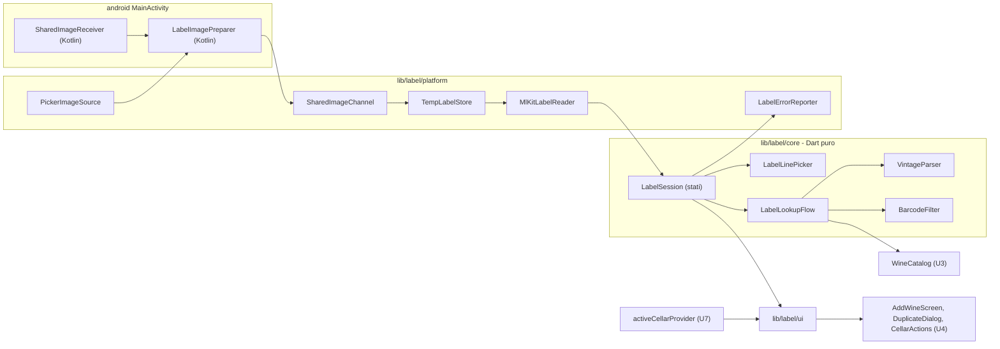

# Logical Components — u6-label-recognition

Fonti:
- requisiti non funzionali di U6: `performance-requirements.md`, `security-requirements.md`, `tech-stack-decisions.md`;
- design funzionale di U6: `functional-spec.md` (BR1.1–BR1.15 e chiarimenti), `rules.md`, `frontend-components.md`;
- `contract-summary.md` (C1);
- codice esistente: `lib/catalog/` (U3), `lib/cellar/` (U4), `lib/app/`, `android/app/src/main/`;
- riepilogo confermato in `nfr-design-questions.md`.

## Componenti

Testo equivalente:
- il nucleo puro sceglie la riga più significativa, legge l'annata, filtra i codici, decide l'ordine di ricerca e tiene lo stato della lettura;
- gli adattatori parlano con ML Kit, il selettore di foto, il canale nativo delle condivisioni, la cartella temporanea e i report degli errori;
- il codice nativo Android riceve le immagini condivise e prepara tutte le immagini (anche quelle del selettore): controlli, riduzione e orientamento, prima di consegnarle a Dart;
- le schermate usano U4 per il modulo e il salvataggio, e U7 per i permessi.

| Componente | File | Responsabilità | Requisiti |
|---|---|---|---|
| `LabelLinePicker` | `lib/label/core/label_line_picker.dart` | Riga più significativa (BR1.12): denominazione riconosciuta, poi la più lunga con almeno 3 lettere, scarti ("ml", "% vol", "contiene solfiti", numeri soli), 120 caratteri | BR1.11, BR1.12 |
| `VintageParser` | `lib/label/core/vintage_parser.dart` | Anno tra 1900 e quest'anno dal testo; con più anni, quello isolato più vicino a una parola di vino, altrimenti il più recente | BR1.8 e chiarimenti |
| `BarcodeFilter` | `lib/label/core/barcode_filter.dart` | Solo EAN-13, EAN-8, UPC-A, normalizzati con `normalizeBarcode` di U3; il primo valido | BR1.7 |
| `LabelLookupFlow` | `lib/label/core/label_lookup_flow.dart` | Ordine di ricerca (BR1.8): `lookupBarcode` con codice e rete, poi `matchLabelText`; errori del catalogo come "nessun risultato"; annata del testo che sostituisce quella del candidato; al più 2 richieste | BR1.8, BR1.9; NFR5.1, NFR6.3 |
| `LabelSession` | `lib/label/core/label_session.dart` | Stati: `reading`, `proposal`, `incomplete`, `unreadable`, `barcodeOnly`, `permissionDenied`, `cameraUnavailable`, `cancelled`; transizioni e "Annulla" | BR1.9–BR1.13 |
| `LabelReader` / `MlKitLabelReader` | `lib/label/platform/mlkit_label_reader.dart` | Codice e testo in parallelo (`Future.wait`) sulla stessa immagine ridotta; testo al più 2.000 caratteri; chiude i riconoscitori dopo ogni lettura | BR1.7; NFR1.2 |
| `ImageSource` / `PickerImageSource` | `lib/label/platform/picker_image_source.dart` | `image_picker` per fotocamera e galleria, senza riduzione; passa il file a `LabelImagePreparer` tramite il canale; `retrieveLostData` all'avvio letto e scartato; traduce gli errori di accesso in `permissionDenied` o `cameraUnavailable` | BR1.2, BR1.3, BR1.5; NFR8.1 |
| `SharedImageChannel` | `lib/label/platform/shared_image_channel.dart` | Canale con il codice nativo: riceve un percorso già verificato in `label/` o un motivo di scarto; riferimento in memoria all'avvio a freddo | BR1.4; NFR4.4, NFR4.5 |
| `SharedImageReceiver` | `android/app/src/main/kotlin/.../SharedImageReceiver.kt` | Solo `ACTION_SEND` e `ACTION_SEND_MULTIPLE` con `image/*`, solo `content://`, primo elemento; copia a blocchi interrotta oltre 20 MB; poi `LabelImagePreparer`; consuma l'intent (`onCreate` e `onNewIntent`) | NFR4.4, NFR4.5 |
| `LabelImagePreparer` | `android/app/src/main/kotlin/.../LabelImagePreparer.kt` | Unico punto di controllo e preparazione delle immagini (condivise e da `image_picker`): dimensione, formato, HEIC solo da API 28, pixel, `inSampleSize`, scala a 2.048, EXIF, scrittura in `cacheDir/label`; thread in background; ogni errore come codice di scarto | NFR4.4; NFR1.2 |
| `TempLabelStore` | `lib/label/platform/temp_label_store.dart` | Cartella `<temporanea>/label/`; cancella il file di una lettura alla fine (successo, errore, annulla, sostituzione, chiusura); svuota la cartella all'avvio prima di qualsiasi lettura; cancella i file più vecchi di 10 minuti | BR1.6; NFR8.1 |
| `LabelErrorReporter` | `lib/label/platform/label_error_reporter.dart` | Unico punto che chiama `ErrorReporter` per U6, con i 4 motivi fissi e il solo tipo dell'eccezione | BR1.14; NFR8.2 |
| Provider | `lib/label/label_providers.dart` | `labelReaderProvider`, `imageSourceProvider`, `tempLabelStoreProvider`, `labelSessionProvider` (`autoDispose`), `sharedImageProvider` | — |
| Schermate | `lib/label/ui/` | `AddChoiceScreen`, `LabelReadingScreen`, `LabelProposalSheet`, `LabelUnreadableView`, `BarcodeOnlyView`, `PermissionDeniedView` | BR1.1, BR1.9–BR1.13; NFR3.x |
| Estensioni di U4 | `lib/cellar/ui/add_wine_screen.dart`, `lib/cellar/ui/cellar_dialogs.dart` | `AddWineInitialValues`; `DuplicateDialog` pubblico | BR1.15 |
| Shell (modifica) | `lib/app/home_shell.dart` | "Aggiungi" apre `AddChoiceScreen`; ascolto delle immagini condivise | BR1.1, BR1.4 |

## Isolamento e impatto di un guasto

| Guasto | Impatto | Contenimento |
|---|---|---|
| ML Kit fallisce o va in crash | Nessuna proposta | Catturato in `MlKitLabelReader` → `unreadable` con `label_read_failed`; "Scrivi a mano" sempre disponibile |
| Catalogo spento, lento o al limite | Nessun vino trovato | `LabelLookupFlow` passa al passo successivo, poi `incomplete` con il modulo di U4 |
| Fotocamera assente | Nessuno scatto | `cameraUnavailable` con "Importa una foto" e "Scrivi a mano" |
| Immagine condivisa ostile | Nessuna lettura | Scarto nativo prima che arrivi a Dart; nessuna copia resta |
| Pulizia dei file fallita | File residuo | `label_cleanup_failed`; ripresa all'avvio e con il limite dei 10 minuti |
