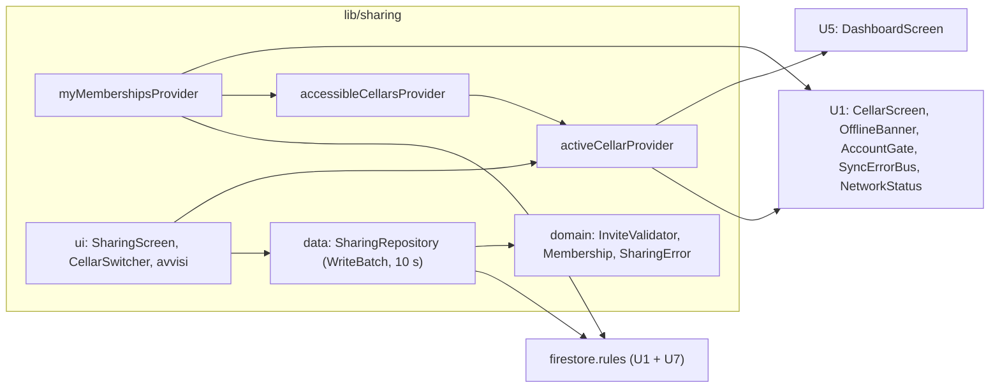

# Logical Components — u7-sharing

Fonti:
- requisiti non funzionali di U7 (`performance-requirements.md`, `security-requirements.md`, `tech-stack-decisions.md`);
- design funzionale di U7 (`functional-spec.md`, `rules.md`, `frontend-components.md`);
- `contract-summary.md` (C3 con le aggiunte del 2026-11-06, C4);
- codice di U1 (`firestore.rules`, `lib/app/providers.dart`, `lib/sync/sync_error_bus.dart`, `lib/account/network_status.dart`, `lib/account/account_gate.dart`);
- riepilogo confermato in `nfr-design-questions.md`.

## Componenti

Testo equivalente:
- il repository scrive e l'ascolto dei propri inviti legge, entrambi passando dalle regole cloud;
- dagli inviti si ricavano le cantine accessibili e da queste la cantina attiva, che usano le schermate di U1 e U5;
- gli errori di accesso perso vanno nel bus di U1.

| Componente | File | Responsabilità | Requisiti |
|---|---|---|---|
| Regole cloud | `firestore.rules` | Funzioni comuni, blocco `members`, gruppo di collezioni, contatore, `drinkingRecords`; tabella degli accessi in commento (`security-design.md` §1) | NFR4.1–NFR4.9, NFR5.2 |
| Indice | `firestore.indexes.json` | `fieldOverride` su `members.inviteeEmail`, ambito `COLLECTION_GROUP` | NFR4.7 |
| `InviteValidator` | `lib/sharing/domain/invite_validator.dart` | Normalizza l'email (trim, minuscolo), controlla il formato (≤ 254 caratteri, niente `/`), sé stesso, già invitata, limite. Puro Dart. | BR1.2; NFR4.9 |
| Modelli ed errori | `lib/sharing/domain/membership.dart`, `sharing_error.dart` | `Membership` (mapper che non lancia mai, come `Wine`), `AccessibleCellar`, `SharingError` (`invalidEmail`, `selfInvite`, `alreadyInvited`, `limitReached`, `notOwner`, `notFound`, `offline`, `timeout`, `failed`) | C4 |
| `SharingRepository` | `lib/sharing/data/sharing_repository.dart` | Le 7 operazioni (`invite`, `changePermission`, `revoke`, `leave`, `activate`, `deleteClosed`, `revokeAllForUser`), ognuna un solo `WriteBatch`; `commit()` con `timeout(10 s)`; traduzione degli errori del cloud (`security-design.md` §4) | BR1.8–BR1.11, BR1.13; NFR2.1, NFR6.2 |
| `myMembershipsProvider` | `lib/sharing/sharing_providers.dart` | `StreamProvider` per uid sulla query `collectionGroup('members').where('inviteeEmail', isEqualTo: email)`; attiva gli inviti `invited` (BR1.4); pubblica `CellarAccessLost` quando un invito passa a `revoked` | BR1.4, BR1.14; NFR2.2, NFR2.3, NFR5.1 |
| `accessibleCellarsProvider` | stesso file | Cantina personale più le cantine con invito `active`, con nome del proprietario e permesso | BR1.5; C4 `listAccessibleCellars` |
| `activeCellarProvider` | stesso file | `Notifier` con la cantina scelta; si salva in `shared_preferences` con la chiave `sharing.activeCellar.<uid>`; se la scelta non è più accessibile torna alla personale; espone `canEdit` | BR1.5, BR1.6; NFR2.4, NFR6.3 |
| `cellarMembersProvider` | stesso file | Ascolto dei `members` di una cantina, aperto **solo** quando il proprietario apre "Persone" | BR1.12; NFR5.1 |
| Schermate | `lib/sharing/ui/` | `SharingScreen`, `InviteForm`, `MemberTile`, `PermissionMenu`, `RevokeDialog`, `LeaveCellarDialog`, `CellarSwitcher`, `SharedCellarNotice`; condivisione con `share_plus` | BR1.1–BR1.12; NFR3.x |
| Modifiche a U1 (dettaglio in `security-design.md` §4) | `lib/cellar/domain/cellar.dart` (`memberSlots`, `memberOpKey`), `lib/cellar/data/cellar_repository.dart` (`watchCellar(cellarId)`), `lib/cellar/data/wine_repository.dart` (`cellarId` negli errori), `lib/cellar/ui/*`, `lib/sync/ui/offline_banner.dart`, `lib/app/providers.dart` (`syncStatusProvider`, `reopenCellarListeners`, `invalidateFirestoreListeners`), `lib/account/account_gate.dart` (`retryCellar`, reset), `lib/sync/sync_error_bus.dart` (`CellarAccessLost`), `lib/account/network_status.dart` (`onChanged`), `lib/app/home_shell.dart` | Come nella tabella "Integrazione con U1" di `functional-spec.md` | NFR6.1, NFR6.3, NFR6.4, NFR7.5 |
| Modifiche a U5 | `lib/dashboard/dashboard_providers.dart`, `lib/dashboard/ui/dashboard_screen.dart` | La cantina attiva al posto di `Cellar.personalCellarId(uid)`; con `read` nasconde "Aggiungi il primo vino" | BR1.6 |

## Isolamento e impatto di un guasto

| Guasto | Impatto | Contenimento |
|---|---|---|
| Regola sbagliata | Una persona vede o scrive dove non dovrebbe | Matrice di test delle regole nel job `rules`, obbligatorio prima del merge (NFR4.1) |
| Indice mancante in produzione | La ricerca degli inviti fallisce: nessuna cantina condivisa compare | Controllo dell'indice in CI; pubblicazione delle regole e dell'indice **prima** della versione dell'app (NFR4.7). L'errore della query non blocca la cantina personale |
| Quota giornaliera esaurita | Le letture dal cloud falliscono fino al giorno dopo | L'app continua dalla cache come offline (U1); avviso al 70% (design dell'infrastruttura) |
| Batch scaduto | Esito incerto | "Non riuscito, riprova"; le regole rifiutano un doppione (NFR6.2) |
| Accesso revocato | Ascolti chiusi dalle regole | Ritorno alla cantina personale, un solo avviso (NFR6.3) |
