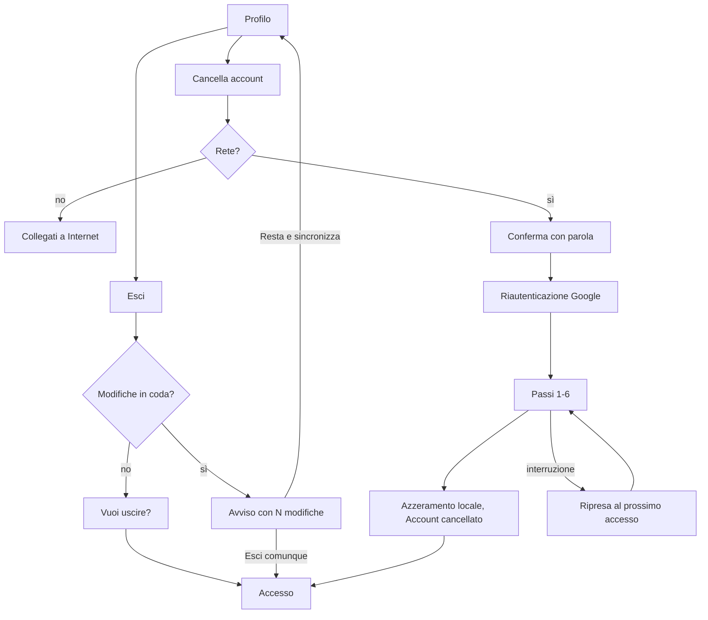

# Functional Specification — u8-account

Fonti:
- `unit-of-work.md` (U8);
- `requirements.md` (FR1.3, FR1.4 e NFR8 aggiornati il 2026-11-06; FR10, NFR3);
- `stories.md` (US1.2, US1.3);
- `components.md` (Account);
- `contract-summary.md` (C3 dati e regole, C4 condivisione di U7);
- mockup S0 (presentazione) e profilo;
- risposte in `functional-design-questions.md`: Q1 = A (avviso con scelta), Q2 = A (pagina su GitHub Pages), Q3 = A (uscita dalle cantine altrui, bevute conservate), riepilogo confermato.

U8 completa il ciclo di vita dell'account:
- presentazione al primo avvio;
- profilo;
- uscita con avviso sulle modifiche in coda;
- cancellazione dell'account fatta dall'app, senza funzioni nel cloud;
- pagina web per chiedere la cancellazione.

## Interfacce usate

| Interfaccia | Da | Uso |
|---|---|---|
| `AuthService` (accesso Google, `signOut`, nuovo `reauthenticate` e `deleteUser`) | U1 | Uscita e cancellazione |
| `LocalLedger` (modifiche in coda) e `ResetCoordinator` (azzeramento locale) | U1 | Avviso di uscita, pulizia finale |
| `NetworkStatus` | U1 | La cancellazione richiede la rete |
| `SharingRepository` (`leave`, `revoke`, `deleteClosed`, `revokeAllForUser`) | U7 | Uscita dalle cantine altrui e revoca degli inviti |
| `WineRepository.deleteWineWithRecords`, `DrinkingRecordRepository` | U4 | Cancellazione di vini e bevute a parti di 400 |
| `TempLabelStore` | U6 | Pulizia di eventuali file della foto |

## Aggiunte al modello dati (C3)

| Dove | Campo | Significato |
|---|---|---|
| `users/{uid}` | `deletionStartedAt` (timestamp, facoltativo) | La cancellazione è iniziata; l'account non si usa finché non finisce |
| Telefono (`shared_preferences`) | `onboarding.seen` (bool) | La presentazione è già stata vista su questo telefono |

## Regole

| ID | Regola |
|---|---|
| BR1.1 | **Presentazione al primo avvio.** Tre pagine (mockup S0) con indicatore di pagina, "Salta" e, all'ultima, "Inizia"; entrambi portano all'accesso. Si mostra **prima** dell'accesso, quindi il profilo nel cloud non è ancora leggibile: decide il segnale locale `onboarding.seen`, che diventa vero con "Salta" o "Inizia". Il campo esistente `users/{uid}.onboardingSeen` (U1) resta come oggi e si imposta a vero alla creazione del profilo; non decide la presentazione. Un'uscita o una cancellazione non la ripropongono. |
| BR1.2 | **Profilo.** Dal menu dell'app: foto, nome ed email dell'account Google, "Esci", "Cancella account", e il collegamento all'informativa sulla privacy. |
| BR1.3 | **Uscita senza modifiche in coda (AC1.2.1).** "Esci" chiede "Vuoi uscire?" con "Annulla" ed "Esci". Con "Esci": `signOut` di U1 e ritorno all'accesso. I dati locali restano finché non entra un altro account (U1). |
| BR1.4 | **Uscita con modifiche in coda (AC1.2.2, Q1 = A).** Se il registro di U1 ha N scritture non confermate: "Hai N modifiche non ancora salvate. Se esci e poi entra un altro account, andranno perse." con "Resta e sincronizza" ed "Esci comunque". "Resta e sincronizza" chiude l'avviso e prova la sincronizzazione; se va a buon fine compare "Tutto salvato" e si può uscire normalmente. |
| BR1.5 | **Cancellazione: condizioni.** "Cancella account" richiede la rete; senza rete: "Collegati a Internet per cancellare l'account". Durante la cancellazione l'app mostra solo l'avanzamento, senza altre schermate. |
| BR1.6 | **Cancellazione: conferma (AC1.3.1).** La schermata elenca cosa si cancella: la tua cantina con vini e Storico, le condivisioni che hai dato (le persone invitate perdono l'accesso), la tua partecipazione alle cantine di altri (le tue bevute restano lì senza nome), il profilo. Il pulsante "Cancella per sempre" si attiva solo scrivendo la parola di conferma della lingua dell'app (it "CANCELLA", en "DELETE", pt-BR "EXCLUIR"). Poi si rifà l'accesso con Google (riautenticazione richiesta da Firebase). |
| BR1.7 | **Cancellazione: ordine (corretto dopo la revisione).** Il runner (`AccountDeletionRunner`) esegue i passi uno alla volta e si ferma al primo errore; non usa `revokeAllForUser` di U7, che raccoglie gli errori e segue un altro ordine. Dopo la riautenticazione: 0. segnale locale `account.deletion.<uid>` = passo 0, poi arresto di `SyncWatcher` e degli ascolti e azzeramento del registro delle scritture in coda (BR1.13); 1. `users/{uid}.deletionStartedAt` = adesso (solo se assente); 2. nelle cantine altrui: per ogni invito **in attesa**, prima attivazione (`activate`) e poi uscita, come fa già `revokeAllForUser`; per ogni invito **attivo**, uscita (`leave`); poi cancellazione di **tutti** i tuoi documenti `members` chiusi, compresi quelli revocati in passato o lasciati prima; 3. nella tua cantina: revoca di ogni invito ancora aperto, poi cancellazione di tutti i documenti `members`; 4. bevute e vini della tua cantina, a parti di 400 (U4); 5. la tua cantina; 6. `users/{uid}`, poi subito `deleteUser` di Firebase Auth; 7. segnale locale = completato, azzeramento locale (`ResetCoordinator`), pulizia di `TempLabelStore`, ritorno all'accesso con "Account cancellato". Il segnale locale avanza a ogni passo riuscito. |
| BR1.8 | **Ripresa (corretta dopo la revisione).** Ogni passo è ripetibile. Una cancellazione si considera in corso **solo** se c'è un segnale esplicito: il segnale locale `account.deletion.<uid>` oppure `users/{uid}.deletionStartedAt`. L'assenza del profilo **non** è mai un segnale: è anche lo stato di un account appena creato. • Il controllo avviene in `AccountGate` **prima** di `ensureProfile` e `ensurePersonalCellar`: con un segnale, il gate non ricrea profilo e cantina e mostra la schermata di avanzamento, che riprende dal passo indicato dal segnale locale (o dal passo 1 se c'è solo `deletionStartedAt`). • Caso limite: interruzione tra il passo 6 (`users` cancellato) e `deleteUser`, su un telefono senza segnale locale (app reinstallata). L'account torna come nuovo, con profilo e cantina vuoti ricreati dal gate; i dati sono già cancellati e si può ripetere "Cancella account". Il caso è dichiarato nella procedura della checklist. |
| BR1.9 | **Cantine altrui (Q3 = A, precisata dopo la revisione).** Le cantine restano ai proprietari. Si cancellano tutti i tuoi documenti `members` (attivi, in attesa e chiusi), quindi nelle cantine altrui non restano la tua email né il tuo nome. Le bevute registrate da te restano nel loro Storico con il solo identificativo tecnico `recordedBy` (un codice casuale di Firebase, non un dato leggibile): dove serviva il tuo nome compare "Persona non più presente". Questo residuo è dichiarato nell'informativa sulla privacy. Nessuna altra scrittura nelle cantine altrui. |
| BR1.10 | **Regole del cloud.** Si aggiungono solo i permessi necessari: • `users/{uid}`: `delete` solo da quell'utente; aggiornamento di `deletionStartedAt` solo da quell'utente, solo se il campo è assente, con valore uguale a `request.time`, e poi immutabile; • `cellars/{id}`: `delete` solo dal proprietario e solo se non ci sono più inviti aperti (`memberSlots == 0`). Bevute, vini e `members` chiusi si cancellano già con le regole di U4 e U7. |
| BR1.11 | **Pagina web per Google Play (Q2 = A).** Pagina statica su GitHub Pages (`docs/account-deletion/`) in it, en e pt-BR: come cancellare dall'app, cosa si cancella, entro quando (30 giorni), e l'indirizzo email per chiedere la cancellazione senza l'app. L'indirizzo lo sceglie il proprietario prima della pubblicazione; nel repository c'è un segnaposto controllato dalla checklist. |
| BR1.12 | **Richieste via email.** Procedura nella checklist: verificare che il mittente sia l'email dell'account, cancellare dalla console Firebase gli stessi dati di BR1.7 e l'utente di Authentication, rispondere entro 30 giorni (NFR8). |
| BR1.13 | **Contratto con il resto dell'app durante la cancellazione (aggiunta dopo la revisione).** • **Scritture in coda:** prima della conferma, se il registro di U1 ha N scritture non confermate, la schermata dice "Hai N modifiche non ancora salvate: andranno perse con la cancellazione". Al passo 0 il registro si azzera, così nessuna scrittura viene ritentata contro dati cancellati. • **Sincronizzazione e ascolti:** al passo 0 si fermano `SyncWatcher` e tutti gli ascolti di Firestore (come fa `ResetCoordinator` all'inizio), e non ripartono finché la cancellazione non finisce. • **Dopo `deleteUser`:** prima di chiamarlo il runner imposta lo stato `deletionCompleted` nel gate; quando arriva il cambio di utente, il gate mostra l'accesso con "Account cancellato" invece di "Sessione scaduta". |

## Flussi

Testo equivalente: dal profilo si esce, con un avviso se ci sono modifiche in coda, oppure si cancella l'account. La cancellazione richiede rete, una parola di conferma e la riautenticazione; poi esegue i passi in ordine e, se si interrompe, riprende al prossimo accesso.

## Errori e casi limite

| Caso | Comportamento |
|---|---|
| Riautenticazione annullata o con un altro account Google | Nessuna cancellazione; "La cancellazione richiede l'accesso con lo stesso account" |
| Rete persa a metà | Avanzamento fermo con "Riprova"; ripresa anche al prossimo accesso (BR1.8) |
| Regole che rifiutano un passo | Messaggio "Non è stato possibile completare la cancellazione. Riprova" e motivo fisso `account_delete_failed` nei report, senza dati personali |
| `deleteUser` chiede di nuovo l'accesso | Nuova riautenticazione e ripetizione del passo 6 |
| Invito in attesa in una cantina altrui | Trattato come attivo: uscita e cancellazione |
| Proprietario con persone invitate | Revoca prima della cancellazione: perdono subito l'accesso |

## Fuori ambito

- Funzioni nel cloud per la cancellazione automatica (budget 0 €).
- Esportazione dei dati prima della cancellazione.
- Cambio di account Google senza uscire.

## Chiarimenti dopo la seconda revisione (2026-11-06)

Questi punti precisano BR1.1, BR1.7, BR1.8, BR1.9, BR1.10, BR1.12 e BR1.13. Dove c'è differenza, vale questa sezione.

- **Scritture già in coda in Firestore (BR1.7 passo 0, BR1.13).** Azzerare il registro di U1 non svuota la coda interna di Firestore. Perciò il passo 0 diventa:
  1. fermare `SyncWatcher` e gli ascolti;
  2. aspettare `waitForPendingWrites()` con un tempo massimo di 30 s: con la rete presente (BR1.5) le modifiche in coda arrivano al server e poi vengono cancellate con il resto;
  3. se l'attesa scade o una scrittura è rifiutata, la cancellazione non inizia e compare "Non riesco a salvare le modifiche in sospeso. Riprova", con "Riprova";
  4. solo dopo, azzeramento del registro.
  
  L'avviso di BR1.13 diventa: "Hai N modifiche non ancora salvate: verranno salvate e poi cancellate con il resto".
- **Cancellazione di vini e bevute (BR1.7 passo 4).** Non si usa `deleteWineWithRecords` di U4, che lavora su un vino alla volta e passa dal registro. Il runner:
  - legge dal **server** tutti i vini della cantina, senza il filtro `quantity > 0`, quindi anche quelli finiti;
  - legge tutte le bevute della cantina (raccolta `drinkingRecords` intera), comprese quelle di vini già cancellati;
  - cancella bevute e poi vini in batch da 400, aspettando la conferma del server per ogni batch (`commit` con la rete; nessun passaggio dal registro);
  - ripete la lettura finché entrambe le raccolte sono vuote.
- **Profilo assente al passo 1 (BR1.7, BR1.10).** Il profilo può mancare, perché U1 lo crea in background. Il passo 1 quindi:
  - aggiorna `users/{uid}` con `deletionStartedAt` se il profilo esiste;
  - altrimenti lo **crea** con i campi di U1 più `deletionStartedAt`.
  
  BR1.10 si estende: la creazione del profilo ammette il campo facoltativo `deletionStartedAt == request.time`.
- **Gate (BR1.8):**
  - **Ordine:** prima i controlli esistenti di `_admit` (accesso valido, account bloccato, azzeramento in sospeso), poi il controllo della cancellazione, poi `ensureProfile` e `ensurePersonalCellar`.
  - **Stati nuovi di `GateState`:** `GateDeleting(step)` e `GateDeleted`.
  - **Lettura di `deletionStartedAt` impossibile** (senza rete e senza cache):
    - con il segnale locale, il gate mostra `GateDeleting` con "Collegati a Internet per completare la cancellazione";
    - senza segnale locale, il gate procede normalmente: senza un segnale esplicito non si cancella.
- **Fine della cancellazione (BR1.7 passo 7):**
  - `ResetCoordinator.reset` riceve l'uid dell'account cancellato e azzera il telefono senza aprire una nuova cantina;
  - il segnale locale si toglie **dopo** che l'azzeramento è riuscito;
  - se l'azzeramento fallisce, il segnale resta e al prossimo avvio si ripete solo il passo 7.
- **Residui nelle cantine altrui (BR1.9).** Oltre a `recordedBy` nelle bevute, possono restare `updatedBy` (vini e bevute) e `closedBy` (inviti, ora cancellati). Sono codici tecnici casuali, non leggibili. L'informativa li dichiara insieme a `recordedBy`.
- **Procedura manuale via email (BR1.12).** La checklist elenca esplicitamente cosa cancellare dalla console:
  - le sotto-raccolte `wines`, `drinkingRecords` e `members` della cantina;
  - la cantina;
  - i documenti `members` dell'utente nelle cantine altrui (ricerca per `inviteeEmail`);
  - `users/{uid}`;
  - l'utente in Authentication.
- **Presentazione e aggiornamenti (BR1.1).** All'avvio, se c'è già una sessione salvata (utente che aggiorna l'app), la presentazione non compare e `onboarding.seen` diventa vero.

## Decisione del proprietario sulla pagina web (2026-11-06, durante NFR Requirements)

Sostituisce BR1.11 e BR1.12 dove differiscono.

- **BR1.11 (nuova forma):** la pagina su GitHub Pages (`docs/account-deletion/`, it, en, pt-BR) è una piccola versione web di "Cancella account":
  - **accesso con Google:** Firebase Auth nel browser, con un token firmato verificato dalle stesse regole del database dell'app;
  - **conferma:** elenco di cosa si cancella e parola di conferma;
  - **cancellazione:** gli stessi passi di BR1.7 (salvo il passo 0, che riguarda solo il telefono), con la stessa ripresa da `deletionStartedAt` e la riautenticazione prima di riprendere;
  - **costo:** niente server né funzioni nel cloud, 0 €.
- **BR1.12 (nuova forma):** l'email `bottazzinibruno@gmail.com` resta solo come **ultima strada** per chi non può più accedere al proprio account Google. Procedura nella checklist:
  1. annotare la data della richiesta;
  2. rispondere **all'indirizzo dell'account** chiedendo conferma ("Rispondi Sì");
  3. cancellare dalla console solo dopo il "Sì" arrivato da quell'indirizzo, entro 30 giorni;
  4. senza risposta entro 14 giorni, chiudere la richiesta senza cancellare.
  
  Non serve controllare firme o intestazioni.

