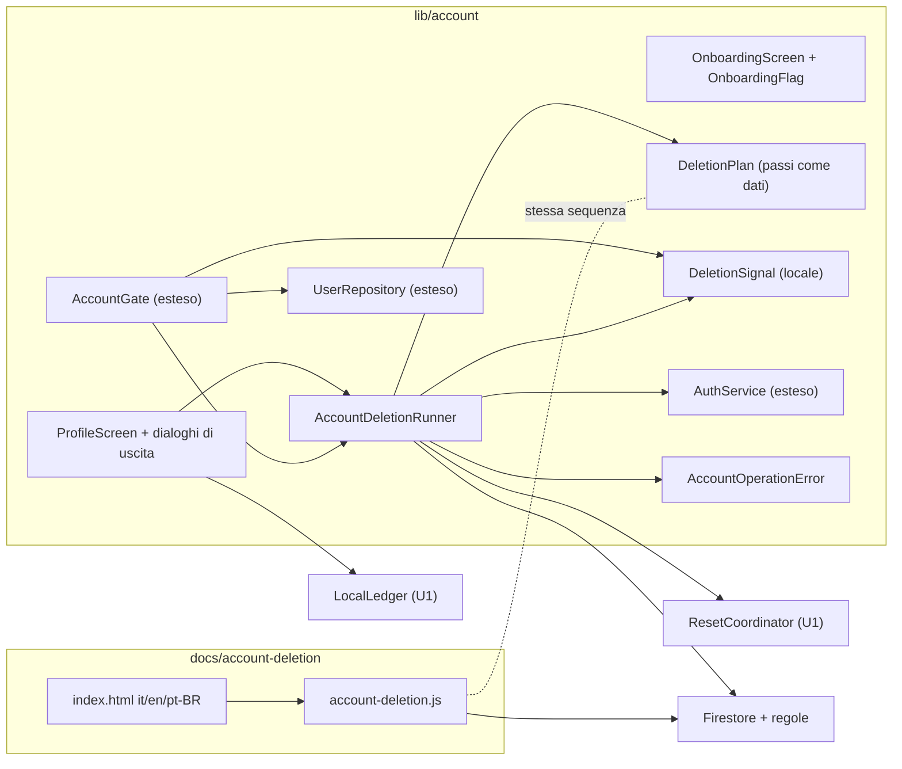

# Logical Components — u8-account

Fonti:
- requisiti non funzionali di U8: `performance-requirements.md`, `security-requirements.md`, `tech-stack-decisions.md`;
- design funzionale di U8: `functional-spec.md` (BR1.1–BR1.13, chiarimenti, decisione sulla pagina web), `rules.md`, `frontend-components.md`;
- codice esistente: `lib/account/`, `lib/sharing/data/sharing_repository.dart`, `lib/cellar/`, `lib/sync/`, `firestore.rules`;
- riepilogo confermato in `nfr-design-questions.md`.

## Componenti

Testo equivalente:
- la presentazione e il profilo stanno nell'app;
- il runner esegue la sequenza descritta da `DeletionPlan` e aggiorna il segnale locale;
- il gate controlla il segnale prima di aprire profilo e cantina;
- la pagina web esegue la stessa sequenza in JavaScript, con le stesse regole.

| Componente | File | Responsabilità | Requisiti |
|---|---|---|---|
| `OnboardingScreen`, `OnboardingFlag` | `lib/account/ui/onboarding_screen.dart`, `lib/account/onboarding_flag.dart` | Tre pagine; `onboarding.seen` in `shared_preferences`; saltata se c'è già una sessione | BR1.1; NFR1.1, NFR3.x |
| `ProfileScreen`, `SignOutConfirmDialog`, `SignOutWarningDialog` | `lib/account/ui/profile_screen.dart` | Nome, email, Esci, Cancella account; N dal `LocalLedger` | BR1.2–BR1.4; NFR6.3 |
| `DeleteAccountScreen`, `DeletionProgressView` | `lib/account/ui/delete_account_screen.dart` | Elenco, parola di conferma, avviso sulle modifiche in coda, avanzamento, Riprova | BR1.5, BR1.6, BR1.13; NFR3.2, NFR6.4 |
| `DeletionPlan` | `lib/account/deletion/deletion_plan.dart` | I passi 0–7 come dati (nome, condizione, operazione), riusati dai test di sequenza | BR1.7 |
| `AccountDeletionRunner` | `lib/account/deletion/account_deletion_runner.dart` | Esegue i passi, si ferma al primo errore, aggiorna `DeletionSignal`, attende `waitForPendingWrites` (30 s), letture dal server a pagine di 400, batch da 400 confermati | BR1.7, BR1.8, BR1.13; NFR1.2, NFR1.3, NFR6.1 |
| `DeletionSignal` | `lib/account/deletion/deletion_signal.dart` | `account.deletion.<uid>` con il passo raggiunto; tolto dopo l'azzeramento | BR1.8; NFR8.3 |
| `AccountGate` (esteso) | `lib/account/account_gate.dart` | Dopo `_admit`, prima di `ensureProfile`: controllo del segnale e di `deletionStartedAt`; stati `GateDeleting(step)` e `GateDeleted`; riautenticazione prima della ripresa | BR1.8; NFR4.6, NFR6.2 |
| `UserRepository` (esteso) | `lib/account/data/user_repository.dart` | `markDeletionStarted` (crea o aggiorna con `deletionStartedAt`), `deleteProfile` | BR1.7; NFR4.2 |
| `AuthService` (esteso) | `lib/account/auth_service.dart`, `google_auth_service.dart` | `reauthenticate` con controllo dello stesso uid, `deleteUser` | BR1.6; NFR4.6 |
| `AccountOperationError` | `lib/account/account_operation_error.dart` | Errore tipizzato: motivo fisso, passo, nome del tipo originale | NFR8.2 |
| Regole | `firestore.rules` | `users` delete e `deletionStartedAt`; `cellars` delete con recupero | BR1.10; NFR4.1–NFR4.4 |
| Pagina web | `docs/account-deletion/index.html`, `en/`, `pt-BR/`, `account-deletion.js` (esporta `createAccountDeletion(sdk, db, auth)`), `vendor/firebase/<versione>/` | Accesso Google, conferma, stessa sequenza, ripresa; pubblicata da `gh-pages` con `pages.yml` dopo le regole | BR1.11; NFR8.5, NFR4.7 |

## Isolamento e impatto di un guasto

| Guasto | Impatto | Contenimento |
|---|---|---|
| Rete persa durante la cancellazione | Passo fermo | Errore con Riprova; segnale locale e `deletionStartedAt` permettono la ripresa |
| Regole che rifiutano un passo | Passo fermo | `account_delete_failed` con il passo; Riprova; percorso di recupero per la cantina |
| App chiusa a metà | Account in uno stato intermedio | Il gate riprende prima di ricreare profilo e cantina |
| `deleteUser` chiede un accesso recente | Passo 6 fermo | Nuova riautenticazione e ripetizione |
| Pagina web aperta su un account già in cancellazione dall'app | Due esecutori | I passi sono ripetibili; ogni passo verifica lo stato prima di scrivere |
