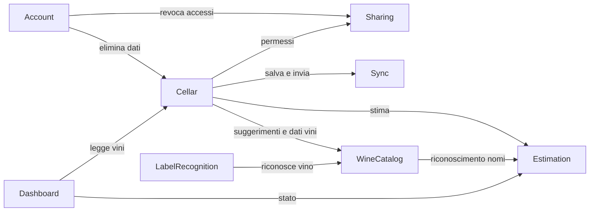

# Components — Vinoozy

Fonti: `requirements.md` (FR1–FR10, NFR1–NFR8), `stories.md` (US1.1–US10.1), `team-practices.md`, risposte in `domain-design-questions.md` (Q1: divisione per area; Q2: intermediario cloud per la base dati vini). Qui ci sono solo i mattoni logici e chi possiede quali dati; tipi, vincoli e distribuzione vengono definiti nelle fasi successive.

## Catalogo (fonte di verità)

```yaml
components:
  - name: Account
    summary: Accesso con Google, sessione, uscita e cancellazione dell'account
    behaviour: >
      Autentica l'utente con Google; mantiene la sessione anche offline dopo il primo accesso;
      all'uscita avvisa se ci sono modifiche non sincronizzate; la cancellazione dell'account
      chiede conferma, elimina cantine, storico e foto del proprietario tramite Cellar e
      revoca tutte le condivisioni tramite Sharing; ricorda se la presentazione iniziale e' gia' stata vista.
    responsibilities:
      - Accesso e sessione (FR1.1, FR1.2)
      - Uscita (FR1.3)
      - Cancellazione account e dati (FR1.4, NFR8)
      - Preferenze utente (lingua di riserva, presentazione vista)
    depends_on:
      - component: Cellar
        interaction: eliminare cantine, vini, bevute e foto alla cancellazione dell'account
        style: async
      - component: Sharing
        interaction: revocare gli accessi concessi e quelli ricevuti alla cancellazione
        style: async
    dependents: []
    external_dependencies:
      - name: Firebase Authentication
        kind: third-party-api
        purpose: accesso con account Google
    entities:
      - name: UserProfile
        identifier: userId
        attributes: [userId, displayName, email, onboardingSeen, createdAt]

  - name: Cellar
    summary: Cantina, vini, quantita' e bottiglie bevute (storico)
    behaviour: >
      Aggiunge vini da testo o da proposta confermata; se nome, produttore e annata
      corrispondono a un vino esistente aumenta la quantita' invece di creare un doppione;
      valida nome, annata (1900..anno corrente o senza annata) e quantita' (1..99);
      registra le correzioni di quantita' (+/-) come variazioni, senza voce nello storico;
      "segna come bevuta" crea un DrinkingRecord e riduce la quantita' di 1, mai sotto 0;
      un vino con quantita' 0 esce dall'elenco e resta visibile solo nello storico;
      annullare una bevuta la elimina e ripristina la quantita'; ogni scrittura verifica
      il permesso dell'utente tramite Sharing; chiede a Estimation la finestra quando un vino
      viene creato o modificato.
    responsibilities:
      - Inventario vini e quantita' (FR2.1, FR2.4, FR2.5, FR2.6, FR2.7, FR3.1-FR3.4)
      - Bottiglie bevute, voto, note e storico (FR6.1-FR6.4)
      - Conferma della proposta da foto (FR2.3)
    depends_on:
      - component: Estimation
        interaction: ottenere finestra ideale, fiducia e abbinamenti per un vino nuovo o modificato
        style: sync
      - component: Sharing
        interaction: verificare se l'utente corrente puo' leggere o modificare la cantina
        style: sync
      - component: Sync
        interaction: salvare le modifiche in locale e metterle in coda per il cloud
        style: async
      - component: WineCatalog
        interaction: suggerimenti durante la scrittura e dati esterni da passare a Estimation (aggiunto 2026-11-05)
        style: sync
    dependents:
      - component: Account
        interaction: eliminare i dati alla cancellazione dell'account
      - component: Dashboard
        interaction: leggere vini e quantita' per i grafici
    external_dependencies:
      - name: Cloud Firestore
        kind: database
        purpose: archivio cloud di cantine, vini e bevute
    entities:
      - name: Cellar
        identifier: cellarId
        attributes: [cellarId, ownerId, name, createdAt]
        references:
          - entity: UserProfile
            owned_by: Account
            relationship: ogni cantina ha un solo proprietario
      - name: Wine
        identifier: wineId
        attributes: [wineId, cellarId, name, producer, vintage, wineType, region, denomination, quantity, estimateId, createdAt, updatedAt]
        references:
          - entity: DrinkingWindowEstimate
            owned_by: Estimation
            relationship: ogni vino ha al massimo una stima corrente
      - name: DrinkingRecord
        identifier: recordId
        attributes: [recordId, cellarId, wineId, wineSnapshotName, vintage, drankOn, rating, notes, recordedBy]
        references:
          - entity: UserProfile
            owned_by: Account
            relationship: ogni bevuta e' registrata da un utente

  - name: Estimation
    summary: Finestra ideale, stato del vino, fiducia e abbinamenti
    behaviour: >
      Per un vino usa i dati esterni che Cellar ottiene da WineCatalog (aggiornato 2026-11-05: Estimation
      resta una libreria pura e non chiama WineCatalog); se non ci sono o non c'e' rete
      applica regole interne per tipologia, denominazione e annata, con fiducia piu' bassa;
      la fiducia ha tre livelli (alta, media, bassa); lo stato (da aspettare, pronto,
      da bere presto, oltre la finestra) si calcola sempre dalla data di oggi e non viene salvato;
      "da bere presto" quando mancano alla fine al massimo il 25% della durata della finestra,
      con preavviso minimo 3 mesi e massimo 12; restituisce anche gli abbinamenti, oppure quelli
      tipici della tipologia indicandolo.
    responsibilities:
      - Stima della finestra e fonte (FR4.1-FR4.4, FR4.7)
      - Stato derivato e regola "da bere presto" (FR4.5, FR4.6)
      - Abbinamenti cibo-vino (FR7.1, FR7.2)
    depends_on: []
    dependents:
      - component: Cellar
        interaction: stimare un vino nuovo o modificato, passando i dati esterni ottenuti da WineCatalog
      - component: WineCatalog
        interaction: usare normalizzazione e riconoscimento delle denominazioni
      - component: Dashboard
        interaction: calcolare lo stato di ogni vino per i grafici
    external_dependencies: []
    entities:
      - name: DrinkingWindowEstimate
        identifier: estimateId
        attributes: [estimateId, wineId, startYear, peakYear, endYear, confidence, source, pairings, estimatedAt]
        references:
          - entity: Wine
            owned_by: Cellar
            relationship: ogni stima si riferisce a un solo vino

  - name: WineCatalog
    summary: Catalogo dei vini dentro l'app (catalogo interno + Open Food Facts) (aggiornato 2026-11-05)
    behaviour: >
      Modulo dentro l'app; fornisce suggerimenti di nomi mentre l'utente scrive, il riconoscimento di un vino
      da un testo letto sull'etichetta o da un codice a barre e i dati esterni disponibili per la stima;
      usa un catalogo interno sempre disponibile e Open Food Facts quando c'e' rete; limita le richieste
      verso Open Food Facts, conserva le risposte per 30 giorni e ogni chiamata ha un timeout.
      In origine era una funzione cloud con la chiave di un fornitore: cambiato su scelta del proprietario
      in Functional Design di U3.
    responsibilities:
      - Suggerimenti di vini durante la scrittura (FR2.1)
      - Corrispondenza testo dell'etichetta -> vino (FR2.2)
      - Dati della base esterna per stima e abbinamenti (FR4.2, FR7.2)
    depends_on:
      - component: Estimation
        interaction: normalizzazione e riconoscimento delle denominazioni (funzioni di catalogo di C2)
        style: sync
    dependents:
      - component: Cellar
        interaction: suggerimenti durante la scrittura e dati esterni da passare a Estimation
      - component: LabelRecognition
        interaction: trovare il vino corrispondente al testo letto
    external_dependencies:
      - name: Open Food Facts
        kind: third-party-api
        purpose: nome, produttore e categoria dei vini in commercio, anche per codice a barre (dati ODbL)
    entities: []

  - name: LabelRecognition
    summary: Lettura del testo dell'etichetta sul telefono e proposta del vino
    behaviour: >
      Legge il testo dalla foto sul telefono, senza inviare la foto; manda il testo a WineCatalog
      per trovare il vino; restituisce una proposta che l'utente conferma o corregge;
      se il testo non e' leggibile o non c'e' rete, propone di scrivere a mano.
    responsibilities:
      - Lettura dell'etichetta e proposta (FR2.2)
    depends_on:
      - component: WineCatalog
        interaction: trovare il vino corrispondente al testo letto
        style: sync
    dependents: []
    external_dependencies:
      - name: Riconoscimento testo sul telefono (ML Kit)
        kind: other
        purpose: lettura del testo dell'etichetta senza costi
    entities: []

  - name: Sharing
    summary: Inviti, permessi e accesso alle cantine condivise
    behaviour: >
      Il proprietario invita fino a 2 persone per email (limite portato da 5 a 2 il 2026-11-06) con permesso "solo lettura" o "puo' modificare";
      rifiuta inviti a se stessi, a email gia' invitate e oltre il limite; la revoca ha effetto
      alla successiva sincronizzazione della persona; risponde alle verifiche di permesso;
      le stesse regole valgono anche lato cloud, cosi' una modifica non permessa viene rifiutata.
    responsibilities:
      - Inviti e permessi (FR8.1, FR8.2)
      - Revoca (FR8.3)
      - Verifica dei permessi lato app e lato cloud (FR8.4, NFR4)
    depends_on: []
    dependents:
      - component: Account
        interaction: revocare gli accessi alla cancellazione
      - component: Cellar
        interaction: verificare i permessi prima di ogni lettura o scrittura
    external_dependencies:
      - name: Firestore Security Rules
        kind: other
        purpose: applicare i permessi lato cloud
    entities:
      - name: CellarMembership
        identifier: membershipId
        attributes: [membershipId, cellarId, inviteeEmail, inviteeUserId, permission, status, invitedAt]
        references:
          - entity: Cellar
            owned_by: Cellar
            relationship: ogni accesso riguarda una sola cantina
          - entity: UserProfile
            owned_by: Account
            relationship: l'accesso e' legato all'utente invitato quando accede

  - name: Sync
    summary: Lavoro offline e sincronizzazione con il cloud
    behaviour: >
      Salva ogni modifica prima sul telefono e la invia al cloud quando c'e' rete, senza perderla
      se l'app si chiude; le variazioni di quantita' si inviano come incrementi, cosi' modifiche
      contemporanee di due persone si sommano; per gli altri campi vale l'ultima modifica;
      espone lo stato "offline - sincronizzazione in attesa" all'interfaccia.
    responsibilities:
      - Funzionamento offline e coda di invio (FR9.1, FR9.2, NFR6)
      - Stato di sincronizzazione (FR9.3)
      - Regole di unione delle modifiche (FR9.4)
    depends_on: []
    dependents:
      - component: Cellar
        interaction: salvare e inviare le modifiche
    external_dependencies:
      - name: Cloud Firestore (cache offline)
        kind: database
        purpose: archivio locale e sincronizzazione
    entities:
      - name: SyncStatus
        identifier: deviceId
        attributes: [deviceId, pendingCount, lastSyncedAt, lastError]

  - name: Dashboard
    summary: Statistiche per il cruscotto e la lista "da bere presto"
    behaviour: >
      Calcola dai vini e dagli stati: lista "da bere presto" ordinata per fine finestra;
      conteggi per stato (aggiornato 2026-11-06, scelta del proprietario in Functional Design di U5: quattro barre, "da bere presto" separata dalle pronte); bottiglie per anno di picco;
      bottiglie per tipologia; restituisce anche una descrizione testuale per il lettore schermo.
    responsibilities:
      - Lista "da bere presto" (FR5.1, FR5.2)
      - Dati dei grafici e descrizioni accessibili (FR5.3-FR5.6, NFR2)
    depends_on:
      - component: Cellar
        interaction: leggere vini e quantita'
        style: sync
      - component: Estimation
        interaction: calcolare lo stato di ogni vino
        style: sync
    dependents: []
    external_dependencies: []
    entities: []
```

Lingua e tema dell'interfaccia (FR10) sono aspetti trasversali dello strato di presentazione, non un componente con logica propria: sono assegnati all'interfaccia di ogni componente che mostra schermate.

## Component Diagram



<!-- Text fallback: Account usa Cellar e Sharing; Cellar usa Estimation, Sharing e Sync; Cellar e LabelRecognition usano WineCatalog; WineCatalog usa Estimation per riconoscere i nomi (aggiornato 2026-11-05); Dashboard usa Cellar ed Estimation. Nessun ciclo. -->

## Component Summary

| Component | Purpose | Depends On | Dependents | Entities Owned |
|-----------|---------|------------|------------|----------------|
| Account | Accesso, uscita, cancellazione | Cellar, Sharing | — | UserProfile |
| Cellar | Vini, quantità, bevute | Estimation, Sharing, Sync, WineCatalog | Account, Dashboard | Cellar, Wine, DrinkingRecord |
| Estimation | Finestra, stato, fiducia, abbinamenti | — | Cellar, Dashboard, WineCatalog | DrinkingWindowEstimate |
| WineCatalog | Catalogo dei vini dentro l'app (interno + Open Food Facts), aggiornato 2026-11-05 | Estimation | Cellar, LabelRecognition | — |
| LabelRecognition | Lettura etichetta e proposta | WineCatalog | — | — |
| Sharing | Inviti e permessi | — | Account, Cellar | CellarMembership |
| Sync | Offline e sincronizzazione | — | Cellar | SyncStatus |
| Dashboard | Dati del cruscotto | Cellar, Estimation | — | — |

## Entity Ownership

| Entity | Owning Component | Identifier | Attributes | References |
|--------|------------------|------------|------------|------------|
| UserProfile | Account | userId | displayName, email, onboardingSeen, createdAt | — |
| Cellar | Cellar | cellarId | ownerId, name, createdAt | UserProfile (Account) |
| Wine | Cellar | wineId | cellarId, name, producer, vintage, wineType, region, denomination, quantity, estimateId, createdAt, updatedAt | DrinkingWindowEstimate (Estimation) |
| DrinkingRecord | Cellar | recordId | cellarId, wineId, wineSnapshotName, vintage, drankOn, rating, notes, recordedBy | UserProfile (Account) |
| DrinkingWindowEstimate | Estimation | estimateId | wineId, startYear, peakYear, endYear, confidence, source, pairings, estimatedAt | Wine (Cellar) |
| CellarMembership | Sharing | membershipId | cellarId, inviteeEmail, inviteeUserId, permission, status, invitedAt | Cellar (Cellar), UserProfile (Account) |
| SyncStatus | Sync | deviceId | pendingCount, lastSyncedAt, lastError | — |

## External Dependencies

| Component | Dependency | Kind | Purpose |
|-----------|------------|------|---------|
| Account | Firebase Authentication | third-party-api | Accesso con Google |
| Cellar | Cloud Firestore | database | Archivio cloud |
| WineCatalog | Open Food Facts (aggiornato 2026-11-05) | third-party-api | Nome, produttore e categoria dei vini, codice a barre (ODbL) |
| LabelRecognition | ML Kit (testo sul telefono) | other | Lettura etichetta gratuita |
| Sharing | Firestore Security Rules | other | Permessi lato cloud |
| Sync | Cloud Firestore (cache offline) | database | Archivio locale e sincronizzazione |

## Rationale

| Component | Perché è un mattone separato |
|-----------|------------------------------|
| Account | Ciclo di vita dell'utente distinto dai dati della cantina; la cancellazione coordina più componenti |
| Cellar | Possiede i dati principali e le loro regole (doppioni, quantità, bevute) |
| Estimation | Logica di dominio enologica che cambierà spesso (regole, fonti) senza toccare l'inventario; pura e facile da testare |
| WineCatalog | Isola la fonte esterna (Open Food Facts) dietro un adattatore, con cache e limiti propri, e ha un ritmo di cambiamento legato alla fonte; in origine girava nel cloud per custodire una chiave, non più necessaria (aggiornato 2026-11-05) |
| LabelRecognition | Dipende dalla fotocamera e dal riconoscimento sul telefono; si può sostituire senza toccare il resto |
| Sharing | Le regole di permesso vanno applicate sia nell'app sia nel cloud; isolarle evita errori di sicurezza |
| Sync | Problema tecnico trasversale (offline, conflitti) separato dalle regole della cantina |
| Dashboard | Solo lettura e calcolo, cambia con l'interfaccia e non con i dati |

**Alternatives Rejected** (vedi `decisions.md` ADR-001): divisione più granulare con Storico e Abbinamenti separati (troppi confini per un progetto di una persona); divisione più compatta con Cantina e Stima insieme (mescola dati e logica enologica, peggiora i test).
