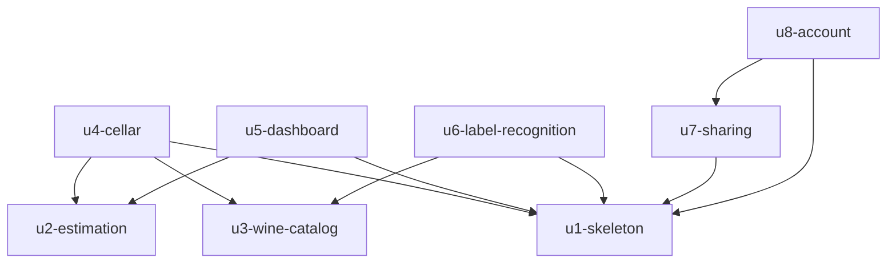

# Unit Dependencies — Vinoozy

Fonti: `unit-of-work.md`, `components.md`, `decisions.md`, `requirements.md`, `stories.md`. Qui c'è solo la struttura delle dipendenze; l'ordine di costruzione lo decide Delivery Planning.

## Grafo



<!-- Text fallback: u1-skeleton, u2-estimation e u3-wine-catalog non dipendono da nulla. u4-cellar dipende da u1, u2, u3. u5-dashboard da u1 e u2. u6-label-recognition da u1 e u3. u7-sharing da u1. u8-account da u1 e u7. Nessun ciclo. -->

| Unità | Dipende da | Motivo |
|-------|------------|--------|
| u1-skeleton | — | Struttura dell'app, accesso, modello minimo, Sync |
| u2-estimation | — | Logica pura, nessun codice di altre unità |
| u3-wine-catalog | — | Funzione cloud indipendente |
| u4-cellar | u1-skeleton, u2-estimation, u3-wine-catalog | Estende il modello di U1, usa stima e suggerimenti |
| u5-dashboard | u1-skeleton, u2-estimation | Legge i vini di U1 e calcola gli stati con U2 |
| u6-label-recognition | u1-skeleton, u3-wine-catalog | Usa l'aggiunta di U1 e il riconoscimento di U3 |
| u7-sharing | u1-skeleton | Estende le regole di sicurezza e il modello di cantina di U1 |
| u8-account | u1-skeleton, u7-sharing | La cancellazione revoca le condivisioni di U7 |

## Punti di integrazione

| Tra | Integrazione |
|-----|--------------|
| u4 → u2 | Chiamata diretta a funzioni Dart (pacchetto locale) |
| u4, u6 → u3 | Chiamata HTTPS autenticata alla funzione cloud |
| u4, u5, u6, u7, u8 → u1 | Modello dati condiviso (Cellar, Wine) e archivio Firestore tramite Sync |
| u7 → u1 | Estensione delle regole di sicurezza Firestore |
| u8 → u7 | Revoca delle condivisioni alla cancellazione |

## Possibilità di lavoro in parallelo

- u1-skeleton, u2-estimation e u3-wine-catalog non dipendono tra loro.
- Dopo u1-skeleton: u7-sharing può procedere indipendentemente da u2 e u3.
- u5-dashboard e u6-label-recognition non dipendono tra loro.

## Walking skeleton

u1-skeleton è la prima unità nell'ordine del grafo e la fetta integrata: funziona da sola (app, accesso, aggiunta, offline, sincronizzazione) senza le unità successive, che la estendono.

## Edge block

```yaml
units:
  - name: u1-skeleton
    kind: ui
    depends_on: []
  - name: u2-estimation
    kind: library
    depends_on: []
  - name: u3-wine-catalog
    kind: service
    depends_on: []
  - name: u4-cellar
    kind: ui
    depends_on: [u1-skeleton, u2-estimation, u3-wine-catalog]
  - name: u5-dashboard
    kind: ui
    depends_on: [u1-skeleton, u2-estimation]
  - name: u6-label-recognition
    kind: ui
    depends_on: [u1-skeleton, u3-wine-catalog]
  - name: u7-sharing
    kind: ui
    depends_on: [u1-skeleton]
  - name: u8-account
    kind: ui
    depends_on: [u1-skeleton, u7-sharing]
```
