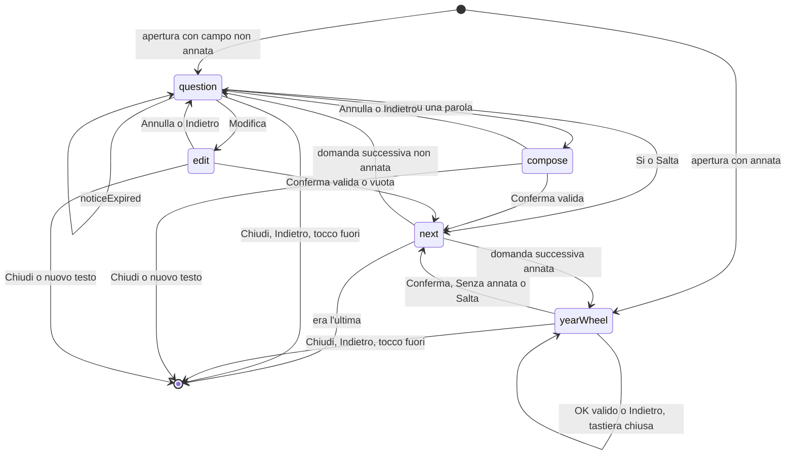

# Entità — compilazione dall'etichetta e finestre per tutto il mondo

## Fonti

- `inception/requirements-analysis/requirements.md` (FR1–FR6, NFR1–NFR6).
- `inception/refined-mockups/interaction-spec.md`.
- Riapertura da Build and Test: FR7.1–FR7.9 e schermate G1–G5 (ENT-007…ENT-014).
- `codekb/Vinoozy/`:
  - `Wine`, `WineFields`, `DrinkingWindow`, `WindowAdjustment` in `lib/cellar/domain/`;
  - `firestore.rules` `validWindow`;
  - `packages/estimation` `WineType`, `Qualifier`, `EstimationBasis`.

## ENT-001 `Wine`: campi nuovi

| Campo Firestore | Tipo | Obbligatorio | Note |
|---|---|---|---|
| `level` | stringa: `everyday` \| `good` \| `aging` | no | Assente = "non scelto", che vale `good` (FR4.1). Si scrive solo se scelto o accettato (FR4.3). |
| `windowOverride` | mappa | no | Correzione manuale di "Consigliato fino al" (FR5). Assente = nessuna correzione. |
| `windowOverride.endYear` | intero | sì, se c'è la mappa | Anno di fine corretto. Va da `window.startYear` a `window.startYear + 60`. |
| `windowOverride.setAt` | timestamp | sì, se c'è la mappa | Momento della correzione. Uguale a `request.time` nelle regole. |

I campi esistenti `window`, `baseWindow` e `windowAdjustment` restano come oggi:
- `baseWindow` è la stima;
- `window` è la finestra effettiva.

La finestra effettiva si calcola così: `baseWindow` → livello → adeguamento dalle bevute → correzione manuale (BR4.4).

## ENT-002 `DrinkingWindow`: valori nuovi

- **`basis`.** Aggiunge `grape`, per la stima dal vitigno (FR3.2). L'elenco diventa: `catalog`, `denomination`, `grape`, `wineType`, `generic`.
- **`qualifier`.** Aggiunge le qualifiche estere. L'elenco diventa: `riserva`, `superiore`, `granSelezione`, `crianza`, `reserva`, `granReserva`, `premierCru`, `grandCru`, `kabinett`, `spatlese`, `auslese`, `vintage`, `lbv`, `colheita`.
- **`denominationKey`, nuovo e facoltativo.** È la chiave stabile della riga di tabella usata, per esempio `rioja` o `malbec`. Serve per la riga "Stima dalla denominazione…" e "Stima dal vitigno…" (interaction-spec).

Le regole accettano i valori vecchi e nuovi. Una versione vecchia dell'app non li scrive mai (NFR1.3).

## ENT-003 `LabelFields`: risultato dell'estrazione, solo in memoria

| Campo | Tipo | Note |
|---|---|---|
| `name` | String? | massimo 60 caratteri |
| `producer` | String? | massimo 80 caratteri |
| `denomination` | String? | nome canonico della riga di tabella |
| `vintage` | int? | 1900 … anno corrente + 1 |
| `wineType` | `WineType`? | |
| `country` | codice ISO di 2 lettere? | |
| `region` | String? | |
| `suggestedLevel` | `WineLevel`? | solo `aging`, da una qualifica |
| `sourceKeys` | `Set<String>` | i campi compilati, per il segno "✦ dal testo" |

Non si salva mai su disco né nei log (FR2.3).

## ENT-004 `DenominationProfile` e `GrapeProfile`: tabelle costanti

- **`DenominationProfile`.** Esiste già. Si aggiungono:
  - `country`: codice ISO;
  - `region`: nome canonico di `WineOrigins`, oppure null;
  - `types`: mappa da `WineType` a `YearOffsets`, per le righe con più tipi;
  - `weakAliases`: alias validi solo con un indicatore (BR1.2);
  - `templateKey`: per le righe generate;
  - `dedicated`: vero per le righe con valori scritti una per una;
  - `qualifierOffsets`: le qualifiche estere.
- **`GrapeProfile`.** È nuovo e ha questi campi:
  - `aliases`;
  - `wineType`;
  - `offsets`;
  - `pairingCategories`.

  Il paese non c'è: un vitigno non indica il paese.

Il contenuto è in `world-tables.md`. Le righe generate sono in `generated/appellations.g.dart` (BR3.6). `WineOrigins` legge da qui i suggerimenti di origine (BR3.5).

## ENT-005 `WineLevel`

Enum `everyday`, `good`, `aging`, con i fattori di BR4.1.

## ENT-006 `LensSession`: solo in memoria

Si crea quando Vinoozy apre Lens con "Da Google Lens" (FR2.6) e contiene:
- `openedAt`: l'ora in cui Lens è stato aperto;
- `consumedClipTimestamp`: l'ora di copia del testo già incollato, se c'è.

Serve all'incolla automatico (FR2.7) e scade dopo 5 minuti.

## Conferma guidata (FR7): entità solo in memoria

Aggiunte con la riapertura da Build and Test. **Nessuna di queste entità si salva**: niente disco, Firestore, log, eventi, Crashlytics né stato di ripristino di Android (FR7.9, BR7.22). Il loro `toString` non contiene testo, come `LabelFields`.

Le prime cinque (ENT-007…ENT-011) sono Dart puro nel pacchetto `estimation` (D7). Le ultime tre (ENT-012…ENT-014) sono Dart puro in `lib/label/core/` (D11), perché usano la validazione del modulo (`WineRules`).

### ENT-007 `KeyField`

Enum dei campi chiave, nell'ordine delle domande (FR7.2, BR7.11): `denomination`, `producer`, `name`, `vintage`. Ha `labelFieldKey`, il nome in `LabelFieldKeys`, per il segno "✦ dal testo".

### ENT-008 `FieldCandidate`

| Campo | Tipo | Note |
|---|---|---|
| `field` | `KeyField` | |
| `value` | String | Testo da mettere nel campo. Per l'annata le 4 cifre. Per la denominazione il nome della riga di tabella. |
| `year` | int? | Solo per l'annata. |
| `denominationKey` | String? | Solo per la denominazione: la chiave della riga (BR7.3). |
| `score` | int | Centesimi interi da 0 a 100 (BR7.1): 80 vuol dire 0,80. Nessun `double` nel calcolo né nei confronti con T e M. |
| `wordIds` | `List<int>` | Gli id delle `LabelWord` da cui viene. Servono a disattivarle per gli altri campi (BR7.15). Può essere vuota per un valore che non corrisponde a parole visibili, per esempio un anno su una riga scartata. |
| `signals` | `Set<CandidateSignal>` | I segnali applicati (per esempio `indicatorNear`, `uniqueYear`, `producerLineFirst`). Servono ai test e alla taratura; non contengono testo. |

Uguaglianza: `field` + valore piegato con `tokenizeAll` (BR7.1).

### ENT-009 `KeyFieldAnalysis` e `FieldCertainty`

`FieldCertainty`: `certain`, `uncertain`, `absent` (BR7.8).

| Campo | Tipo | Note |
|---|---|---|
| `field` | `KeyField` | |
| `candidates` | `List<FieldCandidate>` | Ordinati, al massimo 5 (BR7.1). |
| `certainty` | `FieldCertainty` | Regola di BR7.7 e BR7.8. |
| `top` | `FieldCandidate?` | Il primo candidato, se c'è. |
| `value` | `FieldCandidate?` | `top` solo se `certainty == certain`. |

Invarianti:
- `certain` ⇒ `candidates` non vuota, `top.score ≥ 80` e `top.score − second.score ≥ 25` (interi in centesimi);
- `absent` ⇒ `candidates` vuota e `field != vintage`.

### ENT-010 `LabelAnalysis`

Il risultato di `analyzeLabelText(text, currentYear)` (D7).

| Campo | Tipo | Note |
|---|---|---|
| `fields` | `Map<KeyField, KeyFieldAnalysis>` | Sempre con le 4 chiavi. |
| `certainFields` | `LabelFields` (ENT-003) | La vista "senza guida" di BR7.8: campi chiave solo se certi; paese e regione della denominazione solo se la denominazione è certa; il tipo con le regole di BR7.8 (b). È quello che il modulo compila. `extractLabelFields` non cambia e resta il lettore di BR1 (D7). |
| `typeDerivedFromDenomination` | bool | Vero se il tipo di `certainFields` dipende dalla riga della denominazione: serve a BR7.20 per sapere che il tipo si ricalcola alla conferma. |
| `words` | `List<LabelWord>` | Le parole di FR7.5, al massimo 120 (BR7.14). |
| `qualifier` | `Qualifier?` | Come oggi (BR1.8). |
| `uncertainFields` | `List<KeyField>` | I campi `uncertain`, nell'ordine di `KeyField`. |
| `isEmpty` | bool | Nessun campo certo e nessun candidato. |

`LabelAnalysis.empty` è il valore per il testo vuoto e per un errore del lettore (oggi `LabelFields.empty`).

### ENT-011 `LabelWord`

| Campo | Tipo | Note |
|---|---|---|
| `id` | int | Indice nell'elenco: ordine del testo (BR7.14, BR7.15). |
| `text` | String | Testo originale senza la punteggiatura iniziale e finale. |
| `line` | int | Indice della riga, per il raggruppamento "Riga 2 di 6" (A21). |
| `folded` | String | `tokenizeAll(text).join(' ')`, per il confronto con le tabelle (BR7.16). |

Funzioni pure accanto all'entità (D7):
- `composeValue(List<LabelWord> words, Set<int> selected)`: il valore composto (BR7.15);
- `canSelect(...)`: i limiti di 8 parole e 80 caratteri;
- `matchDenomination(String composed, {WineType? type, String? country})`: la riga di tabella di BR7.16, oppure null.

### ENT-012 `GuidedSession`: macchina a stati della guida

Una guida aperta. Vive nel controller del modulo (D11).

| Campo | Tipo | Note |
|---|---|---|
| `analysis` | `LabelAnalysis` | L'analisi del testo che l'ha aperta. |
| `questions` | `List<KeyField>` | Fissate all'apertura (BR7.10, BR7.11). `T = questions.length`, da 1 a 4. |
| `index` | int | Domanda in corso, da 0 a `T − 1`. Sullo schermo `N = index + 1`. |
| `proposal` | `FieldCandidate?` | Il candidato proposto ora. È null dopo l'ultimo "No" e all'apertura di una domanda senza candidati (BR7.12). |
| `noProposalReason` | `NoProposalReason?` | `notFound` (domanda aperta senza candidati: "Non l'ho trovato nel testo") o `exhausted` (dopo l'ultimo "No"). |
| `keyboardOpen` | bool | Solo in `yearWheel`: la tastiera numerica è aperta (BR7.13). |
| `mode` | `GuidedMode` | `question`, `compose`, `edit`, `yearWheel`. |
| `selected` | `List<int>` | Gli id delle parole scelte in `compose`. |
| `editText` | String | Il testo in `edit`. |
| `wheelYear` | int | L'anno al centro della ruota in `yearWheel`. |
| `error` | `FieldError?` | L'errore di validazione di `edit`, `compose` o della ruota. |
| `notice` | `GuidedNotice?` | `rejected(value)` o `noMoreCandidates`, per i 2 secondi di BR7.12. Lo toglie l'azione `noticeExpired`, mandata dal controller con un timer: il timer sta nel controller, la funzione di transizione resta pura. |
| `skipped` | `Set<KeyField>` | I campi saltati in questa guida, per il messaggio finale. |
| `finished` | bool | Vero dopo l'ultima risposta o la chiusura. |

Per l'annata `mode` è sempre `yearWheel`: non ci sono `question`, `compose` né `edit`.

**Stati e transizioni.**

Versione testuale, se il diagramma non si vede:
- **Apertura.** Si parte in `yearWheel` se la prima domanda è l'annata, altrimenti in `question` con il primo candidato non rifiutato.
- **In `question`.**
  - "No" con altri candidati resta in `question` con il candidato successivo.
  - "No" sull'ultimo candidato resta in `question` senza proposta, con l'avviso.
  - Un tocco su una parola porta in `compose`; "Modifica" porta in `edit`.
  - "Sì" o "Salta" passano alla domanda successiva.
- **In `compose` ed `edit`.** "Annulla" o Indietro tornano in `question`. "Conferma" con un valore valido passa alla domanda successiva; in `edit` anche il valore vuoto. Un valore non valido resta nella stessa modalità con `error`.
- **Apertura senza candidati.** Si entra in `question` con `proposal` null e `noProposalReason = notFound`: Sì e No non sono attivi, restano Modifica, parole e Salta.
- **`noticeExpired`.** Dopo 2 secondi il controller manda questa azione: toglie `notice` e non cambia altro.
- **In `yearWheel`.** "Conferma", "Senza annata" e "Salta" passano alla domanda successiva. Il tocco sull'anno al centro mette `keyboardOpen = true`. Con la tastiera aperta: "OK" con un anno valido sposta `wheelYear` e chiude la tastiera; un anno non valido mette `error` e la tastiera resta aperta; Indietro chiude solo la tastiera. "Chiudi" chiude la scheda anche con la tastiera aperta.
- **Domanda successiva.** Si va in `question` o in `yearWheel`, secondo il campo. Dopo l'ultima la guida finisce e la scheda si chiude.
- **Chiusura.** "Chiudi" chiude da ogni stato. Indietro e il tocco fuori chiudono da `question` e `yearWheel`; da `compose` ed `edit` Indietro torna prima in `question`, e il tocco fuori non fa niente (BR7.17).
- **Nuovo testo e "Pulisci".** Chiudono da ogni stato (BR7.18, BR7.21).

### ENT-013 `GuidedAnswer`

La risposta a un campo, nella memoria del modulo:
- `confirmed(value, via)`, con `via` uno tra `yes`, `compose`, `edit`, `wheel`;
- `emptiedByEdit`: "Modifica" confermato vuoto;
- `noVintage`: "Senza annata".

"Salta" e la chiusura non sono risposte (BR7.17). Un campo con una risposta, anche `emptiedByEdit` o `noVintage`, non si riempie mai da solo con un nuovo testo (BR7.18).

### ENT-014 `GuidedMemory`: memoria del modulo

Una per modulo aperto. Si svuota con "Pulisci" (BR7.21) e si perde alla chiusura del modulo o del processo.

| Campo | Tipo | Note |
|---|---|---|
| `answers` | `Map<KeyField, GuidedAnswer>` | I campi con risposta non si chiedono più, nemmeno con un nuovo testo (BR7.13, BR7.18). |
| `rejected` | `Map<KeyField, Set<String>>` | I valori rifiutati con "No", piegati. Non tornano più (BR7.12). |
| `usedWords` | `Map<KeyField, Set<int>>` | Le parole usate da ogni campo confermato, per l'analisi in corso. Servono solo al segno "usata per …" nel `WordPicker`: non disattivano le parole per gli altri campi (BR7.15). Si azzerano con un nuovo testo, perché gli id cambiano. |
| `manual` | `Set<KeyField>` | I campi scritti a mano a guida chiusa (BR7.19). |
| `analysis` | `LabelAnalysis?` | L'ultima analisi, per riaprire la guida con "Conferma guidata". |
| `session` | `GuidedSession?` | La guida aperta, se c'è. |

`pendingQuestions` è la lista dei campi con `certainty == uncertain` nell'ultima analisi (mai `absent`, BR7.8) che sono vuoti, non in `manual` e non in `answers`. Decide se il pulsante "Conferma guidata" si vede (BR7.17, stessa definizione).
