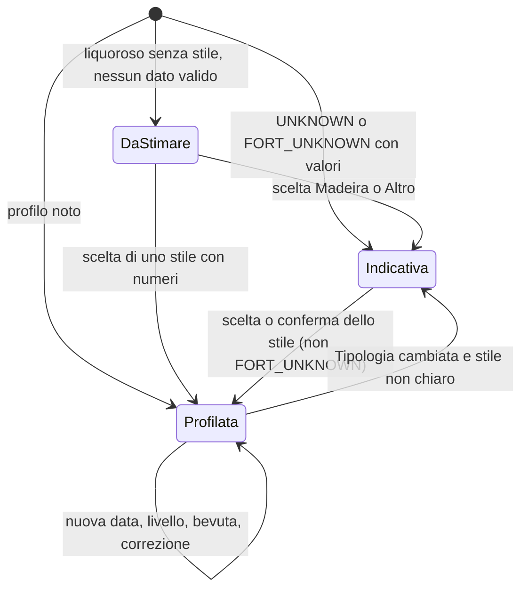
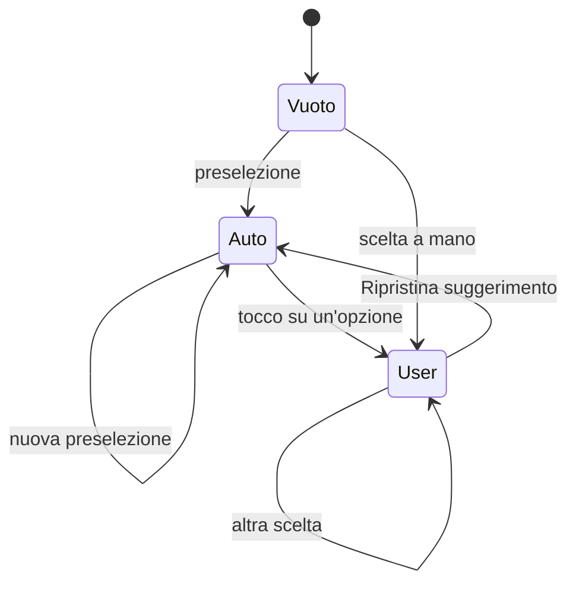
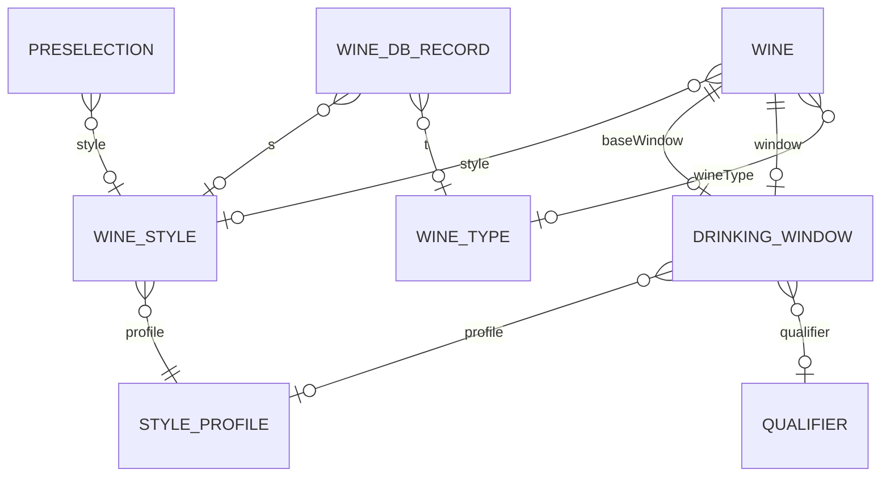

# Specifica funzionale — profili di stile e classificazione automatica

**Collaborator:** aidlc-architect-agent

## Fonti

- `inception/requirements-analysis/requirements.md` (FR1–FR4, NFR1–NFR6), approvato.
- `inception/refined-mockups/interaction-spec.md`, `mockups.md` (S1–S6).
- `codekb/Vinoozy/` (sezioni dell'intent 261108-wine-style-profiles): flussi di oggi di classificazione, stima, migrazione; elenco dei file che toccano tipo, livello e finestra.
- Codice letto: `packages/estimation/lib/src/*`, `lib/cellar/domain/window_adjuster.dart`, `lib/cellar/data/wine_repository.dart` (`updateWine` usa `update`), `tool/build_wine_db.dart`, `firestore.rules`.
- `reviews/review-01.md` (NOT-READY) e le decisioni del proprietario del 2026-11-09 che la risolvono.
- Questa fase: `rules.md` (fonte delle regole), `entities.md` (fonte dei dati), `profile-map.md`/`.json`, `classification-sample.md`/`.json`, `frontend-components.md`.
- Scope `refactor`: nessun Unit, nessuna storia; il codice esistente fa da domain design.

## Decisioni

### D1 — I profili e la mappa vivono nel pacchetto `estimation`, in Dart puro

**Contesto.** La stima, le tabelle e l'analisi dell'etichetta sono già nel pacchetto `packages/estimation` (Dart puro, testabile con `dart test`, copertura ≥ 90% richiesta da NFR4.1). Servono a tre consumatori: l'app, il tool della base e i test della mappa.

**Decisione.** Il pacchetto riceve: la tabella dei 24 profili (`style_profiles.dart`), le chiavi di stile, `resolveStyle` (BR2.1) al posto della parte finale di `resolveWine`, `classifyWine` (BR3–BR5), le correzioni di tipo della tabella delle denominazioni (BR2.12, applicate in `buildDenominationTable` e nel generatore). `estimationTablesVersion` = 3.

**Alternative considerate.**
- *Profili in un file JSON negli asset dell'app, letto all'avvio.* Pro: correggibile senza toccare il codice. Contro: lettura asincrona all'avvio, il tool non lo vede senza duplicare il caricatore, un errore di formato si scopre a runtime; contraddice la regola di oggi "tabelle come costanti di compilazione" (`tables.dart`).
- *Profili nell'app (`lib/cellar/`).* Pro: vicino al modulo. Contro: il tool `build_wine_db.dart` e i test della mappa dovrebbero dipendere da Flutter; la classificazione della base e quella del modulo divergerebbero.
- *Profili in Firestore (configurazione remota).* Contro: rete e costo, contro NFR1.

**Conseguenze.** Una correzione enologica è una modifica di codice con test e una versione nuova delle tabelle (migrazione automatica). La fixture `profile-map.json` (≈ 4 MB) entra in `packages/estimation/test/fixtures/`.

### D2 — La finestra porta i mesi come campi in più, non come nuovo tipo

**Contesto.** Oggi tutto è in anni interi (`DrinkingWindow`, regole, override, cruscotto). Otto profili sono in mesi, quattro hanno picco o fine null.

**Decisione.** `DrinkingWindow` tiene `startYear` obbligatorio, rende facoltativi `peakYear` e `endYear`, e aggiunge `unit`, `startMonth`/`peakMonth`/`endMonth`, `profile`, `anchor`, `anchorFallback`, `indicative` (ENT-106). Tutti i confronti passano per l'indice di mese (BR6.1); per le finestre in anni il risultato è identico a oggi.

**Alternative considerate.**
- *Due tipi distinti (`YearWindow`, `MonthWindow`).* Pro: tipi più stretti. Contro: ogni consumatore (≈ 20 file) diventa un `switch`; la mappa Firestore diventa a due forme; le regole devono discriminare.
- *Tutto in mesi (indice assoluto) anche per i profili in anni.* Pro: un solo formato. Contro: cambia la forma salvata di tutte le finestre esistenti, rompe la lettura delle app vecchie e le regole attuali.
- *Mesi come frazione dell'anno (es. 2027.25).* Contro: Firestore e le regole confrontano numeri, ma l'arrotondamento e la visualizzazione diventano fragili.

**Conseguenze.** Le app vecchie leggono una finestra senza picco o fine come "Da stimare" (nessun dato perso); i vecchi documenti si leggono come `unit: years`.

### D3 — La base offline si classifica quando si genera, con la stessa funzione del modulo

**Contesto.** FR2.5 chiede di calcolare nel tool; la base ha tipo nel 47% dei vini, denominazione nell'8%, nessun vitigno.

**Decisione.** `tool/build_wine_db.dart` chiama `classifyWine` del pacchetto e scrive `t`, `l`, `s` nel record (BR9.1, BR9.2), con la tabella completa delle denominazioni. Nel telefono la proposta dalla base usa i valori salvati; per una base di formato 1 l'app classifica al momento.

**Alternative considerate.**
- *Classificare nell'app al momento della proposta.* Pro: nessuna ricostruzione della base. Contro: la soglia del 90% non si può misurare sulla base spedita; i tag di categoria di OFF non sono nel telefono; lavoro ripetuto a ogni ricerca (NFR3, 50 ms).
- *Classificare con un servizio in rete.* Contro: NFR1.
- *Classificare nel tool con regole proprie.* Contro: due implementazioni che divergono (codekb: oggi le parole di tipo sono scritte tre volte con contenuti diversi).

**Conseguenze.** La base va ricostruita dall'export in `.cache/` (FR2.5); il tool registra la quota misurata nel manifest (`classifiedTypeShare`) e il test di CI verifica che la base spedita la rispetti, insieme alle soglie del campione (BR9.5). Il 90% di FR2.1 resta l'obiettivo, non un blocco. Misura con un prototipo Python delle regole (classification-sample.md): **83,5%** dei vini della base con Tipologia (12.941 su 15.492, esclusi 124 non vini), con la regola Château compresa; con gli alias della tabella Dart la proiezione è 84–86%. Sotto il 90%: decisione del proprietario al gate (rischio R1).

### D4 — La migrazione è una tantum, per vino, con lo stato nel documento

**Contesto.** FR4.1, FR4.2; `EstimatesMigration` di oggi riscrive solo la stima e parte quando cambia `estimationTablesVersion`.

**Decisione.** Si estende `EstimatesMigration`: candidati = vini con `migrationVersion` < 3 (non solo finestre interne); per ogni vino una transazione che rilegge il documento e, se `updatedAt` non è cambiato da quando il vino è entrato nel giro, scrive provenienze, preselezione dei campi vuoti, stile, stima nuova e `migrationVersion: 3`; altrimenti salta il vino, che si riprende all'avvio successivo (BR7.4–BR7.6). Silenziosa.

**Alternative considerate.**
- *Stato nelle preferenze del telefono (elenco degli id migrati).* Contro: non vale su un altro dispositivo né per un membro della cantina condivisa; si perde con la reinstallazione; non è atomico con la scrittura.
- *Migrazione lato server (Cloud Function).* Contro: costo e piano gratuito (C6), un altro componente da distribuire.
- *Nessuna migrazione: ricalcolo alla lettura.* Contro: cruscotto e cantina leggono `window` salvata; due stime diverse fra app e dati; le provenienze non esisterebbero mai.
- *`update` semplice senza transazione (come la migrazione di oggi).* Contro: in una cantina condivisa un membro che cambia il Livello fra la lettura e la scrittura vedrebbe sovrascrivere `levelSource` o la finestra (revisione R-10).

**Conseguenze.** Ogni vino si scrive una volta (≤ 200 vini, ≤ 1 s di calcolo, NFR3). Un rifiuto delle regole ferma la migrazione e la riprende al prossimo avvio (tre tentativi come oggi).

### D5 — Livello assoluto come oggi; "Da invecchiamento" solo con una qualifica

**Contesto.** FR2.3: il Livello resta un moltiplicatore per i profili in anni ed è sempre preselezionato. L'elenco di FR2.3 proponeva "Da invecchiamento" anche per i profili R_LONG, R_AGE, W_AGE, SW_BOTRYTIS, PORT_VINTAGE. La revisione (R-01) ha mostrato che un Livello relativo al profilo cambiava il significato dei Livelli già salvati.

**Decisione (del proprietario, 2026-11-09).** BR4.1–BR4.4: i numeri dei profili e le finestre conservate sono la finestra "Buono"; il Livello moltiplica come oggi (Quotidiano ×0,5/0,6/0,6, Da invecchiamento ×1,25/1,3/1,4, senza moltiplicare di nuovo gli scarti di una qualifica). La preselezione dà "Da invecchiamento" solo con una qualifica da lunga evoluzione (Riserva, Gran Reserva, Grand Cru, Gran Selezione, Auslese e superiori, Vintage Port), "Quotidiano" ai profili freschi senza qualifica, a IGT/IGP, vini da tavola, SP_TANK e LAM_FRESH, "Buono" a tutto il resto, R_LONG e R_AGE compresi. È uno scostamento dichiarato dall'elenco di FR2.3: il profilo descrive già il vino da invecchiamento e un secondo moltiplicatore lo conterebbe due volte.

**Alternative considerate.**
- *Livello relativo al profilo.* Pro: la preselezione non sposta mai la mappa. Contro: un "Buono" già salvato su un Barolo darebbe 4/9/18 invece di 8/15/30; il selettore mostrerebbe "Buono" con una finestra che non è quella "Buono" (R-01).
- *Assoluto con l'elenco completo di FR2.3.* Contro: Barolo 8/15/30 → 10/20/42, Porto Vintage 15/30/60 → 19/39/84 alla sola preselezione.
- *Il livello automatico non moltiplica, solo quello scelto.* Contro: toccare il suggerimento per confermarlo cambierebbe la finestra.

**Conseguenze.** Un Barolo con "Buono" salvato resta 8/15/30 prima e dopo l'aggiornamento (test in BR11.3). Il selettore del Livello resta quello di oggi, con "Ripristina suggerimento" in più (BR7.3). Il campione misura 96,5% di Livelli giusti contro 59,8% di un classificatore che risponde sempre "Buono".

### D6 — Regole Firestore: campi facoltativi, validati solo quando cambiano

**Contesto.** `wineFields()` usa `hasOnly`; `validWindow` richiede anni interi e tutte e tre le date.

**Decisione.** BR10.1–BR10.3: si aggiungono i campi nuovi a `wineFields()`, si estendono `validWindow`, `validOverride`, `validAdjustment`, si aggiungono `validStyle`, `validSource`, `validAgingStart`, `validMigrationVersion`; ogni campo si controlla in update solo se cambia, come `level`. Le regole si pubblicano prima della build, con l'OK del proprietario, dopo i test nell'emulatore.

**Alternative considerate.**
- *Un sotto-oggetto `classification: {style, sources...}`.* Pro: un solo nome in `wineFields()`. Contro: validare una mappa annidata è più lungo; un update parziale di un solo valore riscrive tutta la mappa e può perdere un campo scritto da un altro dispositivo.
- *Regole permissive (nessun controllo sui campi nuovi).* Contro: un client difettoso potrebbe scrivere valori che l'app non sa leggere; contro la regola "validare ai confini".
- *Nuova collezione per la classificazione.* Contro: due letture per vino, sincronizzazione offline più complessa.

**Conseguenze.** Le scritture dell'app di oggi restano valide con le regole nuove (NFR2.2). Da aggiungere ai test delle regole: ogni validatore con un caso valido e due non validi.

### D7 — Provenienza come tre campi `*Source`

**Decisione.** `typeSource`, `levelSource`, `styleSource` con valori `user`/`auto` (BR7.1).

**Alternative considerate.**
- *Salvare il valore proposto (`preselected: {wineType, level, style}`) e dedurre "auto" se il campo coincide.* Pro: resiste a un'app vecchia che cambia il tipo. Contro: toccare il suggerimento per confermarlo non si distinguerebbe dal non toccarlo; serve comunque un flag.
- *Un solo campo `autoFields: [..]`.* Contro: aggiornare un elemento di una lista con update parziali è scomodo e le regole lo validano peggio.

**Conseguenze (rischio accettato).** Un'app vecchia che cambia Tipologia o Livello lascia `auto`; una successiva compilazione automatica dell'app nuova potrebbe cambiarli. Vale solo nel periodo di rilascio, con un solo utente.

### D8 — Una sola data `agingStartMonth` per sboccatura e imbottigliamento

**Decisione.** BR8.1–BR8.3: un campo mese/anno; l'etichetta dipende dallo stile.

**Alternative considerate.**
- *Due campi (`disgorgementMonth`, `bottlingMonth`).* Contro: cambiando stile la data finirebbe nel campo sbagliato; il requisito dice "la data resta salvata".
- *Data completa (giorno).* Contro: le etichette riportano mese e anno; il giorno inventato darebbe precisione falsa.

### D9 — Mappa generata da uno script e fissata come fixture

**Decisione.** La mappa delle 5946 combinazioni si genera con uno script (fuori dal repository, nella cartella del job) che applica BR2 allo studio; il risultato `profile-map.json` è la fixture del test. Il codice Dart non legge lo studio: implementa le regole e il test verifica che dia la stessa mappa.

**Alternative considerate.**
- *Codice Dart generato dalla mappa (tabella per combinazione).* Contro: 5946 valori duplicati invece di regole; una correzione enologica andrebbe fatta riga per riga.
- *Nessuna fixture, solo test a campione.* Contro: FR1.2 chiede un test per combinazione.

## Flussi

### F1 — Stima di un vino (resolveStyle + estimateWindow)

1. `validateWineFacts` (come oggi, più mese 1..12 e data di sboccatura/imbottigliamento coerente).
2. Finestra del catalogo usabile → vince come oggi (il livello non la cambia).
3. Stile scelto dall'utente (`styleChosen`) → profilo di quello stile (BR2.15).
4. Altrimenti `resolveStyle`: denominazione (utente, catalogo, nome, produttore) con le correzioni di tipo → qualifica e parole di stile → passo 1, 2, 3 o 4 (BR2.1); senza denominazione → vitigno (valori di oggi del vitigno, stile da confermare) → tipo (BR5.6) → generica 1/3/6 indicativa.
5. Decorrenza: annata o anno base (anni), `agingStartMonth` o mese di inserimento (mesi); con il mese di inserimento l'inizio è 0, così una bottiglia comprata non è mai "In attesa" (BR6.2).
6. Livello assoluto come oggi, solo anni con picco e fine; "Da invecchiamento" non rimoltiplica gli scarti di una qualifica (BR4.1).
7. `DrinkingWindow` con `profile`, `unit`, `anchor`, `anchorFallback`, `indicative`, `confidence` (medium solo per riga dedicata con annata o data, come oggi; low se indicativa o con ripiego), `tablesVersion` 3. FORT_UNKNOWN senza stile scelto → nessuna finestra ("Da stimare").
8. App: `WindowAdjuster.effectiveOf` (bevute in mesi BR6.9, poi override con unità BR6.8).

### F2 — Preselezione nel modulo (classifyWine)

1. Ingresso: candidato della base (t, l, s già calcolati), candidato del catalogo, testo dell'etichetta o nome/denominazione scritti a mano.
2. `classifyWine` (BR3.1, BR4.3, BR5.3) → `Preselection`.
3. Per ogni campo: `source == user` → invariato; vuoto o `auto` → valore proposto, `source = auto`, segno "✦ suggerito" (BR7.2).
4. Cambio di Tipologia → nuovo stile auto; cambio di stile → nuovo livello auto (BR4.6); cambio di nome o denominazione → nuova preselezione dei campi auto.
5. Tocco su un'opzione (anche quella suggerita) → `source = user`, segno tolto.
6. Salvataggio: i campi con provenienza, `agingStartMonth` se visibile e completo (BR8.2), stima F1.
7. Prestazione: ≤ 50 ms per vino (NFR3), nessuna rete.

### F3 — Generazione della base (tool)

1. Lettura riga per riga dell'export OFF (come oggi), filtri (vini, categorie escluse, non vini BR9.4).
2. `wineTypeOfTags` → tipo della base; `denominationOf` con la tabella completa.
3. `classifyWine(nome, produttore, denominazione, tipo della base, paese)` → `t`, `l`, `s`.
4. Scrittura `wines.jsonl.gz`, manifest con `formatVersion: 2` e `classifiedTypeShare`.
5. Controlli: dimensioni, ≥ 5000 vini, export ≤ 180 giorni, tempo ≤ 2 minuti; altrimenti nessuna scrittura.

### F4 — Migrazione una tantum

```mermaid
sequenceDiagram
  participant A as CellarActions
  participant M as EstimatesMigration
  participant C as classifyWine
  participant E as WineEstimator
  participant R as WineRepository
  A->>M: run(cellar, user, wines) all'apertura o al ritorno in rete
  M->>M: candidati = migrationVersion < 3; stop se tentativi >= 3
  loop un vino alla volta
    M->>C: preselezione (nome, denominazione, tipo, annata)
    C-->>M: Preselection
    M->>M: provenienze (BR7.4), campi vuoti, stile auto
    M->>E: stima con i profili, adjustment e override conservati
    E-->>M: baseWindow, window
    M->>R: migrateWine in transazione: rilettura del documento
    alt updatedAt cambiato da un'altra persona
      R-->>M: skipped (si riprende al prossimo avvio)
    else invariato
      R-->>M: update di classificazione, stima, migrationVersion 3
    end
    alt rifiuto delle regole
      R-->>M: rejected
      M->>M: tentativi + 1, stop per questo avvio
    end
  end
```

Testo: ogni vino si scrive in una transazione che controlla `updatedAt`; i vini già a `migrationVersion` 3 non si toccano più; i vini con finestra del catalogo ricevono provenienze e stile ma non una nuova stima.

### F5 — Scelta dello stile dal dettaglio (S4)

1. Il dettaglio di un vino con "Stile da confermare" mostra l'avviso e i chip dello Stile (e "Scegli la tipologia" se manca).
2. Tocco su un chip → `style`, `styleSource = user`; se `levelSource = auto` nuovo livello; nuova stima F1; scrittura `updateClassification` (campi di classificazione e stima).
3. Annuncio al lettore di schermo "Stima aggiornata: pronto da marzo 2026".

## Stati

### Stato della finestra di un vino



Testo: "Da stimare" non ha finestra; "Indicativa" ha finestra con `indicative: true` e avviso; "Profilata" ha finestra senza avviso. Lo stato del giorno (in attesa, da bere, bevi presto, finestra passata) si calcola su ogni finestra con BR6.3.

### Provenienza di un campo



## Dove si scrive o si mostra una finestra

| File | Scrive / mostra | Cosa cambia |
|---|---|---|
| `packages/estimation/lib/src/window.dart` | scrive | `estimateWindow` con profili, mesi, livello assoluto (F1) |
| `packages/estimation/lib/src/status.dart` | calcola | `statusOf` su indici di mese (BR6.3) |
| `packages/estimation/lib/src/effective_window.dart` | calcola | override con mese, intervallo in mesi (BR6.8) |
| `packages/estimation/lib/src/validation.dart` | valida | picco/fine null, mesi (BR6.10) |
| `packages/estimation/lib/src/models.dart`, `tables.dart` | modello | `DrinkingWindow`, `Qualifier`, versione 3 |
| `lib/cellar/domain/wine.dart` | legge/scrive | `windowFrom`/`windowToMap` con i campi nuovi; campi del vino |
| `lib/cellar/domain/wine_estimate.dart` | scrive | `toFields` con i campi nuovi |
| `lib/cellar/domain/window_adjuster.dart` | calcola | bevute in mesi (BR6.9); `labelOf` confronta gli indici |
| `lib/cellar/domain/window_override.dart` | legge/scrive | `endMonth` |
| `lib/cellar/domain/cellar_filter.dart` | mostra | filtro di stato e di tipo (famiglia da una sola funzione) |
| `lib/cellar/wine_estimator.dart` | scrive | `WineFactsInput` con stile, data, mese di inserimento |
| `lib/cellar/cellar_actions.dart` | scrive | salvataggi, ricalcolo dopo bevuta, avvio migrazione |
| `lib/cellar/estimates_migration.dart` | scrive | F4 |
| `lib/cellar/estimate_refresher.dart` | scrive | conserva unità e profilo quando rifà la stima |
| `lib/cellar/data/wine_repository.dart` | scrive | `addWine`, `updateWine`, `setEstimate`, `setOverride`, nuovi `migrateWine` e `updateClassification` |
| `lib/catalog/core/wine_catalog.dart` | legge | finestra del catalogo (anni), tipo a 8 valori |
| `lib/cellar/ui/ideal_moment_card.dart` | mostra | mesi, nessun picco, nessuna fine, origine del profilo, avviso |
| `lib/cellar/ui/window_override_widgets.dart` | mostra/scrive | foglio "Consigliato fino al" in mesi |
| `lib/cellar/ui/wine_detail_screen.dart` | mostra | avviso "Stile da confermare", chip dello stile |
| `lib/cellar/ui/wine_labels.dart` | mostra | testi dello stile, formati del mese |
| `lib/cellar/ui/level_section.dart`, `wine_level_selector.dart` | mostra | anteprima del livello, "Ripristina suggerimento"; "Il livello non cambia questa stima" per i profili in mesi |
| `lib/cellar/ui/wine_card.dart`, `cellar_screen.dart` | mostra | stato e "entro mar 2027" |
| `lib/app/home_shell.dart` | mostra | contatori di stato |
| `lib/dashboard/domain/dashboard_calculator.dart`, `dashboard_summary.dart` | calcola | picchi per anno, da bere presto, "Da confermare" (BR6.7) |
| `lib/dashboard/ui/chart_cards.dart`, `dashboard_screen.dart`, `drink_soon_section.dart`, `status_icons.dart` | mostra | mese, riquadro "Da confermare" |
| `lib/dashboard/dashboard_event_logger.dart` | conta | solo conteggi, nessun valore nuovo |
| `lib/sharing/data/sharing_repository.dart`, `lib/sync/sync_gateway.dart` | copia/sincronizza | portano i campi nuovi senza toccarli |
| `tool/build_wine_db.dart` | scrive | F3 |
| `firestore.rules` | valida | BR10 |

## Diagramma entità-relazioni (derivato da `entities.md`)



Testo: un vino ha al più uno stile, che punta a un profilo; le due finestre del vino possono citare il profilo usato; il record della base porta Tipologia e stile preselezionati.

## Sintesi delle regole (derivata da `rules.md`)

| Gruppo | Regole | Oggetto |
|---|---|---|
| BR1 | BR1.1–BR1.4 | 24 profili, valori null, fonti, chiavi di stile |
| BR2 | BR2.1–BR2.17 | precedenza e regole enologiche della mappa (5946 combinazioni) |
| BR3 | BR3.1–BR3.9 | preselezione della Tipologia |
| BR4 | BR4.1–BR4.6 | Livello assoluto e sua preselezione |
| BR5 | BR5.1–BR5.6 | Stile nel modulo e nel dettaglio |
| BR6 | BR6.1–BR6.10 | mesi, stato, formati, cruscotto, correzioni |
| BR7 | BR7.1–BR7.8 | provenienza e migrazione |
| BR8 | BR8.1–BR8.3 | data di sboccatura o imbottigliamento |
| BR9 | BR9.1–BR9.5 | classificazione della base |
| BR10 | BR10.1–BR10.3 | regole Firestore |
| BR11 | BR11.1–BR11.3 | test: copertura, e2e, migrazione e regole |

## Decisioni e requisiti

| Decisione | Requisiti |
|---|---|
| D1 | FR1.1, FR1.2, NFR1, NFR4.1, NFR4.2, NFR6 |
| D2 | FR1.3, FR3.4, FR3.5, NFR2.1, NFR2.3 |
| D3 | FR2.1, FR2.5, NFR3, NFR4.3 |
| D4 | FR4.1, FR4.2, NFR3, NFR4.4 |
| D5 | FR2.3 |
| D6 | NFR2.1, NFR2.2, NFR2.3 |
| D7 | FR2.4, NFR2.3 |
| D8 | FR3.3 |
| D9 | FR1.2, NFR4.2 |

## Piano di test (NFR4)

Le regole BR11.1–BR11.3 fissano i test che Code Generation scrive: profili (`style_profiles_test.dart`), mappa con la fixture `profile-map.json` (`profile_map_test.dart`), classificazione e soglie del campione (`classify_wine_test.dart`), stato in mesi (`month_status_test.dart`), Livello (`window_level_test.dart`), migrazione (`test/cellar/estimates_migration_test.dart`), regole Firestore nell'emulatore, e2e del modulo (`integration_test/style_profile_flow_test.dart`). Copertura 80% sul progetto senza esclusioni e 90% su `estimation`.

## Rischi aperti

- **R1 — Soglia del 90% della base (decisione del proprietario al gate).** Il prototipo delle regole misura 83,5% (12.941 vini su 15.492, esclusi 124 non vini); con gli alias della tabella Dart la proiezione è 84–86%. Il test di CI non blocca su questo valore: verifica che la base spedita rispetti la quota registrata nel manifest e le soglie del campione (BR9.5). Se la base ricostruita resta sotto il 90%, il proprietario decide se accettarla.
- **R2 — Mappa lontana dallo studio.** 3908 combinazioni su 5946 hanno un profilo diverso da quello dello studio, quasi tutte righe generate (FAKE_TYPE 1511, GENERATED_STYLE 1623), perché lo studio stesso dice "fallback solo se stile noto". Va letto come applicazione dello studio, non come smentita.
- **R3 — Scostamento da FR2.3 sul Livello (D5).** I profili da invecchiamento senza qualifica propongono "Buono", non "Da invecchiamento": va confermato al gate come correzione del requisito.
- **R4 — Etichetta e finestra del Kabinett.** Lo stile mostrato è W_MEDIUM (1/3/6) ma la finestra resta quella di oggi (per esempio Mosel 2/6/15): lo stile descrive il vino, la finestra resta la stima già in uso.
- **R5 — Pauillac.** Il Grand Cru Classé conserva gli scarti di oggi contro l'azione della riga dello studio (ACTION_OVERRIDDEN, elencato in profile-map.md).
- **R6 — Provenienze e app vecchia (D7).**
- **R7 — Fixture di 4 MB** nel repository.
- **R8 — Copertura dei test.** Molte modifiche di UI (≈ 20 file) con soglia 80% senza esclusioni.
- **R9 — Campione tarato in parte.** 14 righe del campione su 100 sono servite a correggere il prototipo; le misure sulle sole 86 righe non usate sono riportate a parte (Tipologia 100%, Livello 95,9% contro 60,3% di "sempre Buono").
