# Configurazione della consegna continua (CD)

La pipeline esiste già nel repository. Questa fase la documenta così com'è
dopo le modifiche di questo lavoro. Non c'è un CI Pipeline né un
Infrastructure Design di questo intent: le fonti sono i workflow, la mappa del
codice (`aidlc/spaces/default/codekb/Vinoozy/`) e `team.md`.

## Flusso

```mermaid
flowchart LR
  push["push su main"] --> ci["ci.yml: 7 job"]
  ci -->|"workflow_run success"| check["release.yml: Check the play-internal configuration"]
  check --> build["build AAB firmato + versionCode da Play"]
  build --> internal["canale di test interno"]
  internal --> tag["tag build-N"]
  internal --> smoke["smoke test sul telefono"]
  smoke --> promote["promote.yml manuale"]
  promote --> pcheck["Check the play-production configuration"]
  pcheck --> approve["approvazione del proprietario"]
  approve --> prod["produzione: 1.0 la prima volta, poi 0.2 e complete"]
  prod --> vtag["tag v-nome+N"]
```

<!-- Text fallback: un push su main avvia ci.yml; se i 7 job sono verdi parte
release.yml, che prima verifica la configurazione di play-internal, poi
costruisce l'AAB firmato con il versionCode letto da Play, lo carica sul canale
interno e crea il tag build-N. Dopo lo smoke test sul telefono, promote.yml si
avvia a mano, verifica la configurazione di play-production, attende
l'approvazione del proprietario e promuove in produzione (1.0 la prima volta,
poi 0.2 e complete); a rilascio completo crea il tag v<nome>+N. -->

## Workflow e ambienti

| Workflow | Trigger | Ambiente | Protezione | Credenziali |
|---|---|---|---|---|
| `ci.yml` | push, pull_request | — | ruleset di `main`: i 7 job richiesti | nessuna |
| `release.yml` job `internal` | `workflow_run` di `ci` riuscito, push su `main`, stesso repository | `play-internal` | solo `main` | 7 segreti + variabile `GOOGLE_SERVER_CLIENT_ID` (`docs/github-actions-setup.md` §1) |
| `release.yml` job `crashlytics-symbols` | dopo `internal` | `crashlytics-symbols` | solo `main`; saltato senza variabili WIF | WIF, nessun segreto |
| `promote.yml` | manuale (`versionCode`, `fraction`, `action`) | `play-production` (da creare) | approvazione del proprietario, solo `main` | `PLAY_PRODUCTION_SA_JSON` (§2 della guida) |
| `firebase-deploy.yml`, `functions-deploy.yml` | manuale | `firebase-prod` | approvazione, `main` e tag `v*` | WIF |

## Controlli all'inizio dei job (questo lavoro)

| Job | Step | Effetto in caso di errore |
|---|---|---|
| `release.yml` `internal` | `Check the play-internal configuration` (`tool/check_release_inputs.sh --profile internal`), subito dopo il checkout | il job si ferma prima di installare Java e Flutter e prima di scrivere file, ed elenca tutti i nomi da sistemare con l'ambiente |
| `promote.yml` `production` | `Check the play-production configuration` (`--profile production`), prima di scrivere la credenziale | si ferma nominando `PLAY_PRODUCTION_SA_JSON` e `play-production` |
| `tool/play_api.sh` | controllo della chiave e messaggi d'errore | uscita 3 (chiave), 4 (autenticazione), 5 (Play API); stdout solo il valore |

## Versioni

- `versionName` da `pubspec.yaml` (semantic versioning).
- `versionCode` = massimo su tutte le tracce di Play + 1
  (`tool/play_api.sh next-version-code`): nessuna collisione con build
  caricate a mano.

## Flag funzionali

Nessun servizio esterno di feature flag. I flag remoti stanno in
`config/policy` (`adsEnabled`, `capacityLimitEnabled`, `purchasesEnabled`,
tutti spenti per default), e li cambia solo il proprietario con
`tool/admin/set_policy.mjs`. Una versione può quindi andare in produzione con
le funzioni nuove spente e accenderle dopo, senza un nuovo rilascio.

## Prerequisiti ancora da completare (a cura del proprietario)

1. Segreti e variabile di `play-internal` (guida §1).
2. Ambiente `play-production` con approvazione e segreto (guida §2).
3. Un `firebase-deploy` riuscito con le regole della build da promuovere
   (controllato da `promote.yml`).
